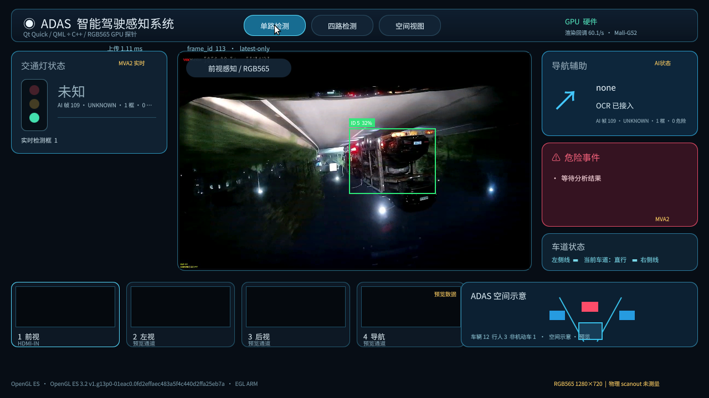

# RK3566 Qt Quick GPU Probe

独立 Qt 5.12.8 / Qt Quick 验证程序，不替换或链接到 `deployment/lubancat/mali_video` 正式 EGL 显示程序。视频自定义渲染使用 `QQuickFramebufferObject` 和单个复用的 RGB565 GLES 纹理；CPU 生产线程只保留最新帧，AI 通过现有 UDP sidecar 异步收发。

## 板端环境

- LubanCat RK3566，Ubuntu 20.04.6 LTS arm64，Linux `4.19.232`。
- Qt `5.12.8`，qmake，Qt Quick/QML 头文件和运行模块已安装，安装前缀 `/usr`。
- X11 会话运行方式：`QT_QPA_PLATFORM=xcb QT_XCB_GL_INTEGRATION=xcb_egl`。实际加载 `libqxcb.so`、`libqxcb-egl-integration.so`、`libEGL.so.1` 和 `/lib/aarch64-linux-gnu/libmali.so.1`。
- Qt 的 `eglfs`、`linuxfb` 插件也存在；本轮 xcb 已能工作，没有切换平台，也没有改动驱动。
- GL 运行时证据：vendor `ARM`，renderer `Mali-G52`，OpenGL ES `3.2`，EGL vendor `ARM`。程序拒绝 `llvmpipe`、`softpipe` 和非 Mali renderer。
- 3.8 GiB RAM；测试前约 1.8-1.9 GiB 可用，无 swap。根分区 29 GiB，测试前约 17 GiB 可用。

## 构建与运行

本轮板端工程目录为 `/home/cat/qt_gpu_probe_ai_20261019`。在已运行 X11 桌面会话、1280x720 HDMI 屏的板端执行：

```sh
cd /home/cat/qt_gpu_probe_ai_20261019
qmake qt_gpu_probe.pro
make -j2
DISPLAY=:0 XAUTHORITY=/home/cat/.Xauthority QT_QPA_PLATFORM=xcb QT_XCB_GL_INTEGRATION=xcb_egl QSG_INFO=1 \
  ./qt_gpu_probe --fps 30 --duration 30 --output-json results/qt_gpu_probe_smoke.json
```

使用全量真实道路 RGB565 回放。帧生成器源文件是 `../mali_video/prepare_replay.py`；将其部署为 `$RUN/prepare_replay_ch2.py` 后生成 2700 帧清单：

```sh
RUN=/home/cat/qt_gpu_probe_ai_20261019
python3 "$RUN/prepare_replay_ch2.py" \
  /home/cat/adas-edge-rect/videos/ch2_right.mp4 \
  "$RUN/replay_ch2_all" "$RUN/replay_ch2_all.manifest"
```

播放命令：

```sh
DISPLAY=:0 XAUTHORITY=/home/cat/.Xauthority QT_QPA_PLATFORM=xcb QT_XCB_GL_INTEGRATION=xcb_egl QSG_INFO=1 \
  ./qt_gpu_probe --fps 30 --duration 30 \
  --replay-manifest /home/cat/qt_gpu_probe_ai_20261019/replay_ch2_all.manifest \
  --output-json results/qt_replay_30.json
```

AI 联合测试需用同一工程版本的 `ai_bridge.py`，避免覆盖正在运行的正式 EGL 程序。sidecar 和 Qt 程序在同一板端分别运行：

```sh
RUN=/home/cat/qt_gpu_probe_ai_20261019
ADAS_EDGE_ROOT=/home/cat/competition_cockpit_port_20261018 /usr/bin/python3 \
  /home/cat/competition_cockpit_port_20261018/deployment/lubancat/mali_video/ai_bridge.py \
  --live-frame-file /dev/shm/qt_gpu_probe_ai.mfr1 --source LOCAL_REPLAY \
  --layout front --display-view front \
  --main-model /home/cat/adas-edge-rect/rect_models/yolo11n_rk3566_int8_split_512x288.rknn \
  --specialist-model /home/cat/adas-edge-rect/tl_check/tl_specialist_512x192_hybrid2.rknn \
  --main-hz 10 --specialist-hz 3 --ocr-hz 3 --idle-timeout 60 \
  --summary "$RUN/results/ai_summary.json" >"$RUN/results/ai.log" 2>&1 &
```

等 sidecar 日志出现 `READY` 后运行：

```sh
DISPLAY=:0 XAUTHORITY=/home/cat/.Xauthority QT_QPA_PLATFORM=xcb QT_XCB_GL_INTEGRATION=xcb_egl QSG_INFO=1 \
  ./qt_gpu_probe --fps 30 --duration 30 \
  --replay-manifest /home/cat/qt_gpu_probe_ai_20261019/replay_ch2_all.manifest \
  --ai-frame-file /dev/shm/qt_gpu_probe_ai.mfr1 --ai-hz 10 \
  --output-json results/qt_ai_30.json
```

改 `--fps 60` 可测试 60 FPS 请求档位。测试素材 `/home/cat/adas-edge-rect/videos/ch2_right.mp4` 为 1280x720、25 FPS、108 秒、2700 个不同源帧；完整 RGB565 帧文件约占 4.64 GiB，写入根分区而非 `/tmp`。程序通过 `MFR1` 原子发布完整帧快照、`MVR2` 发送请求并检查 `MVA2` frame_id、时间戳和包结构；AI 返回只更新最新 QML 状态，不阻塞纹理上传。

## 测试结果（2026-10-19）

真实板端日志与 JSON 报告记录 Qt Quick OpenGL scene graph、GL vendor `ARM`、renderer `Mali-G52`、OpenGL ES `3.2`、EGL vendor `ARM`，以及已加载的 `libmali.so.1`、EGL、xcb 和 Qt Quick 库。程序拒绝 `llvmpipe`、`softpipe` 和非 Mali renderer。RGB565 以 `GL_UNSIGNED_SHORT_5_6_5` 上传到复用纹理；回放读取直接进入该帧的 `std::vector`，避免 `QByteArray` 临时整帧副本，但每帧仍会分配新的 vector，测试结果包含这项成本。物理 HDMI scanout FPS 未测量，报告保持 `null`。

| 负载 | 请求 FPS | 实际输入平均 / 末窗 | 不同 manifest 索引被 GL 接受 | QSG 回调末窗 | 上传 API p95 |
|---|---:|---:|---:|---:|---:|
| Qt Quick + 道路回放，无 AI | 30 | 25.86 / 24 FPS | 25.50/s | 60/s | 1.95 ms |
| Qt Quick + 道路回放 + YOLO11n/交通灯专模/OCR | 30 | 23.11 / 30.06 FPS | 22.11/s | 58.12/s | 2.41 ms |
| Qt Quick + 道路回放 + YOLO11n/交通灯专模/OCR | 60 | 33.07 / 20.08 FPS | 27.94/s | 58.23/s | 2.27 ms |

30 FPS AI 测试为 30.12 秒，696 个 producer 帧中 666 个不同 manifest 索引被 GL 上传调用接受；60 FPS AI 测试为 30.17 秒，998 个 producer 帧中 843 个不同 manifest 索引被接受。两次 `replay_content_wrapped=false`，全程没有重复 manifest 索引。这里的“接受”只表示 `glTex*` 后 `glGetError()==GL_NO_ERROR`，不表示 GPU 已完成传输。`source_frames_not_uploaded` 是 producer 与接受数的残差上界，包含 latest-only 覆盖、停止时待处理帧及其他未接受原因，不能直接解释为单一丢帧原因。原始素材为 25 FPS；实际回放低于请求值，因此目标 PCIe/DDR 直达输入没有在本轮测量。

两次 AI 测试都收到约 10.04 Hz 请求，分别分析约 9.94/10.00 个不同请求 frame_id/s；帧快照身份错配为 0，推理错误为 0。30 FPS 档 YOLO11n/交通灯专模/OCR 更新约 6.86/2.61/2.61 Hz，AI 全流程 p95 约 142 ms；60 FPS 档约 6.24/2.57/2.57 Hz，p95 约 143 ms。两档 NPU 中位利用率均为 100%，GPU 平均约 27%，sidecar 峰值 RSS 约 126-129 MiB；Qt 进程 RSS 约 111-119 MiB。没有 OOM。上传计时是 CPU 侧 GL API 调用时间，不代表 GPU 完成时间。

Qt-only 同素材基线为 25.50 个不同 manifest 索引被 GL 接受/s，AI 联合 30 FPS 档为 22.11/s。QSG 回调维持约 58-60/s、纹理上传 API p95 约 2.0-2.4ms、GPU 利用率约 27%；结合 eMMC 逐帧读入和 NPU 满载，结果提示输入生产与 AI/CPU 资源竞争需继续隔离测试。本轮没有单独测量 eMMC 带宽或 PCIe 实时输入。

此前原生 C++ EGL/Mali 路线的 5 分钟报告使用合成 RGB565 内存输入、60 FPS 请求，完整 AI 下 `unique_source_submit_fps=58.216`，renderer 同为 Mali-G52；物理 scanout 同样未测量。它与本轮 eMMC 逐文件回放不是同一输入条件，不能把性能差值直接归因于 Qt。原报告：`deployment/lubancat/mali_video/results/p0_full_ai_60fps_5m_verified_display_20261019.json`。

实际 RK3566 HDMI/X11 运行截图（单路模式，检测框来自 AI sidecar）：

QML 样板包含顶栏模式切换、中央道路视频、交通灯、导航、危险事件、底部缩略图和空间示意；单路/四路/空间视图已在板端验证可切换。指定 `docs/ui/adas_cockpit_reference.png` 和 `docs/ui/` 在当前仓库中不存在；根目录 `ref.png`/`new.png` 属于另一套 PC 模拟器画面，不是指定参考图。因此截图证明组件和硬件运行，不证明严格复刻该概念图。

## 结论

**PARTIAL PASS**：Qt Quick 确实使用 Mali-G52 硬件加速，RGB565 连续更新、完整 UI 和 YOLO11n/交通灯专模/OCR sidecar 可同时运行，没有 OOM；但两档道路回放的不同源图像上传率均未达到 30/s，因此没有证明无卡顿的 30 FPS 联合显示。eMMC 逐文件读取可能限制输入生产，PCIe/DDR 直达路径尚未测量。指定参考图缺失也阻止严格视觉验收。现阶段保留正式 EGL 路线，不替换车机入口。

## 报告文件

- `results/qt_ai_stream_30_20261019.json` 与 `results/qt_ai_sidecar_stream_30_20261019.json`：30 FPS 请求档、30 秒道路 RGB565 + 完整 AI。
- `results/qt_ai_stream_60_20261019.json` 与 `results/qt_ai_sidecar_stream_60_20261019.json`：60 FPS 请求档、30 秒道路 RGB565 + 完整 AI。
- `results/qt_no_ai_real_ch2_30_20261019.json`：同一长素材的 Qt-only 30 FPS 请求基线。
- `results/qt_ai_stream_30_20261019.png`：真实板端 QML/AI 截图。
- `check_report.py REPORT.json [AI_SIDECAR_SUMMARY.json]`：核对 Mali renderer、实际加载库、RGB565 上传账目与 AI 帧身份/推理结果。
