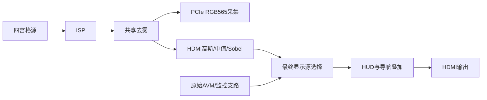

# PG2L100H 与 RK3566 PCIe 协议开发交接

文档版本 **1.0.1**，日期 **2026-10-24**。重点为 RK→FPGA 控制，同时涵盖传统双向 DMA、FPGA→RK 视频 DMA 和状态回读。配套文件：`rk3566_pcie_protocol_v1.json`。

## 1. 对应工程与协议边界

- 工程根目录：`D:/QiansaiFPGA/source_code_3/PCIE_timig_fix`。
- 本文核对源码：`build/hsst_timing_structural_20261024/PG2L100H_AVM.pds`，器件 **PG2L100H-6FBG676**。
- 对照已有完整交接稿对应源码：`build/hsst_zero_slack_20261024`。36个来源文件中33个直接字节比较相同；图像控制寄存器、ISP配置CDC、视频寄存器3个文件结构不同，核对其读写分支、字段与握手后未发现外部协议定义变化。本次仅独立更新交接文档，不改变 RTL、驱动或 EDA 状态。
- 本文描述**现有 RTL 的行为**。寄存器 magic/version 不是固件唯一标识，不能单凭它们确认板上位流版本；RK 开发与板卡负责人应同时核对实际加载工程。
- **FPGA 不解析 JSON 文本。** JSON 是开发契约，RK 软件将业务数据编码为 BAR1 MMIO。PCIe 链路本身使用标准 MRd/MWr/CplD，不添加应用包头、哈希或新的校验门禁。

### 先核对这些容易混淆的规则

| 项目 | 当前实现 |
| --- | --- |
| RK 场景识别 | 写 `0x638/63c/640` shadow 后，向 `0x644` **低16位**写非零序号提交 |
| 基本 HUD 灯光 | 单次写 `0x608`，序号在**高16位**，不允许0 |
| 导航 | `0x670` shadow + `0x674` 提交，高16位序号允许0；与场景分别握手 |
| ISP / 去雾 | 各有 shadow/COMMIT/STATUS，序号在高16位，允许0；APPLY/QUERY不是导航操作 |
| 车道来源 | **新鲜 HSST 整包 > 新鲜 RK 场景 > 未知**，新鲜但未知的 HSST 也覆盖 RK |
| 动作命令 | 本版油门/刹车/左右变道来自**以太网动作链路**，PCIe没有对应的动作写CSR |
| 算法控制优先级 | Ethernet > PCIe；已经送入像素CDC的事务先完成，不能中途覆盖 |
| “已写入/已接收” | 不等于配置已在画面生效，应按各通道的完成条件回读 |
| 画面范围 | ISP/去雾作用于算法四宫格和PCIe采集；当前原始AVM/监控显示支路会绕过它们 |

### 地址速查

所有偏移相对 **BAR1**，单位为字节；具体访问属性、编码和握手见后文。

| 偏移范围 | 用途 | RK侧重点 |
| --- | --- | --- |
| `0x100..0x140` | 传统 RK→FPGA DMA | FPGA MRd读取RK DMA缓冲；16bit staging RAM，不是视频DDR |
| `0x200..0x240` | 传统 FPGA→RK DMA | FPGA MWr写RK DMA缓冲；完成寄存器读清 |
| `0x400..0x428` | 视频DMA全局控制/统计 | START/STOP、generation、背压/丢帧计数 |
| `0x500..0x57c` | 视频DMA四槽描述符 | 64bit DMA地址、容量、所有权及帧状态 |
| `0x600..0x634` | HUD灯光与能力 | REQUEST高16位序号，分别确认accepted/applied |
| `0x638..0x64c` | RK识别结果与时间 | shadow后COMMIT低16位非零序号 |
| `0x650..0x664` | 行为结果 | `0x650/654`为保留地址，不能写动作命令 |
| `0x670..0x67c` | 右侧导航 | 直行/左转/右转、距离米数，等待真实overlay回执 |
| `0x680..0x68c` | HSST车道状态只读 | 左右数量、最近边界线类型、fresh/stale |
| `0x700..0x75c` | ISP身份/配置/事务 | 四tile完整配置，master与各算法开关分别控制 |
| `0x760..0x78c` | ALGO事务及配置快照 | 去雾/高斯/中值/Sobel；ISP快照索引位于`0x780/784` |

参考驱动的新MMIO ioctl只开放其中一部分地址，必须先阅读第3节；不能仅按地址速查表直接调用所有窗口。

## 2. PCIe、BAR 与基本访问规则

RK3566 为 Root Complex，FPGA 为 Endpoint。IP 配置 `VID:DID=0755:0755`，最高 **Gen2、x4**；实际连接速率及 lane 数以 RK 的 `lspci -vv` 为准，不能把 FPGA 的 x4 配置当成 RK 实际连接也是 x4。

| BAR | IP配置 | 用途 |
| --- | --- | --- |
| BAR0 | 8KiB、32bit、non-prefetchable Memory | 独立 PIO RAM，正常枚举窗口 `0x0000..0x1fff` |
| BAR1 | 4KiB、32bit、non-prefetchable Memory | 传统DMA与扩展业务CSR；本文全部寄存器偏移均相对BAR1 |

实际 BAR CPU 地址由 PCI 枚举分配。`BAR1+0x638` 不是 PCI 配置空间地址，也不是固定 RK 物理地址。

**控制写必须是一条4字节对齐的完整 DWORD 写**：TLP length=1 DWORD、FirstBE=`0xf`、LastBE=`0x0`。使用 `iowrite32/writel`；控制读使用 `ioread32/readl`。不要使用 64/128bit store、`memcpy` 或 WC 合并批量写 CSR。多 DWORD、部分字节写会被拒绝，不能用这种方法一次写完 ISP shadow。

RK 使用小端 DWORD。本文 `0x00780003` 指寄存器数值，内存字节为 `03 00 78 00`，不要额外 `htonl()`。RTL 内部 128bit/16字节窗口是完成包数据选择结构，不要求 RK 用128bit读写。

MWr 是 posted write：写返回成功只表明软件访问成功。保持 MMIO 顺序，适当安全回读排空 posted write，然后检查业务状态。**不要随意读取传统 `0x130/230` 来做 flush，它们读清完成标志。** 本版 `ven_msi_req=0`，业务完成采用轮询，无新增应用 MSI 通知。

## 3. RK 参考驱动与当前缺口

源码位于候选工程 `host/rk3566_image_control/`，设备名 `/dev/pango_pci_driver`。

```c
struct pango_image_mmio {
    __u32 offset;   /* BAR1 byte offset */
    __u32 value;    /* write input; read-back output */
};
#define PCI_IMAGE_MMIO_READ_CMD  _IOWR('S', 11, struct pango_image_mmio)
#define PCI_IMAGE_MMIO_WRITE_CMD _IOWR('S', 12, struct pango_image_mmio)
/* 固定8字节结构：Linux通用编码分别为0xc008530b、0xc008530c。 */
```

现有新 MMIO ioctl 白名单：

| 操作 | 已开放的 BAR1 偏移 |
| --- | --- |
| 读 | `0x700..0x7fc` DWORD对齐、`0x670..0x67c`、`0x630` |
| 写 | `0x700..0x7fc` DWORD对齐、`0x670..0x67c` |

**基本HUD、场景、行为、HSST状态、视频DMA控制均未完整开放给这个新ioctl。** RK整合完整功能时，应沿用已验证的相应旧接口，或补充严格按已实现地址开放的 BAR1 API。本文没有修改驱动。不要把“RTL已有寄存器”理解为“现有ispctl能访问所有寄存器”。

旧 ioctl nr0/1 调用 `pci_read_config_dword/pci_write_config_dword`，访问的是 **PCI配置空间**，不能拿它们去读写本文的HUD/场景BAR1地址。nr12会把 `value` 改为同地址的读取结果，WO/COMMIT读回0是正常行为，不能要求“回读等于写值”才算发送成功。

`image_mmio_lock`只保护单次 ioctl。一个完整的 QUERY→读快照→修改→写shadow→COMMIT→轮询应由单个控制worker执行，并通过同设备 `flock` 或进程间锁协调其他进程；驱动的单次锁不能保护一整笔复合事务。此锁不能阻止以太网客户端更新，仍要考虑Ethernet优先级。

旧参考 ioctl nr0..10 的准确C结构、用途及64位ABI边界见配套JSON `driver`；不要只看 `_IOWR(...,int)` 就按4字节传递旧DMA结构。**参考驱动的传统DMA缓冲上限4KiB，不是视频DMA所需的四个大帧缓冲。**

## 4. RK→FPGA：基本HUD灯光

| BAR1偏移 | 名称 | 访问 | 定义 |
| --- | --- | --- | --- |
| `0x600` | MAGIC | RO | 0x31445548（内存ASCII HUD1） |
| `0x604` | VERSION | RO | 0x00010000 |
| `0x608` | REQUEST | WO_READ_ZERO | 基本HUD灯光完整请求，sequence放高16位，见hud_basic.request_fields |
| `0x60c` | STATUS | RO | 基本HUD握手及有效显示状态，见hud_basic.status_fields |
| `0x610` | ACCEPTED_SEQ | RO | 低16位最后接受序号 |
| `0x614` | APPLIED_SEQ | RO | 低16位真实overlay锁存序号 |
| `0x618` | RK_STATE | RO | 最后应用的RK基本请求低13位，含takeover和blink |
| `0x61c` | EFFECTIVE_STATE | RO | 真实overlay锁存9bit显示状态，反映用户/去雾覆盖 |
| `0x620` | REJECT_COUNT | RO | 累计拒绝次数，32bit回绕；成功写不清零 |
| `0x624` | LAST_ERROR | RO | 最后拒绝错误；成功写不清除，没有此通道CLEAR命令 |
| `0x628` | REJECTED_SEQ | RO | 关联被拒完整REQUEST的序号；格式/未知地址错误可为0 |
| `0x62c` | SNAPSHOT_ID | RO | 基本HUD可读状态变化计数；不是覆盖全部导航/HSST的全局版本号 |
| `0x630` | CAPS | RO | 0x000001ff；已命名bit8=导航，其余位保持原值，不另造含义 |
| `0x634` | LAST_ACCEPTED_REQUEST | RO | 完整最后接受的REQUEST |
| `0x638` | SCENE_SHADOW | RW | 扩展场景shadow；只写它不会生效 |
| `0x63c` | TIME0_SHADOW | RW | BCD日期0xMMDDYYYY，无RTC自动计时 |
| `0x640` | TIME1_SHADOW | RW | BCD时间0x00SSMMHH，无RTC自动计时 |
| `0x644` | SCENE_COMMIT | RW_DIFFERENT | 低16位非零序号，原子冻结SCENE/TIME0/TIME1；读回低16位最后接收序号 |
| `0x648` | SCENE_CDC_STATUS | RO | bit0 latest-pending；bit1 mailbox-ready；不是整个场景事务BUSY |
| `0x64c` | SCENE_APPLIED_SEQ | RO | 低16位真实overlay锁存场景序号；中间更新可合并，不保证每条显示 |

上表 `0x638..0x64c` 是扩展场景接口，下一节单独说明。`0x608` 基本 REQUEST 位定义：

| 位 | 字段 | 含义 |
| --- | --- | --- |
| 0 | hud_enable | HUD总显示使能 |
| 1 | left | 左转 |
| 2 | right | 右转 |
| 3 | hazard | 双闪 |
| 4 | low_beam | 近光 |
| 5 | high_beam | 远光 |
| 6 | front_fog | 前雾灯 |
| 7 | position | 示廓灯 |
| 8 | adas | ADAS显示 |
| 9 | left_blink | 左转闪烁，要求left=1 |
| 10 | right_blink | 右转闪烁，要求right=1 |
| 11 | hazard_blink | 双闪闪烁，要求hazard=1 |
| 12 | takeover | 1使用RK字段；0退回默认且低12位必须0 |
| 15:13 | reserved | 写0 |
| 31:16 | sequence | 1..65535；与最近接受序号不同才是新请求 |

默认有效状态为 `0x101`，HUD与ADAS显示开启。`takeover=0` 时必须把低12位写0，表示退回默认；`takeover=1` 时按字段指定目标。

`0x60c STATUS`：bit0 busy，bit1 最后应用RK的takeover，bit2 去雾覆盖标志，bit3 accepted_valid，bit4 applied_valid，bit5 拒绝序号有效，bit6 effective有效，bit7 ready，其余0。bit2仅表示去雾接管，不能把它当作“所有高优先级覆盖”的综合标志。

发送流程：

1. 等 `STATUS.ready=1 && busy=0`；记录当前 `REJECT_COUNT`。
2. 选择与最近accepted不同的序号1..65535，回绕跳过0。
3. 组合完整请求，一次DWORD写 `0x608`。
4. `0x610/0x634`核对接收；等待 `busy=0 && applied_valid && 0x614==seq` 确认真正overlay锁存。
5. 读 `0x61c` 得到当前实际显示灯光，其bit0..8与REQUEST低9位一致；它可能被用户动作或去雾策略覆盖。

**同序号同完整请求幂等**，不重新接受；同序号不同数据拒绝。`LAST_ERROR`、拒绝计数**不会被成功写清除**，且本通道没有CLEAR操作；核对本次是否拒绝应比较计数增量、accepted和applied，不能仅因LAST_ERROR历史非零就报本次失败。`SNAPSHOT_ID`不是覆盖导航、HSST和全部场景的全局版本号。

| 错误码 | 含义 |
| --- | --- |
| 1 | busy |
| 2 | 非完整/非对齐DWORD |
| 3 | 保留位非零 |
| 4 | takeover或blink字段相互矛盾 |
| 5 | sequence=0 |
| 6 | 与最近接受序号相同，但请求不同 |
| 7 | 写只读/未支持地址 |
| 8 | 控制域未ready |

灯光优先级：**以太网用户方向动作窗口 > 去雾灯光策略 > RK请求/默认**。用户方向窗口即使判定“禁止变道”也显示对应转向意图，允许/禁止由下方行为图标分别表达。高优先级会强制HUD可见；去雾还接管雾灯和示廓灯，近远光和ADAS仍来自RK或默认。

RK双闪优先于RK左右独立指示；闪烁为20帧亮、20帧灭，60Hz时周期约0.667秒，不是独立毫秒计时。断链后基本RK灯光会话回默认，独立HSST车道继续工作。

## 5. RK→FPGA：场景识别、车道及日期时间

`SCENE_SHADOW=0x638`：

| 位 | 字段 | 含义 |
| --- | --- | --- |
| 0 | valid | 1刷新场景；0立即清除所有正检测保持 |
| 2:1 | traffic | 0未知/本次无检测，1红，2绿，3不支持 |
| 3 | person | 人正检测 |
| 4 | obstacle | 障碍正检测 |
| 5 | speed_limit | 限速提示正检测 |
| 7:6 | left_lane | 最近左边界：0未知/本次无检测，1实线，2虚线，3不支持 |
| 9:8 | right_lane | 最近右边界：0未知/本次无检测，1实线，2虚线，3不支持 |
| 10 | warning | 场景告警提示；不是动作reason=8的刹车警告 |
| 11 | show_time | 日期时间显示 |
| 31:12 | reserved | 当前未消费，推荐0；RTL不拒绝这些位 |

这里的左右车道表示车辆前进方向下**最近的左右边界线型**。RK没有在这个场景寄存器中发送车道线数量。

日期时间是BCD：

| 寄存器 | 格式 | 例子 |
| --- | --- | --- |
| `0x63c TIME0` | `0xMMDDYYYY` | 2026-10-24 → `0x10242026` |
| `0x640 TIME1` | `0x00SSMMHH` | 14:30:05 → `0x00053014` |

RTL不校验BCD/日期范围，也没有RTC自动推进；RK负责更新时间。时间显隐由SCENE bit11控制。场景 bit0 是识别保鲜/清除语义，**不是整个动态HUD的开关**；本版离线仍保持动态HUD布局。

### 5.1 原子提交与确认

依次完整DWORD写 `SCENE_SHADOW`、`TIME0`、`TIME1`，最后向 `0x644` **低16位**写非零seq，高16位写0。COMMIT冻结这三项，单写shadow不生效。低16位seq=0不提交，并置场景error=1。

序号不去重：同seq、同值再次COMMIT仍是刷新事件。为便于开发核对，建议每次换序号，65535后从1开始。

三层观察点：`0x644`低16位为最近接收seq；`0x658`高16位为perception已消费seq；`0x64c`低16位为真实overlay已锁存seq。`0x648 bit0/1`只表示latest-pending/mailbox-ready，**不是完整BUSY/DONE握手**。

场景采用latest-pending：显示背压时中间更新可以合并，但各次接收事件仍刷新识别保持。要逐条核对画面，串行发送并等待 `0x64c==seq`；连续高速发送时不要无限等待一个已被更新替代的中间seq。`0x64c`没有返回整份场景，且HSST可能覆盖车道，不能据此认定RK车道拥有最终显示。

### 5.2 正检测保持

名义为0.5秒，当前RTL过期阈值为 **501 ms**，以27MHz参考时钟生成的毫秒时间戳计数，并有CDC/流水及下一显示帧延迟。各类正检测独立保持：

- 人、障碍、限速、场景warning为1时重计时；后续包的该位0不会立即清掉原正检测。
- 红/绿有效值新到时立即替换旧颜色并重计时；不会红绿同时延长。
- RK左右有效实/虚线分别替换并重计时；0/未知不会立刻清除旧保持。
- `valid=1`的每次完整COMMIT刷新整包新鲜度；但各正检测仍各自过期。
- **`valid=0`的COMMIT清除所有RK正检测保持。** HSST拥有的独立车道不受此清除影响。

建议识别10..30Hz更新，需要保留的正检测在501ms内刷新；这是实用建议，不是硬件强制发送频率。类型3、保留位虽然不是全面硬件拒绝，也应按表使用合法值。

## 6. FPGA→RK：场景状态与行为结果

| BAR1偏移 | 名称 | 访问 | 定义 |
| --- | --- | --- | --- |
| `0x650` | RESERVED_650 | RO_ZERO_WRITE_IGNORED | 未实现动作控制，不能用来发油门/刹车 |
| `0x654` | RESERVED_654 | RO_ZERO_WRITE_IGNORED | 未实现动作控制，不能用来发左右变道 |
| `0x658` | SCENE_STATUS | RO | RK场景就绪/过期/错误和HSST车道owner，见scene.status_fields |
| `0x65c` | BEHAVIOR_RESULT | RO | PCIe决策域结果；是当前持续判定，不是最终HUD像素回执 |
| `0x660` | BEHAVIOR_EFFECTIVE | RO | 本版本PCIe域与RESULT同值；像素侧按最新HSST来源重算左右判定 |
| `0x664` | CAPS | RO | 0x0002003f；bit5=HSST车道优先接入，其他低位不另造定义 |

`0x658 SCENE_STATUS`：bit0=0；bit1/2均为scene_ready；bit3为**RK场景**stale；bit4场景error；bit5 PCIe link down（掉链通常无法MMIO）；bit6 HSST拥有车道；bit7=0；bits15:8错误码；bits31:16最近已消费RK场景seq。bit3和bit6可同时为1。

当前没有通过 `0x650/654` 发动作的功能。油门、刹车、左右变道由以太网动作mailbox触发；PCIe提供感知依据并读回结果。不要把给RK的JSON业务动作名称当作已实现PCIe写地址。

动作窗口名义1秒，RTL阈值 **1001 ms**。最新动作替换前一动作，同动作重发重计时；窗口内按照实时保持场景和车道持续判断，判定变化不重启动作计时；窗口结束恢复默认四格。

`0x65c/660` 位定义：

| 位 | 字段 | 含义 |
| --- | --- | --- |
| 0 | throttle_allow | 油门动作窗口内的允许标志；fresh RK场景为绿灯时置1 |
| 1 | brake_allow | 刹车动作窗口内置1；reason=8时表示黄色警告，仍允许刹车 |
| 2 | left_allow | 左变道动作窗口内，选定来源的左边界为虚线时置1 |
| 3 | right_allow | 右变道动作窗口内，选定来源的右边界为虚线时置1 |
| 4 | throttle_forbid | 油门动作窗口内缺少绿灯允许依据时置1 |
| 5 | brake_forbid | 本版恒0；刹车警告通过reason=8表达 |
| 6 | left_forbid | 左变道动作窗口内，左边界为实线、未知或无新鲜来源时置1 |
| 7 | right_forbid | 右变道动作窗口内，右边界为实线、未知或无新鲜来源时置1 |
| 13:8 | reason | 0正常；1红灯；2左实线；3右实线；6缺少允许依据；8刹车警告 |
| 14 | action_active | 动作窗口有效；为0时不得仅凭高位序号判断仍在动作 |
| 15 | stale | 油门缺新鲜场景/左右缺新鲜车道来源；新鲜但未知可为0 |
| 23:16 | action_sequence_low8 | 以太网动作序号低8位，结束后可保留 |
| 31:24 | scene_sequence_low8 | RK场景序号低8位，结束后可保留 |

| 动作 | 条件 | 当前RTL判定 |
| --- | --- | --- |
| 油门 | RK场景新鲜且绿灯 | 允许；当前油门分支没有把人/障碍/限速各自加入否决条件 |
| 油门 | 红灯 | 禁止，reason=1 |
| 油门 | 未知/过期 | 禁止，reason=6 |
| 刹车 | 场景新鲜、绿灯，且人/障碍/限速三个保持位全0 | brake_allow=1、reason=8，HUD黄色警告 |
| 刹车 | 其他 | brake_allow=1、reason=0 |
| 左/右变道 | 最终选定最近边界为虚线 | 允许 |
| 左/右变道 | 实线 | 禁止，左reason=2、右reason=3 |
| 左/右变道 | 未知或无新鲜来源 | 禁止，reason=6 |

这里反映代码，不替代外部车辆控制策略。场景bit10告警与行为reason=8黄色警告是两种不同来源。动作结束后高16位序号可仍非零，**一定用bit14判断窗口有效**。

本版PCIe域 `RESULT/EFFECTIVE`同值；像素域独立接收HSST并同帧重算左右动作，保证所画线型与其判定一致。CSR采样与画面可能相差CDC和帧延迟，不能要求同一主机瞬间读到的CSR等于下一帧像素。

## 7. HSST车道优先级与PCIe回读

| BAR1偏移 | 名称 | 访问 | 定义 |
| --- | --- | --- | --- |
| `0x680` | SEQUENCE | RO | HSST发布序号，32位 |
| `0x684` | PAYLOAD | RO | 规范化payload；整包无效时为0 |
| `0x688` | STATUS | RO | bit0 valid；bit1 stale |
| `0x68c` | PROTOCOL_ID | RO | 0x4c4d0001；首个系统状态mailbox到达前可为0 |

`0x684 PAYLOAD`：bits7:0左数量，15:8右数量，17:16左最近类型，19:18右最近类型，20/21左右数量有效，22/23左右类型有效，31:24保留0。类型0未知、1实线、2虚线；数量指边界线数量而非车道数。数量有效且为0时该侧类型规范化为未知。

示例：seq42，左2条最近实线、右1条最近虚线，四个有效位全1，payload=`0x00f90102`。

**新鲜HSST整包同时拥有双侧线型。** 新鲜但某侧未知、无效、有效零条时，也不能回填RK旧虚线；只有HSST整包超时或掉链，才回退仍新鲜RK，否则显示未知。HSST默认500ms接收新鲜度，不叠加RK的501ms正检测保持；同值、同序号完整包也刷新。

HSST系统→像素邮箱独立于PCIe，因此PCIe掉链/停钟时HSST车道仍更新及过期。RK原有动作、导航会话仍按PCIe链路复位。只停PCIe时钟而link/reset不撤销的异常状态下，原RK动作计时可能暂停，不能等同正常掉链。

四个寄存器来自稳定mailbox，但分别MMIO读取**不是严格原子快照**。前后读seq/status可发现部分更新，然而协议允许同seq更新，无法据此证明绝对一致；需要严格采样时，应由应用制定取样策略或后续新增硬件原子快照功能。不要把 `0x62c` 当成HSST快照锁。

光口原始包结构另见工程 `protocol/HSST车道与HUD交接.md`；RK只需据此确认HSST与其场景字段的优先级。

## 8. RK→FPGA：右侧导航

| BAR1偏移 | 名称 | 访问 | 定义 |
| --- | --- | --- | --- |
| `0x670` | NAV_SHADOW | RW | 见navigation.registers中的逐位定义 |
| `0x674` | NAV_CONTROL | RW with different read/write semantics | 见navigation.registers中的逐位定义 |
| `0x678` | NAV_STATUS | RO | 见navigation.registers中的逐位定义 |
| `0x67c` | NAV_ACTIVE | RO | same as NAV_SHADOW; returned from actual overlay frame latch; meaningful with applied_valid |

`NAV_SHADOW`：bit0 enable，bits2:1方向（0直行、1左、2右、3非法），bits15:3保留0，bits31:16为**二进制无符号距离米数0..65535**。不是BCD；0米有效。HUD内部转换5位十进制并去掉前导零。

`NAV_CONTROL`写：高16位seq，低16位操作码1 APPLY、2 CLEAR_ERRORS；读：高16位accepted_seq、低16位applied_seq。seq允许0。与最近accepted的seq及payload都相同为幂等；同seq换payload拒绝。

`NAV_STATUS`：bit0 busy，bit1 applied_valid，bit2 active_enable，bit3 ready，bit4 accepted_valid，bit5 sticky_error，bits7:6=0，15:8 last_error，31:16 reject_count。busy覆盖16拍BCD转换、CDC和真实overlay帧锁存。

流程：确认HUD_CAPS bit8 → 等busy0/ready1 → CLEAR_ERRORS → 写完整SHADOW → 写CONTROL `(seq<<16)|1` → 等busy0、applied_valid、accepted/applied均为本seq、ACTIVE等于本请求且无错误。**旧applied_valid=1不代表本条已完成。** CLEAR只清错误/拒绝数，不取消在途命令。

导航错误：1忙，2部分/未对齐访问，3未知opcode，4保留位/方向非法，6同序号异payload，7写只读/未知导航地址，8控制域未ready。

导航没有0.5秒/1秒TTL，保持到下一次显式更新/关闭或会话复位；断链后下一可用帧隐藏，重连不自动恢复旧导航。它不触发转向灯、不触发用户动作，也不改变车道优先级。HUD总隐藏时导航也不可见，但配置仍可能已锁存。PCIe视频采集不包含HUD/导航。

## 9. RK→FPGA：ISP与去雾/后级算法

| BAR1偏移 | 名称 | 访问 | 定义 |
| --- | --- | --- | --- |
| `0x700` | MAGIC | RO | 图像控制接口magic |
| `0x704` | VERSION | RO | 图像控制CSR版本 |
| `0x708` | CAPABILITIES | RO | 当前返回0x0000000f；现有代码没有定义各bit独立含义 |
| `0x70c` | ISP_GLOBAL_SHADOW | RW | 低8位保存global；bit0总开关，bit[4:1]分区使能 |
| `0x710` | ISP_TILE0_SHADOW_DW0 | RW | tile0配置位[31:0] |
| `0x714` | ISP_TILE0_SHADOW_DW1 | RW | tile0配置位[63:32] |
| `0x718` | ISP_TILE0_SHADOW_DW2 | RW | tile0配置位[95:64] |
| `0x71c` | ISP_TILE0_SHADOW_DW3 | RW | tile0配置位[127:96] |
| `0x720` | ISP_TILE1_SHADOW_DW0 | RW | tile1配置位[31:0] |
| `0x724` | ISP_TILE1_SHADOW_DW1 | RW | tile1配置位[63:32] |
| `0x728` | ISP_TILE1_SHADOW_DW2 | RW | tile1配置位[95:64] |
| `0x72c` | ISP_TILE1_SHADOW_DW3 | RW | tile1配置位[127:96] |
| `0x730` | ISP_TILE2_SHADOW_DW0 | RW | tile2配置位[31:0] |
| `0x734` | ISP_TILE2_SHADOW_DW1 | RW | tile2配置位[63:32] |
| `0x738` | ISP_TILE2_SHADOW_DW2 | RW | tile2配置位[95:64] |
| `0x73c` | ISP_TILE2_SHADOW_DW3 | RW | tile2配置位[127:96] |
| `0x740` | ISP_TILE3_SHADOW_DW0 | RW | tile3配置位[31:0] |
| `0x744` | ISP_TILE3_SHADOW_DW1 | RW | tile3配置位[63:32] |
| `0x748` | ISP_TILE3_SHADOW_DW2 | RW | tile3配置位[95:64] |
| `0x74c` | ISP_TILE3_SHADOW_DW3 | RW | tile3配置位[127:96] |
| `0x750` | ISP_COMMIT | WO_READ_ZERO | sequence[31:16]，opcode[1:0]；bit[15:2]写0 |
| `0x754` | ISP_STATUS | RO | ISP事务busy/done/error/last_error/sequence |
| `0x758` | ISP_RESULT | RO | ISP上次完成快照的epoch与source |
| `0x75c` | ISP_CLEAR | W1_ACTION_READ_ZERO | bit0写1清done/error/last_error；不取消在途命令 |
| `0x760` | ALGO_SHADOW_LO | RW | ALGO配置[31:0] |
| `0x764` | ALGO_SHADOW_HI | RW | ALGO配置[63:32] |
| `0x768` | ALGO_COMMIT | WO_READ_ZERO | 格式同ISP_COMMIT |
| `0x76c` | ALGO_STATUS | RO | 格式同ISP_STATUS |
| `0x770` | ALGO_RESULT | RO | 格式同ISP_RESULT |
| `0x774` | ALGO_CLEAR | W1_ACTION_READ_ZERO | 格式同ISP_CLEAR |
| `0x780` | ISP_SNAPSHOT_INDEX | RW | 0..15=tile*4+DWORD；16=global |
| `0x784` | ISP_SNAPSHOT_DATA | RO | 所选ISP完成快照DWORD；默认index=0 |
| `0x788` | ALGO_SNAPSHOT_LO | RO | ALGO完成快照[31:0] |
| `0x78c` | ALGO_SNAPSHOT_HI | RO | ALGO完成快照[63:32] |

### 9.1 事务格式、完成与错误

ISP及ALGO各支持一个在途事务，可分别等待；不保证两者同一帧生效。

```text
COMMIT = (sequence16 << 16) | opcode
opcode 1 = APPLY；2 = QUERY；bits15:2必须0
sequence允许0和回绕，不去重；同seq重复COMMIT仍会执行

STATUS bit0 busy；bit1 done；bit2 error；bits7:3=0
       bits15:8 last_error；bits31:16 last_sequence
RESULT bits15:0 epoch；bits17:16 source；其余0
source 0默认、1 Ethernet、2 PCIe
```

| 错误码 | 本次是否产生新DONE | 含义 |
| --- | --- | --- |
| 0 | 接受事务正常完成时是 | 成功；旧sticky error仍需CLEAR |
| 1 | 否 | 非法CSR写/地址/index/访问格式 |
| 2 | 是 | owner拒绝非法配置，活动配置不变，busy清、done/error置1 |
| 3 | 否 | busy时重复提交，旧事务继续 |
| 4 | 否 | 非法opcode/COMMIT保留位 |

新COMMIT不自动清DONE/ERROR。先等通道idle，再写对应CLEAR=1；CLEAR不取消busy。合法COMMIT冻结shadow，busy期间写shadow只准备下一份，不能再次COMMIT。DONE与新COMMIT恰好同拍仍按旧busy拒绝。

推荐完整流程：

1. 持有同设备复合事务锁，等通道idle，选择新seq。
2. CLEAR后COMMIT QUERY，轮询每次先查error；成功条件为 `!busy && done && !error && sequence==expected`。
3. 读取该次完成快照与epoch/source，仅改请求字段，其余保留。
4. ISP写完整global+16个tile DWORD，或ALGO写完整低/高2DWORD；等idle、CLEAR、COMMIT APPLY。
5. 轮询到匹配完成；再QUERY核对当前结果/source。以太网后来的更新可能改变结果。

ISP快照：index0..15对应`tile=index/4，DWORD=index%4`，写`0x780`后读`0x784`；index16返回global低8位；`0x758`对应快照的epoch/source。ALGO快照直接读`0x788/78c`及`0x770`。这是**上次完成事务缓存**，不是随Ethernet自动刷新的实时活动镜像。

epoch仅在完整配置值实际变化时加1，16位回绕；同值APPLY仍DONE，来源更新为提交者，epoch可不变。QUERY既不变epoch，也不把来源改成PCIe。

建议轮询1ms、主机超时3000ms（可配置）。超时代表“结果未确认”，不能认为FPGA取消，不应自动重放。无帧边界、停钟或持续Ethernet争用都可能延迟完成。PCIe掉链清CSR/mailbox会话而不复位算法配置；已送入像素CDC的旧事务可排空生效。重连先QUERY，不依据旧seq猜测是否应用。

**参考ispctl已知缺口：** `transaction()`在匹配DONE后才检查error，会把错误1/3/4这类不产生新DONE的拒绝显示成超时。RK新客户端应每轮先查ERROR并保留完整status诊断；这次文档没有改该程序。

### 9.2 ISP配置520bit

```text
{ global[7:0], tile3[127:0], tile2[127:0], tile1[127:0], tile0[127:0] }
tile shadow地址 = 0x710 + tile*0x10 + dword*4
```

global bit0 master，bits4:1 tile mask，bits7:5保留0；复位`0x1e`，即master关闭、四个tile mask全开。tile0/1/2/3分别左上/右上/左下/右下，**不是固定摄像头ID**。单算法实际使能=`master && tile_mask[tile] && tile.algorithm_enable`。

| tile位 | 字段 | 合法值 | 默认 |
| --- | --- | --- | --- |
| 120 | gain_enable | 0..1 | 0 |
| 121 | denoise_enable | 0..1 | 0 |
| 122 | median_enable | 0..1 | 0 |
| 123 | sharpen_enable | 0..1 | 0 |
| 124 | tone_enable | 0..1 | 0 |
| 125 | saturation_enable | 0..1 | 0 |
| 119:110 | gain_r | 0..1023 | 256 |
| 109:100 | gain_g | 0..1023 | 256 |
| 99:90 | gain_b | 0..1023 | 256 |
| 89:82 | offset_r | -128..127 | 0 |
| 81:74 | offset_g | -128..127 | 0 |
| 73:66 | offset_b | -128..127 | 0 |
| 65:64 | denoise_mode | 0..1 | 1 |
| 63:61 | denoise_strength | 0..4 | 1 |
| 60:53 | denoise_threshold | 0..255 | 12 |
| 52:45 | median_threshold | 0..255 | 32 |
| 44:42 | sharpen_strength | 0..4 | 1 |
| 41:34 | sharpen_noise | 0..255 | 4 |
| 33:26 | sharpen_limit | 0..255 | 16 |
| 25:23 | tone_profile | 0..3 | 0 |
| 22:20 | saturation_level | 0..4 | 0 |

tile bits127:126、19:0写0。增益Q2.8，256=1倍；offset为8bit有符号补码，写入用`value & 0xff`；不要直接按网络字节序发128bit字符串。tone只承诺profile0..3，不在交接时另造曲线编号名称。

默认tile从高到低十六进制：`0x00401004000000012184041040000000`；按低DWORD先写：

```text
DW0=0x40000000  DW1=0x21840410  DW2=0x00000001  DW3=0x00401004
```

默认所有算法enable=0。只开gain且仍保持256/0偏移，本来就是单位变换，肉眼可能没有差异；不能据此认定未执行。APPLY会校验所有tile，即使某tile当前没启用，也应填写合法参数与保留位。

### 9.3 ALGO配置64bit

| config64位 | 字段 | 合法值 | 默认 |
| --- | --- | --- | --- |
| 63:56 | stage_mask | 0..15 | 0 |
| 55:48 | tile_mask | 0..15 | 15 |
| 47:40 | w | 0..255 | 230 |
| 39:32 | t_min | 1..255 | 25 |
| 31:24 | atmosphere_a | 1..250 | 220 |
| 23:16 | flags | 0..1 | 1 |
| 15:0 | threshold | 0..1443 | 128 |

stage字节仅低4位有效：bit0去雾、bit1高斯、bit2后级中值、bit3Sobel，即完整config64的**bit56/57/58/59**。tile_mask仅低4位有效；flags仅bit0 autoA有效。其余保留位写0。threshold=0在APPLY时规范化为128。W/t_min/A按现有8位编码使用，autoA开时A仍需满足合法范围。

默认config=`0x000fe619dc010080`，低DWORD=`0xdc010080`，高DWORD=`0x000fe619`，stage全关。去雾与ISP master独立；不要把config bit0当去雾开关。

```c
uint64_t new_cfg = (old_cfg & ~(1ULL << 56)) | ((uint64_t)enable << 56);
uint32_t lo = (uint32_t)new_cfg;
uint32_t hi = (uint32_t)(new_cfg >> 32);
```

用QUERY取得old_cfg再读改写，不要为了开去雾把整个stage字节覆盖，导致其他算法被关。ISP的彩色中值与ALGO的后级灰度中值是两个独立位置。

### 9.4 优先级与画面作用范围



| 功能 | 算法输出四宫格 | PCIe抓图 | 原始AVM/监控显示 |
| --- | --- | --- | --- |
| ISP | 生效 | 生效 | 绕过 |
| 去雾 | 生效 | 生效 | 绕过 |
| ALGO高斯/后级中值/Sobel | 生效 | 不包含 | 原始分支绕过 |
| HUD/导航 | 后叠加 | 不包含 | 后叠加 |

运行时最终显示选择由以太网monitor路由控制，当前没有对应PCIe选择CSR。编译参数 `C_HDMI_QUAD_OUTPUT=1` 是**原始四宫格硬旁路**，连算法/HUD一起绕过，不能与运行时“算法输出四宫格”混为一谈。

Ethernet在收包、解析及pending派发阶段优先；PCIe在mailbox等待。已经进入唯一像素CDC的PCIe事务会先完成，之后Ethernet pending优先派发。没有永久占有者，也没有跨两端的原子compare-and-swap。QUERY与APPLY之间Ethernet仍可能改值，RK的全配置RMW不保证自动合并后来变化。GUI应区分“等待应用”“已完成”“错误”“超时未确认”，不要只显示“已发送”。

## 10. 传统双向小包DMA与PIO

| BAR1偏移 | 名称 | 访问 | 定义 |
| --- | --- | --- | --- |
| `0x100` | HOST_DMA_ADDR_LO | WO_UNSPECIFIED_READ | RK→FPGA：FPGA发MRd读取RK内存，RK DMA总线地址低32位 |
| `0x104` | HOST_DMA_ADDR_HI | WO_UNSPECIFIED_READ | RK DMA总线地址高32位；不要写用户虚拟地址 |
| `0x110` | STAGING_ADDR | WO_UNSPECIFIED_READ | 16bit staging RAM字索引，单位2字节；不是BAR偏移或DDR地址 |
| `0x120` | LENGTH_MINUS_ONE | WO_UNSPECIFIED_READ | 低10位=(字节数/4)-1；当前驱动支持4..4096字节，4的倍数 |
| `0x130` | DONE | RO_READ_CLEAR | 返回bit0完成锁存并清除；读取所在16字节窗口也会消费它 |
| `0x140` | START_ADDR_TYPE | WO_UNSPECIFIED_READ | 最后写入即触发：0=32位地址，1=64位地址；不要重复写启动 |
| `0x200` | HOST_DMA_ADDR_LO | WO_UNSPECIFIED_READ | FPGA→RK：FPGA发MWr写RK内存，RK DMA总线地址低32位 |
| `0x204` | HOST_DMA_ADDR_HI | WO_UNSPECIFIED_READ | RK DMA总线地址高32位；不要写用户虚拟地址 |
| `0x210` | STAGING_ADDR | WO_UNSPECIFIED_READ | 16bit staging RAM字索引，单位2字节；不是BAR偏移或DDR地址 |
| `0x220` | LENGTH_MINUS_ONE | WO_UNSPECIFIED_READ | 低10位=(字节数/4)-1；当前驱动支持4..4096字节，4的倍数 |
| `0x230` | DONE | RO_READ_CLEAR | 返回bit0完成锁存并清除；读取所在16字节窗口也会消费它 |
| `0x240` | START_ADDR_TYPE | WO_UNSPECIFIED_READ | 最后写入即触发：0=32位地址，1=64位地址；不要重复写启动 |

方向以RK应用为准：**H2F/CPU write时，FPGA发送MRd从RK取数据；F2H/CPU read时，FPGA发送MWr把数据推给RK。** 不要按RTL MRd/MWr名字把用户方向写反。

当前驱动支持4..4096字节、4字节整数倍；长度寄存器低10位=`bytes/4-1`。例如256字节写`0x3f`，4096字节写`0x3ff`。DMA地址必须来自内核DMA API；高32位非零用addr_type=1，32位地址用0；**addr_type寄存器最后写入，写本身就是启动**。

staging RAM为4096×16bit=8192字节，`0x110/210`的地址是**16bit字索引**。例如从第256字节开始，应写128；不是写256，也不是DDR地址。实际仅接低12位，RK需检查 `start_word + bytes/2 <= 4096`，当前驱动没有完整范围保护，越界可能回绕。

H2F：准备coherent源缓冲并做必要DMA写屏障 → 写`100/104/110/120` → 最后写`140`启动 → 单消费者轮询`130`到1。F2H：准备coherent目标缓冲 → 写`200/204/210/220` → 最后写`240` → 单消费者轮询`230`到1 → DMA读屏障/必要cache同步后读数据。

**DONE为读清**：读到1后再次读可能0。不要让GUI和worker同时消费DONE；本接收路径先按16字节窗口对齐，读取`0x130..0x13f`会消费H2F DONE，读取`0x230..0x23f`会消费F2H DONE；相邻DWORD也不可作为无副作用flush。传统两个方向共用mem_addr/mem_length与转换链，整笔事务串行，不同时启动。

`video_mode=1`时传统BAR1 DMA控制写被拒绝并计入视频`0x414`，因此传统文件DMA不能与视频DMA并行启动；图像控制、HUD/场景这些扩展CSR仍独立可用。

传统H2F只写staging RAM，**未自动接入DDR视频缓冲，也不是RK整帧上传显示协议**。BAR0是独立PIO RAM，与传统16bit staging RAM不同，不能写BAR0再期待传统DMA读出同一份内容。BAR0按正常枚举8KiB窗口使用，不通过内部RAM端口宽度扩大可访问空间。当前参考驱动没有提供用户态BAR0 mmap；历史nr9名称MAP_BAR0不能当作已实现mmap。

## 11. FPGA→RK 视频DMA

| BAR1偏移 | 名称 | 访问 | 定义 |
| --- | --- | --- | --- |
| `0x400` | MAGIC | RO | 0x31564750（内存ASCII PGV1） |
| `0x404` | VERSION | RO | 1 |
| `0x408` | COMMAND | WO_READ_ZERO | 1 START；2 STOP；4 CLEAR_STATS。值是操作码，不能OR组合 |
| `0x40c` | STATUS | RO | bit0 enable；bit1 engine_busy；bit2 link_up；bit3 video_mode；bit4 any_hw |
| `0x410` | GENERATION | RW_CONDITIONAL | 复位1；软件只能提高；STOP/掉链递增，0xffffffff饱和 |
| `0x414` | REJECT_COUNT | RO | CSR/传统DMA拒绝统计；32位回绕 |
| `0x418` | DONE_COUNT | RO | 成功视频帧数；32位回绕 |
| `0x41c` | ERROR_COUNT | RO | 有效完成但失败的视频帧数；不是所有flush错误槽数量 |
| `0x420` | DROP_COUNT | RO | capture元数据drop事件统计 |
| `0x424` | OVERFLOW_COUNT | RO | capture元数据error事件统计；非单纯FIFO溢出总次数 |
| `0x428` | RATE30 | RW_CONDITIONAL | 0=不隔帧；1=隔帧采样；60fps源时约30fps，不是绝对帧率保证 |

视频固定 **1280×720、RGB565、1843200字节=`0x1c2000`**，行stride2560字节，无行填充。像素`R[15:11]/G[10:5]/B[4:0]`，每像素低字节先、行优先。源为ISP+共享去雾后的四宫格，**不是最终HDMI含HUD画面**；HDMI后级高斯/中值/Sobel、导航、AVM最终合成都不在采集点内。

全局STATUS：bit0 enable、bit1 engine_busy、bit2 link_up、bit3 video_mode、bit4 any_hw。COMMAND值1 START、2 STOP、4 CLEAR_STATS是互斥操作码，不能按bit OR。RATE30=1是隔帧采样，源60fps时约30fps，不保证绝对采集帧率。

### 11.1 四槽描述符

| BAR1偏移 | 名称 | 访问 | 定义 |
| --- | --- | --- | --- |
| `0x500` | DESC0_ADDR_LO | RW_CONDITIONAL | DMA目标地址低32位 |
| `0x504` | DESC0_ADDR_HI | RW_CONDITIONAL | DMA目标地址高32位 |
| `0x508` | DESC0_CAPACITY | RW_CONDITIONAL | 至少1847296字节，且4096字节整数倍 |
| `0x50c` | DESC0_GENERATION | RO | ARM接受时复制当前全局generation |
| `0x510` | DESC0_STATE_CONTROL | RW_DIFFERENT | 读0 FREE/1 READY/2 HW/3 DONE/4 ERROR；写1 ARM，写2 RELEASE |
| `0x514` | DESC0_FRAME_ID | RO | 完成帧号，ARM后清可见值 |
| `0x518` | DESC0_LENGTH | RO | 完成发送的图像字节数 |
| `0x51c` | DESC0_CRC32 | RO | 既有图像CRC32元数据；主机校验可选，不是新增哈希门禁 |
| `0x520` | DESC1_ADDR_LO | RW_CONDITIONAL | DMA目标地址低32位 |
| `0x524` | DESC1_ADDR_HI | RW_CONDITIONAL | DMA目标地址高32位 |
| `0x528` | DESC1_CAPACITY | RW_CONDITIONAL | 至少1847296字节，且4096字节整数倍 |
| `0x52c` | DESC1_GENERATION | RO | ARM接受时复制当前全局generation |
| `0x530` | DESC1_STATE_CONTROL | RW_DIFFERENT | 读0 FREE/1 READY/2 HW/3 DONE/4 ERROR；写1 ARM，写2 RELEASE |
| `0x534` | DESC1_FRAME_ID | RO | 完成帧号，ARM后清可见值 |
| `0x538` | DESC1_LENGTH | RO | 完成发送的图像字节数 |
| `0x53c` | DESC1_CRC32 | RO | 既有图像CRC32元数据；主机校验可选，不是新增哈希门禁 |
| `0x540` | DESC2_ADDR_LO | RW_CONDITIONAL | DMA目标地址低32位 |
| `0x544` | DESC2_ADDR_HI | RW_CONDITIONAL | DMA目标地址高32位 |
| `0x548` | DESC2_CAPACITY | RW_CONDITIONAL | 至少1847296字节，且4096字节整数倍 |
| `0x54c` | DESC2_GENERATION | RO | ARM接受时复制当前全局generation |
| `0x550` | DESC2_STATE_CONTROL | RW_DIFFERENT | 读0 FREE/1 READY/2 HW/3 DONE/4 ERROR；写1 ARM，写2 RELEASE |
| `0x554` | DESC2_FRAME_ID | RO | 完成帧号，ARM后清可见值 |
| `0x558` | DESC2_LENGTH | RO | 完成发送的图像字节数 |
| `0x55c` | DESC2_CRC32 | RO | 既有图像CRC32元数据；主机校验可选，不是新增哈希门禁 |
| `0x560` | DESC3_ADDR_LO | RW_CONDITIONAL | DMA目标地址低32位 |
| `0x564` | DESC3_ADDR_HI | RW_CONDITIONAL | DMA目标地址高32位 |
| `0x568` | DESC3_CAPACITY | RW_CONDITIONAL | 至少1847296字节，且4096字节整数倍 |
| `0x56c` | DESC3_GENERATION | RO | ARM接受时复制当前全局generation |
| `0x570` | DESC3_STATE_CONTROL | RW_DIFFERENT | 读0 FREE/1 READY/2 HW/3 DONE/4 ERROR；写1 ARM，写2 RELEASE |
| `0x574` | DESC3_FRAME_ID | RO | 完成帧号，ARM后清可见值 |
| `0x578` | DESC3_LENGTH | RO | 完成发送的图像字节数 |
| `0x57c` | DESC3_CRC32 | RO | 既有图像CRC32元数据；主机校验可选，不是新增哈希门禁 |

每槽base=`0x500+slot*0x20`。目标DMA地址非零、4KiB对齐；capacity至少 **1847296=`0x1c3000`字节**、4KiB整数倍；64bit地址加capacity不溢出；所有非FREE槽的完整capacity区间不得重叠。

```text
FREE(0) --CONTROL写1/ARM--> READY(1) --硬件领取--> HW(2)
HW --成功--> DONE(3)；HW/READY --错误或STOP/flush--> ERROR(4)
DONE/ERROR --CONTROL写2/RELEASE--> FREE
```

地址/容量只能在采集enable=0、engine不忙、没有HW，且本槽FREE时修改。ARM时固化当前generation，ARM可用于运行中已FREE槽。硬件优先领取最低编号READY槽，不保证round-robin。

启动：等传统DMA空闲、视频停稳 → 内核分配/映射各槽大缓冲 → 写所有地址/容量 → 清内存尾记录commit → ARM → START。**参考驱动nr2最多4KiB，不能直接当视频槽分配API，RK需补大缓冲映射/同步/状态接口。**

消费：发现槽DONE → `dma_rmb()`及必要cache同步 → 核对下述record → 读像素 → RELEASE → 再ARM。CPU不能改写READY/HW槽。若用非coherent映射，应严格执行内核DMA API的CPU/device所有权同步。

停止：写STOP → generation递增、旧READY失效 → 等engine_busy、video_mode、any_hw都清0并处理ERROR槽 → 才解除映射、释放内存。STOP写成功不是立即总线静止确认。正常flush依赖像素域继续运行，停钟时应报告未确认，不能提前释放硬件可能仍使用的映射。

generation复位1，软件仅在停稳且无READY时写更大值；STOP/掉链递增，`0xffffffff`饱和后拒绝START/ARM，需要硬件复位恢复，不能回绕复用旧会话。

### 11.2 主存帧尾记录：32字节

位于 `buffer_dma + 1843200`，所有DWORD为小端。

| 记录偏移 | 字段 | 含义 |
| --- | --- | --- |
| +0 | magic | `0x31564750` |
| +4 | version | 1 |
| +8 | generation | 本次描述符代际 |
| +12 | frame_id | 帧号，允许因丢帧跳变 |
| +16 | sent_bytes | 成功帧必须1843200 |
| +20 | crc32 | 既有RGB565图像CRC32元数据，主机复算可选 |
| +24 | status | 1成功、2 frame_bad |
| +28 | commit_sequence | 最后独立MWr写入；32位递增、回绕跳过0 |

顺序为**像素 → 前7个DWORD记录 → 独立commit DWORD**。主机不能把FPGA槽DONE等同于CPU缓存中所有数据已可见：仍需DMA内存屏障/同步。核对commit非零、相对该槽上次消费有变化，magic/version/generation/status/length匹配后再使用。旧record可留在内存，不能只凭commit非零认作新帧。

现有CRC是CRC32/ISO-HDLC（反射多项式`0xedb88320`、init/xorout=`0xffffffff`，按RGB565字节顺序计算）。这里是描述既有字段，没有新增校验；不要求RK增加强制CRC门禁。

当前数据包MWr最多128字节、不跨4KiB边界，采用4DW地址格式；MPS编码0..5有效。链路协商、源帧率、回收速度、背压、FIFO和RATE30共同决定吞吐，不能从接口格式承诺持续60fps。

## 12. 可直接核对的发送向量

以下W32均表示**BAR1独立完整DWORD写**，必须由可访问相应窗口的驱动API执行。例子不是通过PCIe发送的JSON文本。

### 12.1 基本左转灯稳亮，seq1

```text
W32(0x608, 0x00011103)  // seq1, takeover, ADAS, left, HUD
等待：0x610=1；0x614=1、busy0/applied_valid1
无用户/去雾覆盖时：0x61c=0x103
释放：W32(0x608, 0x00020000)，seq2，回默认0x101
```

### 12.2 绿灯、无人、左虚右实、时间，scene42

```text
W32(0x638, 0x00000985)  // valid1, green, left dashed, right solid, show_time
W32(0x63c, 0x10242026)  // 2026-10-24
W32(0x640, 0x00053014)  // 14:30:05
W32(0x644, 0x0000002a)  // 注意seq42在低16位
观察：0x644低16=42；0x658高16=42；等待0x64c低16=42
```

无HSST时显示左虚右实；有新鲜HSST时按HSST显示。下一次需要立即清除RK正检测，可`W32(0x638,0x00000800)`再`W32(0x644,0x0000002b)`；保留时间显示，同时valid0清RK保持。

### 12.3 导航左转120米，seq1

```text
先等NAV_STATUS busy0/ready1
W32(0x674, 0x00000002)  // 清历史错误
W32(0x670, 0x00780003)  // meters120，left1，enable1
W32(0x674, 0x00010001)  // seq1，APPLY1
完成：0x674=0x00010001；NAV_ACTIVE=0x00780003；busy0/applied_valid1/error0
```

直行0米shadow=`0x00000001`；右转65535米=`0xffff0005`；关闭=`0x00000000`，每次用新seq提交。

### 12.4 去雾从复位配置打开

```text
先完成ALGO QUERY：CLEAR 0x774=1；COMMIT 0x768=0x00010002
确认status匹配seq1且完成，再读0x788/78c得到0x000fe619dc010080

W32(0x760, 0xdc010080)
W32(0x764, 0x010fe619)  // config64 bit56=1
W32(0x774, 0x00000001)
W32(0x768, 0x00020001)  // seq2，APPLY1
等待seq2完成，再QUERY核对source/epoch及结果
```

这组常数只适用于QUERY确认的复位基线。一般操作用完整RMW，保留其他stage/参数。打开ISP master则对QUERY所得global设置bit0后写回全部tile配置；只改master、不打开任意tile算法，不保证视觉变化。

## 13. RK交接核对顺序与诊断

1. 核对实际位流、VID/DID、协商速率/lane、BAR长度、现用驱动源码及白名单；先读可访问的magic/CAPS。
2. 用上述向量分别核对基本HUD、scene、navigation，区分accepted和applied；不要同时让多个进程改shadow。
3. 核对501ms正检测刷新、红绿替换、valid0清除、HSST实线/未知覆盖RK虚线及超时回退。
4. 核对以太网动作1001ms窗口、黄色刹车警告；PCIe只读回，不向保留动作地址写命令。
5. ISP/ALGO先QUERY、RMW、APPLY、再QUERY；验证各算法开关、非法参数/忙拒绝、Ethernet争用及source/epoch。
6. 在算法输出模式观察效果；确认当前参数会实际改变像素。原始AVM/监控绕过时，完成回执仍可能正确。
7. 传统DMA独占测试，确认2字节RAM索引、DONE读清；完成后停传统DMA再测四槽视频DMA与尾记录。
8. 超时显示“结果未确认”，记录offset/seq/status/epoch/source/显示模式；不要自动重放。重连先QUERY算法，重新发送HUD/导航并重建视频会话。

| 症状 | 先查 |
| --- | --- |
| ioctl返回EINVAL | 是否用错配置空间接口、地址未在参考驱动白名单、非对齐 |
| 写成功但不变 | 是否只写shadow、未COMMIT、seq错误、历史幂等、busy/ready、尚未applied |
| 算法DONE但肉眼无变化 | AVM/监控绕过、原始编译旁路、tile/stage/master、单位增益、其他客户端后来覆盖 |
| 始终“等待生效” | 停帧/停钟、以太网争用，或参考客户端未及时处理error1/3/4 |
| RK写虚线却仍实线/未知 | 先看0x658.bit6及0x680..68c，HSST整包优先 |
| 动作窗口过后软件仍显示动作 | 是否误用高位序号判断active，应使用result bit14 |
| DMA DONE刚看到又变0 | DONE读清或被其他线程消费 |
| 视频启动后传统DMA无响应 | video_mode对传统DMA写保护，或误用4KiB传统缓冲作为视频槽 |

## 14. 来源与本次校验范围

关键来源均在上述候选工程内：

- `ipcore/PCIe_IP/PCIe_IP.idf`：VID/DID、BAR及链路配置。
- `source/pcie_ref/dma_src/rt_pcie_dma.v`：TLP单DWORD与BAR1分流；`rx/rt0101_dma_request_ctrl.v`、`tx/rt0206_data_mux.v`：传统DMA启动与DONE读清。
- `source/pcie/pcie_dma_subsystem.v`：各CSR窗口、行为、HSST、视频仲裁。
- `source/pcie/pcie_hud_regs.vh/.v`、`pcie_hud_navigation_regs.v`：HUD/场景/导航寄存器。
- `vehicle_perception_hold.v`、`vehicle_behavior_decision.v`、`source/video/hud_control_subsystem.v`、`hud_priority_control.v`：保持、判定与来源优先级。
- `pcie_image_control_regs.v`、`source/video/isp/isp_control.v`、`control_v2/algorithm_control_v2.v`：ISP/ALGO事务与配置校验。
- `pcie_video_regs.vh/.v`、`pcie_video_mwr_engine.v`、`pcie_video_tap.v`：视频所有权、格式及主存记录。
- `host/rk3566_image_control/driver/`、`include/`、`ispctl.c`：驱动真实白名单、ABI与参考客户端行为。

配套JSON保留完整源文件列表、123个BAR1寄存器、字段范围、默认值、独立序号域和8组核对向量。本次静态检查包含JSON解析、地址唯一/对齐、HUD/VIDEO头文件地址覆盖、字段不重叠、ISP/ALGO默认值重算、示例编码、计时常数、器件与PCIe IP配置，以及全部36个来源文件的存在性。文档版本1.0.1是交接说明更新，不表示FPGA寄存器ABI版本升级。

本次仅完成文档与静态一致性检查，未新增RTL/驱动修改、仿真、综合或布局布线；也未进行RK硬件或板上位流匹配验证。当前工程的最终STA/后仿状态以主工程交付记录为准，本文不宣称时序闭合。
