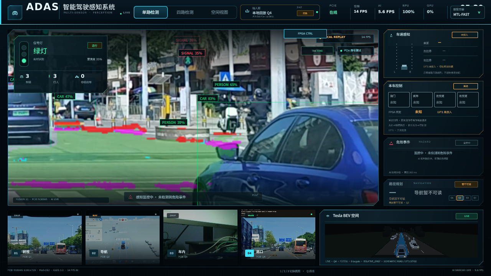
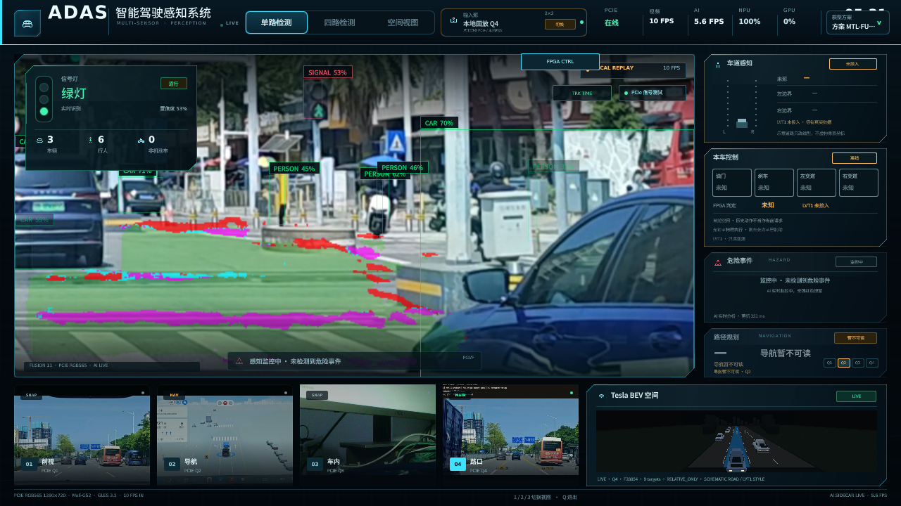
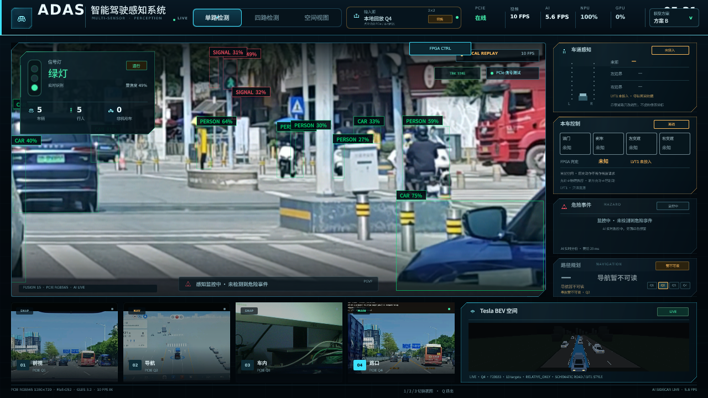

# Qt 多任务分割显示

更新日期：2026-10-31
代码：`deployment/lubancat/qt_gpu_probe/main.qml`
通道：`/dev/shm/adas_mtl_overlay.png` + `.json`
模型：`MTL-FULL` / `MTL-FAST`

---

## 1. 效果

| MTL-FAST | MTL-FULL |
|---|---|
|  |  |

切回 B 后覆盖层消失、检测框保留：



截图条件：RK3566 板端 Qt，1280×720，本地 PGV 回放，道路 Q4，llvmpipe 软件 OpenGL。
演示视频（2.1 MB，不进入普通 Git）：本机归档
`/Users/a1/Documents/默认项目/research/b05n_p2_mtl/deployment/qt_overlay/mtl_demo.mp4`，
16 s，B → MTL-FAST → MTL-FULL → B。需要公开时放 GitHub Release 或对象存储。

## 2. 数据通道

AI 检测器不把 mask 放进 MVA2（4096 B 上限）。每个 MTL 推理帧：

```text
/dev/shm/adas_mtl_overlay.png      RGBA，native mask 尺寸
/dev/shm/adas_mtl_overlay.json     frame_id / timestamp / mask size / generation / model
```

写入流程：

1. 后台 writer 线程取最新一组 mask（合并旧帧，不排队）。
2. `cv2.imencode(".png", canvas)`。
3. 写 `*.tmp`，`os.replace` 原子替换。
4. 更新 JSON 元数据（同样原子替换）。

检测主路径只做一次引用入队，`overlay_ms = 0`；FULL 的 PNG 编码约 36.9 ms、
FAST 约 9.9 ms，均在检测线程之外。

## 3. Qt 叠加

`main.qml` 在 `VideoItem` 之后增加：

```qml
Image {
    id: mtlOverlay
    readonly property bool active: (video.aiModelId === "MTL-FULL"
                                    || video.aiModelId === "MTL-FAST")
                                   && video.aiOnline
    visible: active && root.viewMode !== 2 && !root.videoQsg
    source: ""
    cache: false
    asynchronous: true
    smooth: true
    opacity: 0.92
    fillMode: Image.Stretch
    x: (root.viewMode === 1 && root.inputLayout === "quad")
       ? video.x + (root.roadQuadrant % 2) * video.width * 0.5 : video.x
    y: (root.viewMode === 1 && root.inputLayout === "quad")
       ? video.y + Math.floor(root.roadQuadrant / 2) * video.height * 0.5 : video.y
    width: (root.viewMode === 1 && root.inputLayout === "quad")
           ? video.width * 0.5 : video.width
    height: (root.viewMode === 1 && root.inputLayout === "quad")
            ? video.height * 0.5 : video.height
}

Timer {
    id: mtlOverlayTimer
    interval: 160
    repeat: true
    running: mtlOverlay.visible
    onRunningChanged: if (!running) mtlOverlay.source = ""
    onTriggered: mtlOverlay.source = "file:///dev/shm/adas_mtl_overlay.png#g=" + Date.now()
}
```

### 3.1 为什么用 `#` 而不是 `?`

Qt Quick 的 `Image` 对 `file:///...png?g=...` 会返回 Ready 但渲染空白；
必须使用 URL fragment（`#g=...`）作为缓存刷新参数。

### 3.2 坐标映射

- 模型输入是道路象限（quad 布局下 640×360）letterbox 到 512×288。
- mask 使用模型输入坐标；检测器按 `pad_x/pad_y/resized_w/resized_h` 裁掉
  letterbox 边缘，只保留真实道路内容。
- QML 覆盖层与 `VideoItem` 使用同一矩形；四路布局时 `VideoItem` 已通过
  `sourceViewport` 裁剪到 `root.roadQuadrant`，覆盖层直接铺满。
- `viewMode === 1` 时 `VideoItem` 显示整帧，覆盖层只占对应象限：
  `x = video.x + (q % 2) * video.width / 2`，`y = video.y + floor(q/2) * video.height / 2`。
- `viewMode === 2`（空间视图）或 `videoQsg` 时隐藏，避免叠在 3D 场景上。

## 4. 颜色

| 语义 | 颜色 | BGRA |
|---|---|---|
| 斑马线 / crosswalk | 洋红 | `(255, 0, 255, 190)` |
| direct drivable | 半透明绿 | `(0, 200, 40, 70)` |
| alternative drivable | 半透明蓝 | `(255, 96, 0, 70)` |
| 实线 / solid | 红 | `(0, 0, 255, 200)` |
| 虚线 / dashed | 青 | `(255, 255, 0, 200)` |

类别优先级：drivable 打底 → lane foreground（虚线/实线）→ crosswalk 覆盖。
lane_style 背景但 lane 前景非背景的像素按实线红色处理，避免漏画。

## 5. 模型切换清理

- 切到非 MTL：Qt `aiModelId` 变化，`mtlOverlay.visible=false`，Timer 停止并清空
  `source`；旧 MTL detector `close()` 删除 shm PNG/JSON。
- MTL-FULL ↔ MTL-FAST：旧 detector 关闭删除文件，新 detector 下一帧写入新尺寸；
  QML 覆盖层直接拉伸到同一显示矩形，不依赖旧尺寸。
- 切换失败：保留原 detector 和原覆盖层，不清空可用状态。

## 6. 性能

本地 PGV 回放、llvmpipe：

| 指标 | B（无覆盖层） | MTL-FAST（有覆盖层） |
|---|---:|---:|
| scene_graph_fps p50 / p95 | 4.2 / 6.7 | 3.9 / 6.2 |
| source_fps p50 | 16.2 | 15.2 |
| CPU（全核）p50 | 52.0% | 46.9% |
| AI 结果更新 p50 | 17.5 ms | 15.7 ms |

覆盖层开销在噪声范围内。Qt 的 scene-graph FPS 受软件 OpenGL 限制，不代表
Mali 正常显示上限；生产环境若使用 Mali，应重新测。

## 7. 构建

```bash
cd /home/cat/qt_gpu_probe_build_20261030_time
cp <repo>/deployment/lubancat/qt_gpu_probe/main.qml .
/usr/lib/qt5/bin/rcc -name qml qml.qrc -o qrc_qml.cpp
make -j2 qt_gpu_probe
```

`qrc_qml.cpp`、`.o`、`qt_gpu_probe` 不进入普通 Git；`main.qml` 与 `qml.qrc`
是源文件。C++ 侧不需要为覆盖层新增属性：复用已有 `VideoItem::aiModelId`、
`aiOnline`、`roadQuadrant`、`sourceViewport`。

## 8. 证据

- `docs/hmi/assets/mtl/screenshot_mtl_fast.png`
- `docs/hmi/assets/mtl/screenshot_mtl_full.png`
- `docs/hmi/assets/mtl/screenshot_b_overlay_cleared.png`
- `docs/deployment/evidence/MTL/qt_metrics_mtl.jsonl`
- `docs/deployment/evidence/MTL/qt_phase.txt`
- `deployment/lubancat/qt_gpu_probe/tools/mtl/capture_overlay.py`
