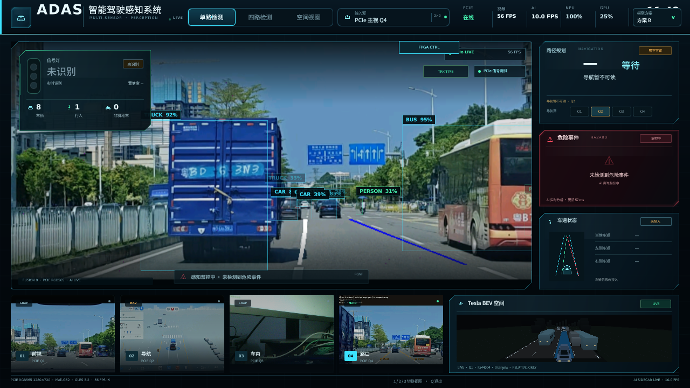

# Tesla 风格 ADAS 三维车机

更新日期：2026-10-28  
当前版本：`/home/cat/qt_gpu_probe_ai_20261019/qt_gpu_probe`（Qt 5.12.8 / Qt Quick / Mali-G52）  
截图：`docs/hmi/assets/current_live_20261028.png`



---

## 1. 它是什么

这不是网页 mock，也不是 PC 截图。它是 RK3566 实板上运行的 Qt Quick 程序：

- 1280×720 HDMI/X11；
- Mali-G52、OpenGL ES 3.2、EGL；
- 单纹理 RGB565 视频上传；
- `QQuickFramebufferObject` 自绘 3D BEV（Tesla-BevCam-Clone 风格）；
- 通过 UDP sidecar 接收 YOLO 检测框；
- 通过 root `hud_bridge.py` 把交通灯/行人等状态写回 FPGA BAR1。

当前画面（2026-10-28）：

```text
顶部：ADAS 智能驾驶感知系统 | 单路检测 | 四路检测 | 空间视图
      PCIe 在线 | 56 FPS | AI 10.0 FPS | NPU 100% | GPU 25% | 方案 B（UI 标签，实际 A）
主视：真实道路 + TRUCK/CAR/PERSON/BUS 检测框 + 路径示意
左侧：信号灯 未识别 | 8 车辆 | 1 行人 | 0 非机动车
右侧：路径规划 导航暂不可读 | 危险事件 未检测到 | 车道状态 车道视觉未接入
底部：前视/导航/车内/路口四宫格 + Tesla BEV 空间
```

---

## 2. 技术栈

| 层 | 实现 |
|---|---|
| 窗口/合成 | Qt 5.12.8，Qt Quick，XCB + EGL |
| 视频 | `VideoItem` / `VideoTextureItem`，RGB565 纹理 |
| 3D | `TeslaSceneItem`，QQuickFramebufferObject + 自写 GLSL |
| AI 结果 | UDP `MVA1/MVA2`，QML `aiBoxes` |
| HUD | UDP 38262 → `hud_bridge.py` → BAR1 |
| 模型切换 | `MVM1/MMS1`，`model_profiles.py` |
| 视频源 | PGVF `/dev/shm/pango-video/latest.pgv` |
| AI 源 | MFR1 `/dev/shm/qt_gpu_probe_ai.mfr1` |

---

## 3. 数据流

```text
FPGA → PCIe → pango_video_capture → latest.pgv
  → Qt VideoItem 读/CRC/上传 RGB565
  → 主视 + 四宫格显示

Qt 主视帧 → MFR1 → ai_bridge（10 Hz）
  → MVA2 boxes + status
  → Qt 检测框 / 交通灯 / 危险 / 导航卡

Qt/AI 状态 → hud_bridge → BAR1 HUD V2 → FPGA OSD/LED
```

关键：AI 结果与视频帧通过 `frame_id`/`timestamp_ns` 关联；Qt 在结果过期时清空框，不保留陈旧检测。

---

## 4. 3D BEV 场景

`TeslaSceneItem` 的特点：

- 四条同向车道，每条约 3.5 m；自车在第二车道中心；
- 蓝色 FSD 路径只铺自车车道；
- 自车是 3D mesh（cuboid + hood/trunk plane），不是 QML 贴图；
- 其他车辆/行人用简单 3D billboard/cuboid；
- 场景相机透视投影，自车/道路/车辆在同一投影世界；
- 支持 `boxes`、`online`、`demoMode`、`sourceKey`、`sourceFrameId`、`sourceTimestampNs`、`sceneFps` 属性。

### 4.1 检测框映射

- 输入框坐标是 1280×720 源像素；
- QML 按 `video.width/height` 缩放，叠在视频上；
- 3D 场景用同一组 `aiBoxes` 做 BEV 投影；
- 当前没有真实 3D 距离/标定，BEV 位置是**视觉投影**，不是测距结果；
- 当前没有 track_id；QML 的 `RAW/FIX4/TIME` 是显示端外推模式，不是跟踪器。

### 4.2 边界

- 不是 calibrated AVM/环视；没有鱼眼标定、地面单应、真实自车姿态；
- 不是 Tesla 官方界面；是 Tesla-BevCam-Clone 风格的视觉参考；
- 不能把 BEV 位置当作真实车道/距离；
- 不能把蓝色路径当作规划算法输出（它是自车车道示意）。

---

## 5. 当前功能状态

| 功能 | 状态 | 说明 |
|---|---|---|
| 真实 PCIe 视频 | ✅ | 49.49 FPS，PGVF |
| 四宫格显示 | ✅ | 单路 1280×720 2×2 mosaic |
| YOLO 检测框 | ✅ | A 模型 10 Hz，实板截图有框 |
| Tesla BEV 场景 | ✅（视觉） | 4 车道/自车/车辆 billboard |
| 检测框 BEV 投影 | ✅（视觉） | 用当前主视 boxes，不是测距 |
| 模型方案切换 | ⚠️ | 代码支持 A/B/C/D；UI 标签与实际 A 不一致 |
| 交通灯状态 | ❌/⚠️ | 当前“未识别”；HSV/专模存在但未稳定 |
| 导航 | ❌ | OCR 1.2 s，当前“暂不可读” |
| 危险事件 | ⚠️ | 实验性图像事件，当前“未检测到” |
| 车道状态 | ❌ | HMI 显示“车道视觉未接入”；FPGA HSST 有数据但未消费 |
| FPGA HUD 回写 | ✅ | applied seq 增长，reject=0/error=0 |
| 物理 HDMI scanout FPS | ❌ | `physical_scanout_fps=null` |

---

## 6. 性能相关设计

- 单纹理 RGB565，一次 `glTexSubImage2D` 上传；
- 预分配帧池，避免每帧整帧 copy；
- 渲染线程直接拉取共享帧队列，QML 不为每帧排 GUI 事件；
- 静态卡片 `layer.enabled` 缓存；
- 目标框用轻量边框/标签图元；
- AI 在独立 latest-only worker，不阻塞 EGL 提交；
- `QT_FRAME_METADATA_HZ=15` 限制元数据通知；
- AI sidecar `Nice=10`，降低与 Qt 抢核。

详见 `docs/hmi/HMI_PERFORMANCE.md`。

---

## 7. 可插入后续算法的最小位置

### 7.1 跟踪（ByteTrack/BoT-SORT/Supervision）

最小侵入点：**`ai_bridge.py` 的 MVA2 结果组装之前**。

```text
RKNN Raw-head 输出
  → DFL/NMS → detections[]
  → [新增] tracker.update(detections, frame_id, timestamp_ns)
  → tracks[]（track_id + bbox + history + velocity）
  → MVA2 boxes/status
  → Qt 检测框 / Tesla BEV
```

- 不需要改 RKNN 模型；
- 不需要改 PGVF/PCIe；
- MVA2 的 `box V2` 已有 7 floats + class_id + confidence，可把 track_id 放进 status JSON，或升级 box 结构；
- Qt 侧只用 `track_id` 做稳定 ID/轨迹，不改变现有框坐标。

### 7.2 事件（Cut-in/TTC/行人横穿/拥堵/急减速）

最小侵入点：**`FrontPipeline` 的 hazard 阶段**（已有 `HazardEvents` 雏形）。

- 输入：track 历史 + 本车速度/车道 + FPGA HSST 车道 + 导航；
- 输出：`events[]`（kind/track_id/severity/ttc/confidence/valid）；
- 通过 MVA2 status JSON 传给 Qt；
- 通过 HUD V2/ADST 扩展字段传给 FPGA；
- 不改现有 HMI 布局，只在“危险事件”卡增加条目。

### 7.3 车道

最小侵入点：**`hud_bridge.py` / `ai_bridge.py` 读取 BAR1 0x680–0x68c**。

- 已有 FPGA HSST 实时数据；
- 需要定义“左/右边界数量/类型”到 HMI `车道状态` 的映射；
- 不能把 HSST 的“数量/类型”直接当成本车车道 ID；
- 需要坐标/归属时，需 FPGA 队友提供更完整的协议。

---

## 8. 已知问题

1. **模型标签不一致**：截图显示“方案 B”，进程/summary 为 A。
2. **板端源码漂移**：板端 `main.qml`/`video_item.cpp` 与仓库不完全一致；运行二进制 hash 已记录。
3. **导航 OCR 不可用**：1.2 s/次，`valid=0`。
4. **交通灯未识别**：HSV/专模未在比赛域稳定。
5. **车道未接入**：HSST 有数据，HMI 不读。
6. **BEV 不是标定几何**：不能当测距/真实车道。
7. **物理 scanout 未测**：56 FPS 是 Qt 自报，不是 HDMI 扫描率。

---

## 9. 相关文档

- `docs/hmi/HMI_PERFORMANCE.md`
- `docs/architecture/PCIE_DATA_FLOW.md`
- `docs/roadmap/ADAS_EVENT_ENGINE_PLAN.md`
- `deployment/lubancat/qt_gpu_probe/README.md`
---

## 10. LVT1 真实数据升级（2026-10-29）

本次在独立分支 `feature/lvt1-ego-bev-20261028` 完成：

- 车道感知卡接入 LVT1 左右最近线型/数量/来源/有效性；
- 新增本车控制卡（油门/刹车/左右变道请求 + FPGA 允许/拒绝/警告/原因）；
- Tesla 3D 道路左右边缘按 LVT1 实线/虚线实时变化；
- 3D 目标复用 Qt 跟踪输出，ID 稳定、900ms 过期、无检测不生成模拟车；
- 默认道路象限改为 Q1（前视），Q2 仅导航；
- 修复 chase camera X 镜像，保证左右不互换。

实板离线截图：

| 模式 | 文件 |
|---|---|
| 单路 | `docs/hmi/assets/lvt1/single_live_targets_20261029.png` |
| 四路 | `docs/hmi/assets/lvt1/quad_live_targets_20261029.png` |
| 空间 | `docs/hmi/assets/lvt1/spatial_live_targets_20261029.png` |
| 左变道拒绝 | `docs/hmi/assets/lvt1/single_left_change_denied_20261029.png` |

详细：[LVT1_REAL_DATA_HMI.md](LVT1_REAL_DATA_HMI.md)。

---

## 9. 2026-10-31 更新：MTL 分割覆盖层

- 默认模型已为 B（B05N P2 Raw-head INT8）；模型菜单共 21 项。
- 新增 MTL-FULL / MTL-FAST 分割覆盖层：车道类别、实线/虚线、斑马线、可行驶区域。
- 分割走 `/dev/shm/adas_mtl_overlay.png` + `.json`，不进入 MVA2。
- 切回 B/B-CAPI 后覆盖层立即清除。
- 截图：`docs/hmi/assets/mtl/screenshot_mtl_fast.png`、`screenshot_mtl_full.png`、
  `screenshot_b_overlay_cleared.png`。
- 详细实现：`docs/hmi/MTL_SEGMENTATION_OVERLAY.md`。
- 多模型架构：`docs/architecture/MULTIMODEL_AI_BRIDGE.md`。

> 第 1–8 节是 2026-10-28 的 HMI 快照；其中“实际 A / UI 标签 B”的描述已被本次更新取代。
