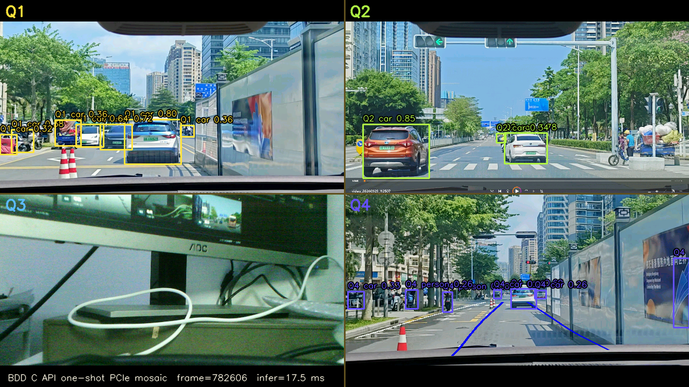
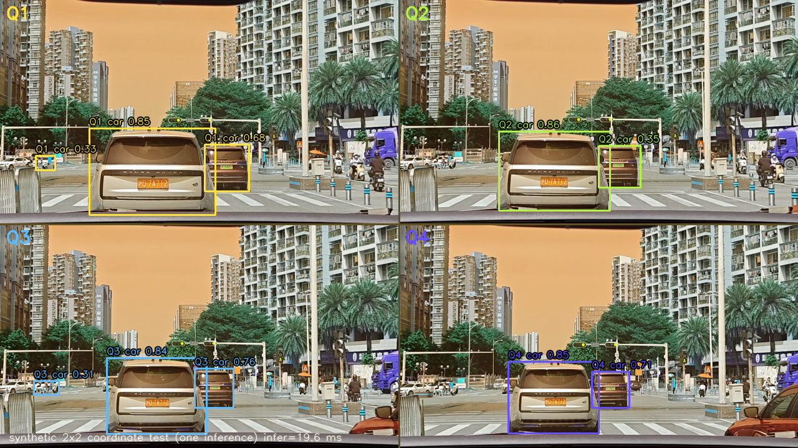

# FAST-MOSAIC：BDD-YOLOv8n C API 与四宫格整图检测

日期：2026-11-01
模型：BDD-YOLOv8n Raw-head INT8
平台：LubanCat RK3566 / RKNN Runtime 2.3.2 / 4×A55
范围：模型与 C API 独立研究；未修改正式 Qt、AI Bridge、systemd、生产 `.so` 或默认模型。

---

## 1. 历史调查结论

追踪 `main`、`research/rk3566-adas-models`、PR #3、PR #4 及 B05N/B05P/MTL 分支后，关键事实如下：

1. **BDD 比 B05N P2 快的主要原因是检测头更小。** BDD 原生 YOLOv8n 是 P3/P4/P5 三个尺度；B05N P2 增加 P2/4 分支，变成四个尺度。实际 `rknn_query` 确认：
   - BDD Raw-head INT8：**9 个输出，3 个尺度**；
   - B05N P2 Raw-head INT8：12 个输出，4 个尺度；
   - B-2a MTL：15 个输出（12 检测 + 3 分割）。
   - 之前文档/manifest 把 BDD 写成 12 输出是错误记录，本报告以板端查询为准。
2. Raw-head 导出把 DFL/坐标解码移出模型，避免 INT8 输出被坐标极值主导；P2 INT8 mAP 从 post-DFL split 的 0.3031 恢复到 0.3651。
3. P2 C API 的 14.33 FPS 来自 `want_float=0`、C 侧 DFL/NMS 和持久化 context；B-2a/Seg-256 进一步用原生 INT8 argmax 和较低分割分辨率把输出获取/后处理压下来。
4. 正式 AI Bridge 的 10 Hz 是请求/调度限制，不是模型上限；观察完整系统 FPS 时必须区分模型吞吐、Bridge 结果率和 Qt 渲染 FPS。
5. Qt 通过 MVA2 接收检测框和状态；本次研究没有改 Qt，只用独立 PNG/JSON 验证四宫格结果。

## 2. BDD 实际输出结构

板端 `rknn_probe` / `rknn_query` 结果：

| 输出 | shape | dtype | scale / zp |
|---|---|---|---|
| `reg_s8` | 1×64×36×64 | INT8 | 0.25298 / −44 |
| `cls_s8` | 1×10×36×64 | INT8 | 0.003571 / −128 |
| `cls_sum_s8` | 1×1×36×64 | INT8 | 0.003801 / −128 |
| `reg_s16` | 1×64×18×32 | INT8 | 0.30721 / −22 |
| `cls_s16` | 1×10×18×32 | INT8 | 0.003698 / −128 |
| `cls_sum_s16` | 1×1×18×32 | INT8 | 0.003770 / −128 |
| `reg_s32` | 1×64×9×16 | INT8 | 0.07917 / −50 |
| `cls_s32` | 1×10×9×16 | INT8 | 0.003699 / −128 |
| `cls_sum_s32` | 1×1×9×16 | INT8 | 0.003922 / −128 |

输入：`1×288×512×3`，NHWC，uint8，RGB。
检测：3 尺度、每尺度 reg/cls/cls_sum 三路，共 **9 路**。
类别：10 类 BDD，分数域是 sigmoid 概率，不是 logits；host 端不需要再做 sigmoid。

## 3. C API 修改

源码：`research/fast_mosaic_detector/capi/p2capi_generic.c`

- `p2_create` 接受 **9 / 12 / 15** 个输出；按 `n_output` 推导 `n_scales` 和 `n_det`。
- 通过 `rknn_tensor_attr.name` 绑定每尺度的 `reg` / `cls`，失败时回退到文档顺序。
- `decode_det` 按真实尺度数循环，DFL softmax/期望、ltrb→xyxy、按类 NMS。
- `want_float=0`，直接读取 INT8；类别数从 cls tensor 的 `dims[1]` 读取。
- 保持 `P2Result`、`p2_create`、`p2_detect`、`p2_destroy` ABI；新增只读的
  `p2_output_count`、`p2_scale_count`。
- `p2_detect_mtl` 保持 15 输出和分割 argmax，不影响 B-2a。
- 独立编译为 `libp2capi_generic.so`；未替换生产 `libp2capi.so`。

## 4. 精度一致性

同一帧、同一预处理（RGB letterbox 512×288）、conf 0.25、NMS IoU 0.45；Python 侧使用生产适配器，C 侧使用新库。

| 输入 | Python 框 | C API 框 | 匹配@IoU 0.5 | 平均 IoU |
|---|---:|---:|---:|---:|
| 道路 Q4 640×360 | 4 | 4 | **4/4** | **0.986** |
| 完整 1280×720 | 7 | 7 | **7/7** | **0.952** |

类别一致；置信度差异通常 <0.02（例如 car 0.891 vs 0.891，person 0.614 vs 0.607）。差异来自 C 双线性 resize 与 OpenCV 的插值差异，以及 C/Python NMS 的边界处理，不是类别错位或坐标恢复错误。

## 5. 公平性能对照

条件：同一批 60 帧、循环 5 轮 = 300 次；完整 1280×720 输入缩放到 512×288；Qt/HMI 同时运行；生产 AI Bridge 未运行（`adas-ai-bridge-live` inactive）。

| 路径 | 完整 FPS | 单帧 p50 / p95 | 说明 |
|---|---:|---:|---|
| BDD Python RKNN Lite | 21.43 | 46.0 / 51.7 ms | wall |
| BDD C API（C 层，int8） | **25.52** | **38.98 / 42.60 ms** | pre 17.69 / run 17.51 / get 2.45 / det 0.62 |
| BDD C API（C 层，float 诊断） | 24.49 | 40.73 / 44.46 ms | get 3.84 ms |
| BDD C API（Python ctypes） | **29.99** | **32.48 / 41.48 ms** | OpenCV 预处理更快；rknn 17.19 / decode 0.62 |
| P2 C API（同条件） | 18.76 | 52.96 / 57.38 ms | run 27.18 / get 5.38 |
| FAST-MOSAIC（真实 PCIe 100 帧） | **25.61** | 31.32 / 39.22 ms | 含 PGV 读取；一次整图推理 |

BDD C API 相对 Python：单帧 p50 −29.4%，FPS +19.1%（C 层）；Python ctypes 路径 FPS +40.0%。相对 P2 C API：FPS +36.0%，单帧 p50 −26.4%。

资源（300 帧 C 层，整板含 Qt）：

- CPU 88.6%
- NPU mean 100%，max 100%
- GPU mean 37.8%，max 100%
- 温度 37.2–40.0 °C

## 6. 真实 PCIe 四宫格

输入：`/dev/shm/pango-video/latest.pgv`，1280×720 2×2 拼接，实际 PCIe 帧 `frame_id=782606`。
处理：整帧一次 `rknn_run()`，框恢复到 1280×720 全局坐标，按框中心分配象限。



另外用四段不同道路帧拼成 2×2 做坐标映射对照（仍是一次推理）：



该合成帧 Q1/Q2/Q3/Q4 分别 3/2/3/2 个框，单帧 19.6 ms，证明框能正确落到四个象限，而不是全部映射到 Q1。

| 象限 | 内容 | 框数 |
|---|---|---:|
| Q1 | 前视道路 | 7 |
| Q2 | 另一道路场景 | 3 |
| Q3 | 车内 | 0 |
| Q4 | 路口 | 7 |

- 单帧推理 17.5 ms。
- Q3 没有误检；Q1/Q2/Q4 的框落在各自象限，没有全部错映射到 Q1。
- 跨象限框按中心归属并标记 `crosses_boundary`，保留全局坐标；本帧未出现跨边界框。
- 512×288 下每个象限约 256×144，远处小车/小灯漏检是实际限制，没有用四路独立推理掩盖。

结构化结果：`research/fast_mosaic_detector/results/mosaic_pcie_bdd_capi.json`。

## 7. C API 生命周期切换

独立进程内连续执行 2 轮 `BDD → P2 → MTL-FAST → BDD`：

- BDD：9 输出，7 框
- P2：12 输出，10 框
- MTL-FAST：15 输出，256×144 mask，10 框
- 回到 BDD：9 输出，7 框，无崩溃、无 context 复用错误

原始记录：`research/fast_mosaic_detector/results/capi_lifecycle.json`。
这是 C API 层的资源释放验证，不是正式 MVM1/MMS1 车机热切换；生产模型注册表未修改。

## 8. 为什么没有训练新模型

任务目标是 **≥20 FPS**。BDD C API 已达到 25.52 FPS（C 层）/ 29.99 FPS（Python ctypes），P2 C API 为 18.76 FPS。再训练更小模型需要：

- 重新准备 BDD 十类数据与四宫格增强；
- 重新训练、校准、量化、精度评估；
- 可能牺牲 car/person/TL 的现有精度。

在 20 FPS 目标已经达到、且 BDD 是现有正式模型的情况下，继续压缩模型的收益不足。按任务允许保留旧 BDD 为最终选择，本轮交付 C API 和整图验证，不重复训练。

如果后续要求 >35 FPS，可优先尝试 416×256 或更小 width 的 BDD 变体；这需要新的训练/量化实验，不能直接把 512×288 权重改输入尺寸冒充新模型。

## 9. 复现

```bash
cd research/fast_mosaic_detector/capi
make CC=gcc
# 板端测试目录复制为 libp2capi_fast.so / rknn_bench_fast
ADAS_P2CAPI_LIB=$PWD/libp2capi_fast.so python3 ../scripts/bench_capi_bdd.py
python3 ../scripts/bench_python_bdd.py
python3 ../scripts/bench_resource_sampler.py <bdd.rknn> bdd_capi_resource
ADAS_P2CAPI_LIB=$PWD/libp2capi_fast.so python3 ../scripts/run_mosaic_pcie.py
```

## 10. 约束与生产状态

- 没有修改正式 Qt、`ai_bridge.py`、systemd、PCIe 驱动、FPGA bitstream、HUD 或默认模型 B。
- 没有替换生产 `libp2capi.so`；测试使用独立目录和独立 `.so`。
- 没有启用自动刹车或车辆控制。
- 测试期间 Qt/HMI 仍在运行；资源数据是整板负载。
- 生产 AI Bridge 在本轮测试时处于 inactive（另一 Agent 的恢复工作），本任务未启动/停止/修改它。
