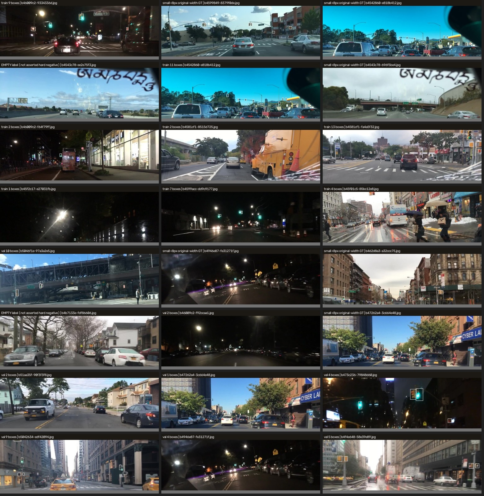
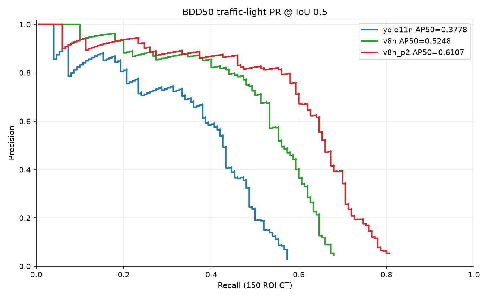
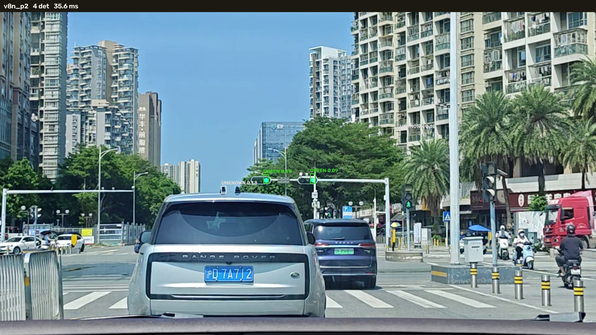
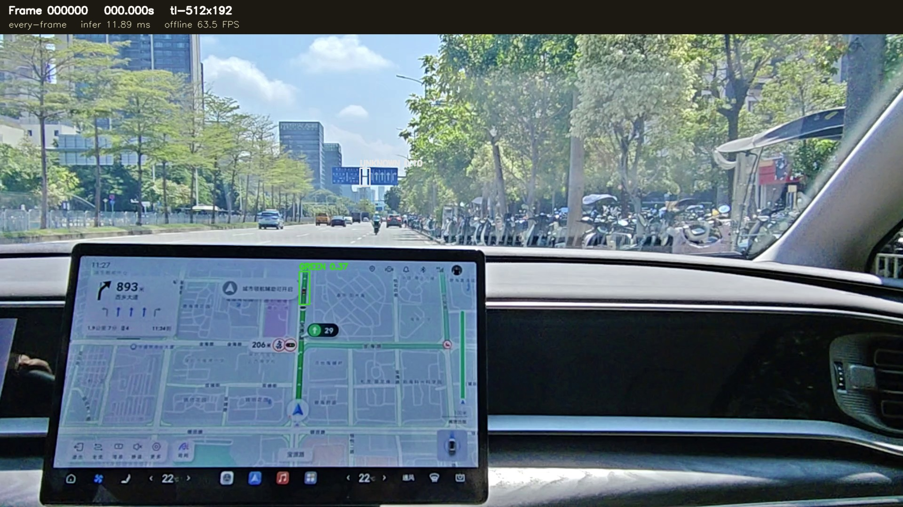
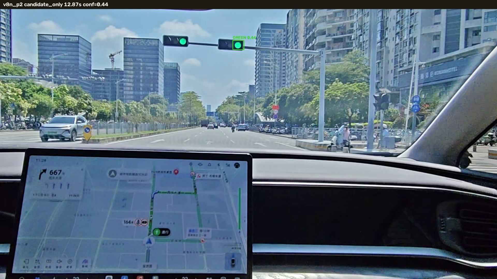
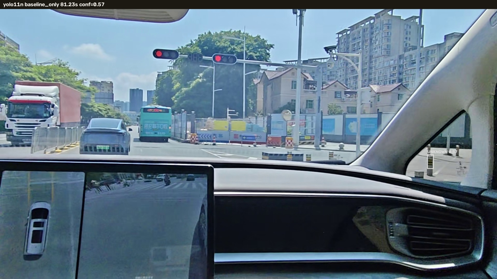
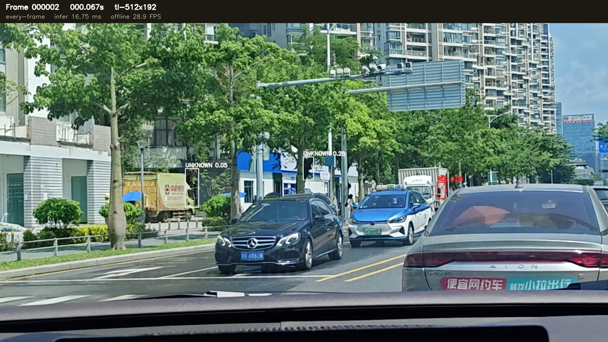
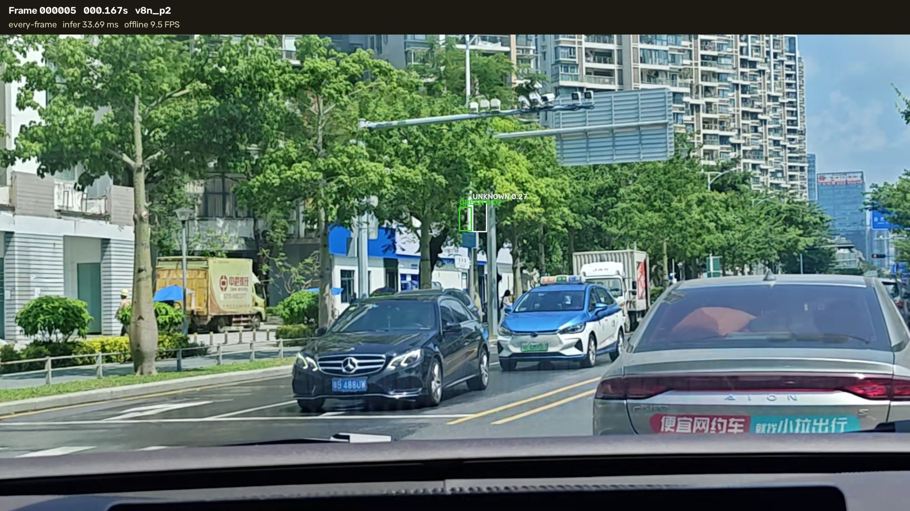

# B-05L — 交通灯 Specialist 替代模型选型与 PC 验证

日期：2026-10-25<br>
分支：`research/rk3566-adas-models`<br>
基线：`c99b154`（B-05K PC 视频验证）<br>
设备：Windows RTX 4060 Laptop 8GB，ASUS Performance 电源模式（训练/评测期间）<br>
范围：只做 PC 端研究、训练、评估和可视化；未连接 RK3566，未修改板端服务或 A 线。

## 0. 结论

1. **YOLOv8n 明确优于现有 YOLO11n Specialist。** 在固定 BDD50 人工 GT、conf=0.25、IoU=0.5 下，Letterbox 的 AP50 从 `0.3879` 提升到 `0.5002`，Recall 从 `0.3933` 提升到 `0.4667`，FP 从 `42` 降到 `32`；直接 Resize 下 AP50 为 `0.5248`、Recall `0.5333`。
2. **YOLOv8n-P2 是 BDD50 上最好的模型，但必须配直接 Resize。** P2 + Resize 达到 `AP50=0.6107`、`Precision=0.7699`、`Recall=0.5800`、`TP/FP/FN=87/26/63`；8–16px 小灯 Recall 从基线的 `33.75%` 提升到 `57.50%`。同一 P2 用 Letterbox 只有 `AP50=0.4853`、Recall `0.4733`，说明预处理与训练分布不匹配会吃掉大部分收益。
3. **官方视频上 P2 不是全面碾压。** 四段视频没有逐帧人工 GT，不能计算真实 Recall/AP。抽样复核显示 P2 能找到基线漏掉的真实绿灯/灯体，也仍会把建筑边缘、红色旗帜/路牌当候选；在 `112507`、`113539` 上 P2 的首次稳定检测晚于 v8n。视频结论只能是“候选更早/更晚、误检样本”，不能冒充准确率。
4. **部署建议：P2 + Resize 进入下一阶段 RKNN 转换和板端 A/B；v8n + Resize 是低风险备选。** 本轮**不替换** RK3566 正式权重：P2 的 4 尺度输出尚未做 RKNN 转换验证，且视频行为仍有混合证据。
5. **预处理结论：** 训练 canvas 是 top-60% ROI 直接缩放到 512×192，不是 Letterbox。新模型使用直接 Resize 与训练分布一致，收益明显；是否改板端预处理必须另做板端 A/B，不能仅凭 PC 结果直接改 RK3566。

## 1. B-05K 基线核实

B-05K 的工具、报告和证据已经存在并提交在 `c99b154`：

```text
tools/b05k_video_benchmark.py
tools/b05k_runtime.py
tools/b05k_common.py
tools/b05k_evaluate.py
tools/b05k_compare.py
research/rk3566_models/reports/B05K_PC_video_validation.md
research/rk3566_models/reports/assets/B05K/
```

本轮用 B-05K 同一评估器和同一 BDD50 人工 GT 复现基线：

```text
154 GT = 150 ROI 内 + 4 ROI 外
TP=59  FP=42  FN=91
Precision=0.5842  Recall=0.3933  AP50=0.3879
```

与 B-05K 报告一致。B-05K 的完整 MP4 仍保留在本机 `D:\Datasets\adas_edge_training\b05k_pc_validation\`，未被覆盖。

## 2. 数据审计与共享划分

主训练/验证数据：

| 项目 | train | val（原始） | clean val |
|---|---:|---:|---:|
| 图像 | 8,513 | 487 | 482 |
| 有标签图像 | 4,719 | 249 | 244 |
| 空标签图像 | 3,794 | 238 | 238 |
| 标注框 | 22,283 | 1,185 | — |
| 原图宽度 <8px | 3,195 | 181 | — |
| 原图宽度 8–16px | 11,286 | 600 | — |
| 原图宽度 16–32px | 6,496 | 330 | — |
| 原图宽度 >32px | 1,306 | 74 | — |

数据来源是 BDD100K validation 的 top-60% ROI，`dataset_card.json` 明确写出 `512x192`、`roi_px=[1280,432]`、`holdout_excluded=true`。训练 canvas 是直接缩放，没有 Letterbox 黑边。

泄漏检查：

- BDD50 的 50 个名字不在 train，也不在 val；50 个名字都在 `bdd_holdout_1000_names.txt` 中。
- train/val 名称无重叠。
- 用 dHash 检查到 5 张 val 与 train 近重复（距离 ≤3），已从验证集排除，不移入训练集；最终 clean val 482 张。
- 空标签图像是 BDD 官方“ROI 内无 traffic light 标注”的帧，**不把它们宣称为已确认的困难负样本**；B-05I 的 17 个 rejected 候选也没有写成空标签。
- 训练集内仍有 2 组完全相同的图像哈希，属于同场景重复帧；本轮没有为此改动训练集，记录为数据噪声。

BDD50：

| 项目 | 数值 |
|---|---:|
| 图像 | 50 |
| 全部 traffic-light GT | 154 |
| top-60% ROI 内 | 150 |
| ROI 外 | 4 |
| ROI 覆盖率 | 97.40% |
| green / red / yellow / none | 81 / 33 / 3 / 37 |
| ROI 内 <8 / 8–16 / 16–32 / >32px | 17 / 80 / 47 / 6 |

视频域清洗样本共 15 图 / 30 框（train 7 / val 3 / test 5），按视频来源划分，未混入三模型主对比。原因：只有 30 个框，且生产基线没有用它们训练；混入会把“数据差异”误当成“架构收益”。它们保留为后续 domain adaptation 数据。



## 3. 模型与训练

三个模型使用同一训练集、同一 clean val、同一 seed、同一输入尺寸和同一 close_mosaic 策略。新模型 `batch=32`，Ultralytics `nbs=64` 下等效 batch 仍是 64；生产基线历史配置为 `batch=16`（同样等效 64）。

| 模型 | 初始化 | epochs | batch | best epoch | val mAP50 | val mAP50-95 | 参数量 | PT 大小 | ONNX 大小 | 训练时长 |
|---|---|---:|---:|---:|---:|---:|---:|---:|---:|---:|
| YOLO11n（生产基线） | `yolo11n.pt` | 60 | 16 | 46 | 0.3665 | 0.1172 | 2,605,492 | 5.43 MB | 10.48 MB | 4,248 s |
| YOLOv8n | `yolov8n.pt` | 60 | 32 | 56 | 0.4760 | 0.1578 | 3,021,500 | 6.21 MB | 12.14 MB | 3,753 s |
| YOLOv8n-P2 | `yolov8n.pt` + `yolov8-p2.yaml` | 60 | 32 | 55 | 0.5250 | 0.1740 | 2,937,802* | 6.12 MB | 11.94 MB | 4,260 s |

\* P2 的参数量是单类重映射后的最终模型；重映射前 `nc=80` 时为 3,366,022。

权重迁移：

- YOLOv8n：355/355 层、100% 参数按 key+shape 精确匹配，完整加载 COCO 权重；分类头随单类数据重映射。
- YOLOv8n-P2：Ultralytics 日志为 `Transferred 219/437 items` 和 `Transferred 389/437 items` 两次；训练前精确同值检查为 219/437 层、43.5% 参数。P2 新增的 P2/4 分支以及索引后移的 neck/head 不能完整继承 COCO 权重，**不能把 P2 当作完整预训练迁移**。这一点是 P2 结果的重要限制。

训练环境：RTX 4060 Laptop 8GB，PyTorch 2.12.1+cu126，CUDA 12.6，Ultralytics 8.4.136。Batch 32 时显存约 1.28 GB（v8n）/1.56 GB（P2）。训练期间 ASUS Performance 模式，GPU 约 1.9–2.5 GHz。

## 4. BDD50 统一评估

评估器要求：

- 输入：原始 1280×720 BDD 图 → top-60% ROI → 512×192。
- 推理：RGB、NCHW、Float32、1/255。
- 后处理：单类 YOLO 输出 `[1,5,N]`，输出已经是概率，不再 sigmoid；NMS IoU=0.5。
- 匹配：每张图严格一对一，IoU=0.5。
- AP50：全局置信度排序，候选下限 0.001。
- 固定 operating point：conf=0.25。
- 尺寸按原图宽度计算（canvas 宽度 ×2.5）。
- 每个模型的尺寸组 TP 合计必须等于总体 TP，代码里有断言。

### 4.1 Letterbox（与 B-05K 部署预处理一致）

| 模型 | AP50 | Precision | Recall | F1 | TP/FP/FN | <8px | 8–16px | 16–32px | >32px |
|---|---:|---:|---:|---:|---:|---:|---:|---:|---:|
| YOLO11n | 0.3879 | 0.5842 | 0.3933 | 0.4701 | 59/42/91 | 1/17 | 26/80 | 28/47 | 4/6 |
| YOLOv8n | **0.5002** | 0.6863 | 0.4667 | 0.5556 | 70/32/80 | 2/17 | 33/80 | 30/47 | 5/6 |
| YOLOv8n-P2 | 0.4853 | **0.6961** | **0.4733** | **0.5635** | **71/31/79** | **3/17** | **34/80** | 29/47 | 5/6 |

Letterbox 下 v8n 的 AP50 最高；P2 的 TP/Recall/小灯略高，但 AP50 因排序略低。两者都明显优于基线。

### 4.2 直接 Resize（与训练 canvas 分布一致）

| 模型 | AP50 | Precision | Recall | F1 | TP/FP/FN | <8px | 8–16px | 16–32px | >32px |
|---|---:|---:|---:|---:|---:|---:|---:|---:|---:|
| YOLO11n | 0.3778 | 0.5688 | 0.4133 | 0.4788 | 62/47/88 | 1/17 | 27/80 | 29/47 | 5/6 |
| YOLOv8n | 0.5248 | 0.6452 | 0.5333 | 0.5839 | 80/44/70 | 2/17 | 39/80 | 34/47 | 5/6 |
| **YOLOv8n-P2** | **0.6107** | **0.7699** | **0.5800** | **0.6616** | **87/26/63** | **3/17** | **46/80** | 33/47 | 5/6 |

P2 + Resize 是唯一同时做到：

- 总 Recall > 50%（58.00%）；
- 8–16px Recall 显著提高（57.50% vs 基线 33.75%，+23.75 点）；
- Precision 不降反升（76.99% vs 56.88%）；
- FP 从 47 降到 26。



### 4.3 固定 FP/image 预算下的 Recall（Resize）

| 模型 | 0.1 FP/img | 0.25 | 0.5 | 1.0 | 2.0 |
|---|---:|---:|---:|---:|---:|
| YOLO11n | 0.1933 | 0.2333 | 0.3600 | 0.4200 | 0.4467 |
| YOLOv8n | 0.2667 | 0.4000 | 0.4933 | 0.5333 | 0.5800 |
| YOLOv8n-P2 | **0.2733** | **0.4600** | **0.5800** | **0.6200** | **0.6600** |

这不是只在低阈值堆框：在相同 FP 预算下，P2 的 Recall 也全面高于基线。

### 4.4 全图口径与 ROI 外 GT

- ROI 内 150 GT 是模型可覆盖范围；ROI 外 4 个 GT 无法被当前 Specialist 看到。
- P2 + Resize 全图 Recall（154 GT 为分母）为 `87/154=56.49%`；基线为 `62/154=40.26%`。
- 报告不把这 4 个 ROI 外 GT 混入 ROI Recall，也不把全图 Recall 当成模型失败。

### 4.5 颜色（保持现有 HSV，不训练颜色）

只统计 conf=0.25 且 IoU≥0.5 匹配框上的 HSV 结果，GT 颜色为 `none` 的不计入准确率：

| 模型/预处理 | 红正确 | 绿正确 | 黄正确 | 排除 none 的准确率 |
|---|---:|---:|---:|---:|
| YOLO11n / Letterbox | 11/14 | 33/37 | 1/1 | 86.54% |
| YOLOv8n / Letterbox | 16/19 | 33/40 | 1/1 | 83.33% |
| P2 / Letterbox | 14/16 | 33/41 | 1/1 | 82.76% |
| YOLO11n / Resize | 10/12 | 33/39 | 1/1 | 84.62% |
| YOLOv8n / Resize | 15/19 | 42/49 | 1/1 | 83.33% |
| P2 / Resize | 15/18 | 42/49 | 1/1 | 81.69% |

检测框更多并不自动让颜色更准；HSV 仍有红/绿互错和 UNKNOWN。颜色不是本轮模型替换的主要收益点。

## 5. 预处理 A/B：为什么 Resize 更适合新模型

训练数据卡写的是：

```text
canvas: 512x192
roi_px: [1280, 432]
```

训练图像是把 1280×432 ROI **直接缩放**到 512×192，没有 Letterbox padding。B-05K 部署使用保比例 Letterbox，是因为历史部署链路如此；这不是训练分布。

| 模型 | Letterbox AP50 | Resize AP50 | Letterbox Recall | Resize Recall | Letterbox FP | Resize FP |
|---|---:|---:|---:|---:|---:|---:|
| YOLO11n | **0.3879** | 0.3778 | 0.3933 | **0.4133** | **42** | 47 |
| YOLOv8n | 0.5002 | **0.5248** | 0.4667 | **0.5333** | **32** | 44 |
| YOLOv8n-P2 | 0.4853 | **0.6107** | 0.4733 | **0.5800** | 31 | **26** |

结论：

- 基线对 Letterbox 更耐受，Resize 只提高 Recall、但 AP 略降、FP 增加；这解释了 B-05K 为什么保留 Letterbox。
- 新模型对 Resize 明显更敏感，尤其 P2：AP50 +12.5 点、Recall +10.7 点、FP 反而减少。
- **不能在没有板端 A/B 的情况下直接改 RK3566 预处理。** 但下一阶段应把“直接 Resize”作为 P2/v8n 的首选候选，在板端单独验证坐标逆变换、颜色 ROI 和 HUD 框位置。

## 6. PyTorch / ONNX 一致性

固定 ONNX：

| 模型 | 输入 | 输出 | opset | 节点数 | ONNX 大小 |
|---|---|---|---:|---:|---:|
| YOLO11n | `[1,3,192,512]` | `[1,5,2016]` | 12 | 319 | 10.48 MB |
| YOLOv8n | `[1,3,192,512]` | `[1,5,2016]` | 12 | 232 | 12.14 MB |
| YOLOv8n-P2 | `[1,3,192,512]` | `[1,5,8160]` | 12 | 282 | 11.94 MB |

三个 ONNX 都通过 `onnx.checker`，没有动态维度，输入输出固定；算子为常规 `Conv/Concat/Resize/Sigmoid/Softmax/Split/Reshape/Transpose` 等。

同帧 PyTorch vs ONNX（113421，每 5 帧取 1 帧，共 79 帧，同一 tensor 实例）：

| 模型 | 匹配框 | 平均 IoU | 平均坐标误差 | 平均置信度误差 | 未匹配 PT/ONNX | Raw 最大绝对差 |
|---|---:|---:|---:|---:|---:|---:|
| YOLOv8n | 393 | 0.999686 | 0.0025 px | 0.000097 | 0 / 0 | 0.5495 |
| YOLOv8n-P2 | 234 | 0.999752 | 0.0018 px | 0.000096 | 0 / 0 | 0.2286 |

BDD50 上 ONNX FP32 与 PyTorch 的 TP/FP/FN 完全一致：

- v8n Letterbox：AP50 `0.5002` vs `0.5001`，TP/FP/FN 都是 `70/32/80`。
- v8n Resize：AP50 `0.5248` vs `0.5249`，TP/FP/FN 都是 `80/44/70`。
- P2 Letterbox：AP50 `0.4853` vs `0.4853`，TP/FP/FN 都是 `71/31/79`。
- P2 Resize：AP50 `0.6107` vs `0.6099`，TP/FP/FN 都是 `87/26/63`。

ONNX Runtime 本机只有 CPU provider；ONNX 单帧耗时 11–13 ms，不能和 4060 的 GPU 时间直接比较。`b05k_compare.py` 中 ONNX 与 PyTorch 交替运行时的 191–226 ms 是线程/同步干扰，不作为部署延迟。

## 7. 官方视频验证

四段视频都是 1920×1080、30 FPS，不是 1280×720：

| 视频 | 解码帧 | 时长 |
|---|---:|---:|
| `video_20260929_113421.mp4` | 392 | 13.07 s |
| `video_20260929_112507.mp4` | 1,349 | 44.97 s |
| `video_20260929_113539.mp4` | 2,315 | 77.17 s |
| `video_20260929_112739.mp4` | 2,776 | 92.53 s |

所有结果都是逐帧独立推理，没有把上一帧检测伪装成本帧；`every-frame` 模式没有 Tracker。视频无人工逐帧 GT，以下“检测帧”只能说明候选出现，不是真实 Recall。

### 7.1 各模型检测帧（conf=0.05 / conf≥0.25）

| 视频 | 基线 任意/可信 | v8n Letterbox | v8n Resize | P2 Letterbox | P2 Resize |
|---|---:|---:|---:|---:|---:|
| 113421 | 359 / 211 | 359 / 260 | 368 / **285** | 337 / 201 | 353 / 243 |
| 112507 | **763 / 313** | 530 / 157 | 663 / 230 | 442 / 88 | 553 / 120 |
| 113539 | **1707 / 570** | 1469 / 688 | **1564 / 755** | 1270 / 375 | 1368 / 444 |
| 112739 | **2124 / 591** | 1007 / 251 | 1086 / 268 | 1135 / 156 | 1351 / 167 |

首次可信（conf≥0.25）时间：

| 视频 | 基线 | v8n LB | v8n RS | P2 LB | P2 RS |
|---|---:|---:|---:|---:|---:|
| 113421 | 1.800 s | 0.000 s | 0.367 s | 0.100 s | 0.067 s |
| 112507 | 0.000 s | 0.000 s | 0.000 s | 3.567 s | 0.367 s |
| 113539 | 0.067 s | 3.267 s | 3.500 s | 2.000 s | 0.167 s |
| 112739 | 0.000 s | 10.767 s | 10.700 s | 0.800 s | 10.567 s |

**这些时间不能直接当“谁更早看到真实灯”**：基线的 `112739` 0 s 是车内导航屏误检，`113539` 0.067 s 包含蓝色路牌/尾灯候选；P2 的 `113539` 0.167 s 是真实灯体/行人信号；P2 的 `112507` 首次稳定检测反而晚到 21.97 s。必须结合人工复核。

### 7.2 首次稳定（连续 3 帧 conf≥0.25）

| 视频 | 基线 | v8n LB | v8n RS | P2 LB | P2 RS |
|---|---:|---:|---:|---:|---:|
| 113421 | 1.800 s | 0.800 s | 0.633 s | 0.100 s | 0.067 s |
| 112507 | 0.000 s | 0.000 s | 0.000 s | 22.167 s | 21.967 s |
| 113539 | 3.400 s | 6.067 s | 4.800 s | 10.633 s | 8.367 s |
| 112739 | 0.200 s（FP） | 11.233 s | 11.200 s | 11.233 s | 10.567 s |

P2 在 `113421` 最早稳定；在 `112507` 明显晚；在 `113539` 晚于 v8n；在 `112739` 早于 v8n 约 0.7 s。没有单一模型在所有视频都更早。

### 7.3 可核验的视觉片段

- `113421` 1.8 s：P2 Resize 检出两个真实顶部绿灯，颜色 GREEN；基线也检出。
- `112739` 0 s：基线把车内导航屏 GREEN 0.07 当交通灯，属于明确误检；P2 没有这个误检。
- `112739` 10.567 s：P2 首次可信候选落在远处真实灯体（UNKNOWN），不是导航屏。
- `112739` 12.87 s：P2 检出真实绿灯 `GREEN 0.44`，基线在该帧没有可信框。
- `112739` 81.23 s：基线检出两个真实红灯，P2 漏掉；这是 P2 的真实视频弱点。
- `113539` 0.067 s：基线候选落在蓝色路牌/尾灯；P2 0.167 s 的首个可信候选落在真实灯体/行人信号。
- `112507` 20 s：两模型都能看到远处两个绿灯；P2 在 112507 的整体可信帧明显更少，不能称为全面提升。













### 7.4 检测框稳定性

在连续帧中按 IoU≥0.5 关联同一框，Resize/Letterbox 的候选框中心位移：

| 视频 | 基线平均中心位移 | v8n 平均 | P2 平均 |
|---|---:|---:|---:|
| 113421 | 1.85 px | 1.02 px | 0.80 px |
| 112507 | 3.86 px | 3.34 px | 2.97 px |
| 113539 | 2.37 px | 1.35 px | 1.87 px |
| 112739 | 1.38 px | 1.14 px | 1.43 px |

三者都没有明显框抖动爆炸；v8n 在多数视频的中心位移最小。

## 8. 误检与漏检分析

### 8.1 BDD50 固定 GT 下的 FP/FN

| 模型/预处理 | FP | FN | FP 与 traffic sign GT 重叠 | FP 落在 car bbox 内（仅提示） |
|---|---:|---:|---:|---:|
| YOLO11n / Letterbox | 42 | 91 | 3 | 4 |
| YOLOv8n / Letterbox | 32 | 80 | 3 | 1 |
| P2 / Letterbox | 31 | 79 | 1 | 0 |
| YOLO11n / Resize | 47 | 88 | 4 | 7 |
| YOLOv8n / Resize | 44 | 70 | 5 | 3 |
| P2 / Resize | **26** | **63** | **2** | 4 |

说明：

- “与 traffic sign GT 重叠”是客观类别提示；“落在 car bbox 内”可能只是真实灯在车辆后方，不能全部当尾灯误检。
- BDD50 的 FP 中很多红框其实落在真实但未标注的灯上（夜间/多灯场景），所以 **FP 数不是纯误检数**；这里只做同 GT 口径比较。
- 8–16px FN：基线 53、v8n 41、P2 34（Resize 口径）。

### 8.2 视频人工抽样

- 基线明确误检：`112739` 0 s 车内导航屏；`113539` 0.067 s 蓝色路牌/车尾灯。
- P2 明确误检：`112739` 80.43 s 建筑边缘 `UNKNOWN 0.40`；`112739` 44.20 s / 48.50 s 红色旗帜/路牌候选。
- P2 明确漏检：`112739` 81.23 s 两个真实红灯；基线检出、P2 没有可信框。
- P2 明确增益：`112739` 12.87 s 真实绿灯 `GREEN 0.44`；基线没有可信框。
- `112507` 的 overhead 绿灯：v8n 0 s 即稳定，P2 到 21.97 s 才稳定；该视频 P2 的可信帧只有 120，远少于 v8n 230/基线 313。

这些是抽样复核，不是全视频 FP/Recall；没有逐帧 GT，不能把它们换算成准确率。

## 9. RK3566 部署可行性

已确认：

- 三个模型都能导出固定 `[1,3,192,512]` ONNX。
- ONNX checker 通过；无动态维度；算子为常规卷积/Resize/Concat/Sigmoid/Softmax/Split/Transpose。
- v8n 是标准 YOLOv8n 单类结构，RKNN Model Zoo 的 YOLOv8 路径可直接参考。
- P2 是 4 尺度输出（`[1,5,8160]`），不是 Model Zoo 默认的 3 尺度；需要自定义输出/解码配置，转换和板端后处理必须单独验证。
- P2 的 COCO 权重只部分迁移（精确同值 219/437 层），不能宣称“完整预训练 P2”。

未完成/不能宣称：

- RKNN Toolkit2 2.3.2 存在 WSL venv，但其 ONNX 包损坏（`onnx_cpp2py_export` 没有扩展），本轮**没有执行 RKNN 转换**。
- 没有做 INT8 量化校准、RKNN 输出比对、板端 NPU 延迟/占用/丢帧测试。
- 没有连接 RK3566，没有覆盖正式权重。

3–5 Hz 判断：

- PC 4060 单帧 P50：基线 41.3 ms、v8n 31.2 ms、P2 39.3 ms；P95 45.2/39.8/48.7 ms。
- 对 3–5 Hz（200–333 ms 预算），三者在 PC 上都有大量余量；但这不是 RK3566 NPU 数字。
- v8n 的 PC 单帧/批吞吐最快（495 img/s @ batch16），P2 为 469 img/s；P2 的单帧延迟约高 31%。
- 若只按部署风险排序：**v8n > P2**；若按 BDD50 精度：**P2 > v8n**。

## 10. 最终问题回答

1. **YOLOv8n 是否真的优于现有 YOLO11n Specialist？** 是。BDD50 上 Letterbox AP50 `0.5002 vs 0.3879`，Recall `0.4667 vs 0.3933`，FP `32 vs 42`；Resize 下 AP50 `0.5248`、Recall `0.5333`。官方视频不是全面更好，但定量检测能力明确提升。
2. **P2 检测头对远距离小灯的收益是多少？** P2 + Resize 的 8–16px Recall 为 `46/80=57.50%`，基线为 `27/80=33.75%`，提升 23.75 点；<8px 从 `1/17=5.88%` 到 `3/17=17.65%`；总 Recall 从 `41.33%` 到 `58.00%`。
3. **哪个模型误检更少？** BDD50 固定 GT 下 P2 + Resize 最少（FP 26 vs 基线 47、v8n 44）。视频抽样中 P2 仍会把建筑边缘、红色旗帜/路牌当候选，不能宣称“视频误检全面更少”。
4. **哪个模型最可能在 RK3566 上达到 3–5 Hz？** v8n 风险最低：标准 YOLOv8n、3 尺度、PC 延迟最低。P2 在 PC 上也有余量，但 4 尺度输出、部分预训练迁移和未验证的 RKNN 转换使它风险更高。
5. **是否存在明确值得替换的模型？** **P2 + Resize 明确值得进入下一阶段 RKNN 转换和板端 A/B；v8n + Resize 是低风险备选。** 本轮不直接替换 RK3566 正式权重，因为视频证据混合且 P2 尚未做 RKNN/板端验证。
6. **如果没有，下一步瓶颈是数据、模型、预处理还是 RKNN 转换？** 当前瓶颈是四者叠加，优先级：
   - 视频域数据/困难负样本（建筑边缘、红色旗帜、路牌、导航屏）；
   - 预处理一致性（训练是 Resize，部署是 Letterbox，必须统一或做板端 A/B）；
   - P2 的完整权重迁移和 4 尺度 RKNN 解码；
   - 板端 3–5 Hz 的真实吞吐/延迟/丢帧。

## 11. 复现

数据审计：

```powershell
python tools/b05l_prepare.py --output D:\Datasets\adas_edge_training\b05l_data\prepare.json
python tools/b05l_audit.py --output D:\Datasets\adas_edge_training\b05l_data\dataset_audit.json `
  --sheet D:\Datasets\adas_edge_training\b05l_data\dataset_samples.jpg
```

训练：

```powershell
python tools/b05l_train.py --arch yolov8n --epochs 60 --batch 32 --workers 8 --name v8n --export
python tools/b05l_train.py --arch yolov8n-p2 --epochs 60 --batch 32 --workers 8 --name v8n_p2 --export
```

BDD50：

```powershell
python tools/b05l_eval.py --model D:\Datasets\adas_edge_training\b05l_runs\v8n_p2\weights\best.pt `
  --backend pytorch --preprocess resize --device cuda:0 `
  --output D:\Datasets\adas_edge_training\b05l_pc_validation\metrics\BDD50_v8n_p2_resize.json
```

视频：

```powershell
python tools/b05l_video_batch.py `
  --model yolo11n=D:\Datasets\adas_edge_training\tl_specialist\tl-512x192\weights\best.pt `
  --model v8n=D:\Datasets\adas_edge_training\b05l_runs\v8n\weights\best.pt `
  --model v8n_p2=D:\Datasets\adas_edge_training\b05l_runs\v8n_p2\weights\best.pt `
  --output D:\Datasets\adas_edge_training\b05l_pc_validation
```

P2 + Resize 视频：

```powershell
python tools/b05l_video_batch.py `
  --model v8n_p2=D:\Datasets\adas_edge_training\b05l_runs\v8n_p2\weights\best.pt `
  --preprocess resize `
  --output D:\Datasets\adas_edge_training\b05l_pc_resize_p2
```

本机播放（Windows 资源管理器/VLC/PotPlayer 均可）：

```text
D:\Datasets\adas_edge_training\b05l_pc_validation\videos\annotated_yolo11n\
D:\Datasets\adas_edge_training\b05l_pc_validation\videos\annotated_v8n\
D:\Datasets\adas_edge_training\b05l_pc_validation\videos\annotated_v8n_p2\
D:\Datasets\adas_edge_training\b05l_pc_resize\videos\annotated_v8n\
D:\Datasets\adas_edge_training\b05l_pc_resize_p2\videos\annotated_v8n_p2\
```

完整 MP4 和逐帧 JSON 保留本机，不上传 GitHub。

## 12. 交付与限制

代码：

```text
tools/b05l_audit.py
tools/b05l_prepare.py
tools/b05l_train.py
tools/b05l_eval.py
tools/b05l_summary.py
tools/b05l_preprocess_ab.py
tools/b05l_fp_analysis.py
tools/b05l_fp_visuals.py
tools/b05l_visualize.py
tools/b05l_video_batch.py
tools/b05l_video_compare.py
tools/b05l_timeline_stats.py
tools/b05l_combine_video.py
tools/b05l_frame_compare.py
tools/b05l_candidate_review.py
tools/b05l_plots.py
tools/b05l_plot_pr.py
tools/b05l_timing.py
tools/b05l_onnx_audit.py
tools/b05l_environment.py
tests/test_b05l_eval.py
```

证据：

```text
research/rk3566_models/reports/assets/B05L/
  BDD50_*.json
  BDD50_summary_*.json
  preprocessing_ab.json
  fp_analysis_*.json
  timing.json
  parity_*.json
  onnx_audit_*.json
  train_v8n*.json / train_v8n*_results.csv / train_v8n*_args.yaml
  video_detection_timeline.json
  video_comparison_*.json
  timeline_stats_*.json
  dataset_audit.json / prepare.json / dataset_audit_samples.jpg
  plots/
  keyframes/
```

限制：

- 未连接 RK3566；未修改 service、RKNN 权重、FPGA、PCIe、Qt 或 A 线驾驶决策。
- 未训练颜色模型；颜色仍是原 HSV。
- 官方视频无逐帧人工 GT；所有视频时间/候选帧都不是 Recall/AP。
- BDD50 FP 包含真实但未标注的灯，不能把 FP 数当纯误检数。
- P2 预训练迁移不完整（219/437 层精确同值），且 4 尺度 RKNN 路径未验证。
- ONNX Runtime 只有 CPU provider；PC 延迟不能外推为 RK3566 NPU 延迟。
- 训练/评测期间临时切到 ASUS Performance 电源模式；完成后已恢复 Silent。

## 13. Git 提交与推送

- B-05K：`c99b154`（本轮开始时已存在，未推送；本轮一并推送）。
- B-05L 主交付：`2f38fa74b143387d1a7d23217560af0a62a9f727`（代码、报告、JSON、关键帧）。
- 远程分支：`origin/research/rk3566-adas-models` 已包含上述两个提交；用 `git ls-remote` 核对到 `2f38fa7`。
- 完整 MP4、逐帧 JSON、训练权重、RKNN/ONNX 大文件保留在 Windows 本地，不进入 GitHub。
