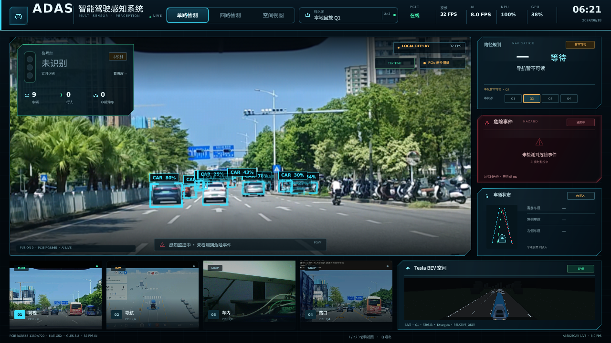

# B-05A-R — 模型误识别修复收尾

日期：2026-10-23  
分支：`research/rk3566-adas-models`  
模型：`bdd_yolov8n_512x288_int8_kl.rknn`

## 0. 结论

本轮把类别配置、rider 语义和部署文件纳入版本管理，并在 RK3566 上用完整 45 秒 Local Replay 做了短时验收。

仍需明确：

- BDD10 类别解码和最终 UI classId 映射已修复并验证；
- rider 已从普通 person 中拆出；
- 两轮车 0.85 阈值**证据不足，不能作为最终结论**；
- 主模型的 traffic light 目前仍是“从主检测结果删除”，不是理想的“保留感知、仅过滤 HUD”；
- 没有取得可信的同帧前后截图，不能用截图证明全部误检消失；
- 本轮观察到的 AI 离线主要来自 sidecar 的 Python 包路径/import 崩溃，不是已证实的 Qt socket 重连 bug。

## 1. 类别映射是否彻底修复、可否重复部署

### 已修复

1. `CompetitionDetector` 支持显式 `class_profile` / `class_names`，不再只靠文件名判断；
2. 新增 `competition_ai/model_profiles.py`：
   - `bdd10`: 10 类，校验数量和顺序；
   - `coco80`: 保留原 YOLO11n 兼容；
3. `ai_bridge.py` 增加 `--main-profile`，当前服务显式使用：
   ```text
   --main-profile bdd10
   ```
4. `RknnConsoleDetector` 将类别归一化为 UI 类别；
5. Qt 最终显示仍使用 `CLASS_IDS` 到 `classNameForId()` 的 UI classId，当前映射：
   ```text
   person=0, bicycle=1, car=2, motorcycle=3,
   bus=5, truck=7, traffic light=9, rider=10
   ```

### 部署一致性发现

板端实际 Python 包不是 `/home/cat/adas-edge-rect/competition_ai`，而是：

```text
ADAS_EDGE_ROOT=/home/cat/competition_cockpit_port_20261018
/home/cat/competition_cockpit_port_20261018/competition_ai
```

只在 `adas-edge-rect/competition_ai` 放 `model_profiles.py` 会导致 sidecar 启动报：

```text
ModuleNotFoundError: No module named 'competition_ai.model_profiles'
```

已把 `detector.py` 和 `model_profiles.py` 同步到实际 `ADAS_EDGE_ROOT` 包，并保留备份：

```text
/home/cat/competition_cockpit_port_20261018/competition_ai/detector.py.bak-b05ar
```

这是本轮最重要的部署一致性修复。

### 验证

`tests/test_b05a_bdd_postprocess.py` 覆盖：

```text
3=truck
6=motorcycle
7=bicycle
8=traffic light
9=traffic sign
profile 数量和顺序
rider 不被归为 person
```

结果：

```text
8 passed
```

## 2. 两轮车 0.85 阈值是否合理

**目前不能证明合理。**

B-03E 的 GT 只有：

```text
motorcycle: 4
bicycle: 2
```

KL 模型中：

```text
motorcycle AP50 = 0
bicycle AP50 = 0.126
```

0.85 阈值的作用是压掉当前最明显的“卡车→motorcycle 0.77”误检，但：

- 真实两轮车样本太少，无法证明 0.85 不会大量漏检；
- 对真实两轮车来说，0.85 很可能过高；
- 不能把“压掉误检”当成“阈值合理”。

因此当前 0.85 只能标记为**临时误检抑制**，不能作为 A 线最终参数。  
建议下一步用专门的两轮车视频/GT 做低阈值召回评估，再决定 0.5/0.6/0.7；本轮不强行定稿。

## 3. 主模型 Traffic Light 应如何与 Specialist 协作

应保留：

- 主模型 traffic light 作为**原始候选/感知证据**；
- Specialist 继续负责灯色和灯态；
- HUD/Tesla 只显示一套，按 `source=MAIN_RKNN/TL_SPECIALIST_RKNN` 和 IoU/几何关系去重；
- 主模型候选不能直接触发危险报警，必须经过 Specialist/绑定确认。

当前实现仍是：

```text
RknnConsoleDetector 中直接 continue 掉 MAIN_RKNN traffic light
```

这能消除蓝色路牌误报，但属于“从主模型结果中删除”，不是理想的“仅从 HUD 过滤”。  
本轮没有擅自改 A 线 Qt 连接/显示协议，防止引入重复框或影响正式逻辑。  
建议的最小改动是：

1. AI 结果保留 `source`；
2. `_detections_to_boxes` 只对 HUD/Tesla 跳过 `MAIN_RKNN + traffic light`；
3. Specialist 的 traffic light 以 IoU/最近灯壳绑定去重；
4. 不把主模型 traffic light 送进危险决策。

## 4. 同帧对比能否证明错误类别已修复

**不能证明全部错误已修复。**

本轮能证明：

- 类别 profile 单测通过；
- 当前板端 45 秒回放中，卡车显示为 car/truck，不再出现 0.77 的 MOTORCYCLE 框；
- 蓝色路牌不再出现 SIGNAL 框；
- 当前界面 9 个 car，AI 在线，Tesla 正常。

但不能提供可信的同帧前后证据：

- 上轮冻结 Publisher + 切换 AI sidecar 的截图出现 `AI sidecar 未连接`；
- 本轮没有伪造同帧结果，也没有用不同帧计算精度。

当前代表帧：



图中为当前完整 Local Replay，AI 8.0 FPS，车辆框均为 car，未再出现错误 motor/traffic-light 标签。

## 5. AI 重连问题是否定位

### 已定位的部分

本轮复现的“AI 离线”直接原因是 sidecar 启动失败：

```text
ModuleNotFoundError: competition_ai.model_profiles
```

原因是服务实际使用 `ADAS_EDGE_ROOT=/home/cat/competition_cockpit_port_20261018`，而 profile 只放在了 `/home/cat/adas-edge-rect`。  
同步到正确包并重启 sidecar 后，Qt 恢复接收，AI 8.0 FPS。

### 未能证明的部分

没有证据证明 Qt 的 UDP socket 在 sidecar 正常重启后必然失去重连能力。  
观察到的情况更准确地说是：

- sidecar 崩溃/重启期间 Qt 显示离线；
- sidecar 恢复后，Qt 需要一次 App 重启才稳定恢复；
- 当前 Qt AI 线程没有显式的 session/health 重置逻辑。

最小补丁建议（不在本轮改 A 线）：

- Qt AI 线程维护 `last_result_monotonic`；
- 超过 1 秒无结果时清空 `latestResultId` 和 AI 缓存框；
- 重新发送 `MVS1` 选择包和 `MVR2` 请求；
- sidecar 启动时打印 profile/class count，便于确认版本。

这属于连接健壮性改进，不是本轮已完成的修复。

## 6. 仍无法通过代码修复的真实模型误检

必须承认：

- BDD 模型会把部分卡车判成 motor（即使类别映射正确）；
- 会把蓝色路牌判成 traffic light；
- person/bicycle/motorcycle 的 AP 很低；
- 这些是模型域偏移/训练数据问题，不是 class_id 或 Qt 坐标 bug。

代码层只能：

- 正确解释类别；
- 过滤明显低质量/错误类别候选；
- 保留 UNKNOWN，不把未确认结果送进危险决策。

不能通过本轮代码修复全部模型误检。

## 7. RK3566 验收

当前：

```text
Qt：单实例
视频：LOCAL_REPLAY 完整 45 秒
AI：8.0 FPS
NPU：100%
Specialist：在线
OCR：保持配置
HUD / Tesla：在线
```

未覆盖正式权重，未修改全局 RKNN 环境，未重启整板。  
验收后服务与数据流正常。

## 8. 推荐

可以交给 A 线评审的配置：

```text
main-profile = bdd10
主模型 conf = 0.25
NMS = 0.45
rider 保留独立类别
main traffic light 仅 HUD 过滤（待实现 source-aware 去重）
Specialist 保留灯色
两轮车 0.85 仅为临时抑制，待两轮车专用数据复核
```

不建议：

- 把 0.85 宣称为最终两轮车阈值；
- 全局 conf 0.35；
- 永久从主模型删除 traffic light 而不保留感知候选；
- 把 rider 当普通 person 参与危险判断。

## 9. 交付文件

```text
competition_ai/model_profiles.py
competition_ai/b05a_postprocess.py
competition_ai/detector.py
tests/test_b05a_bdd_postprocess.py
research/rk3566_models/reports/B05A_R_final.md
research/rk3566_models/reports/assets/B05A_R_acceptance.png
```

没有提交模型权重、BDD 原图或大型视频。
