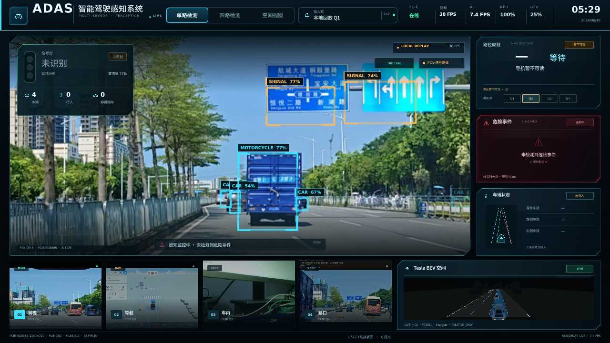
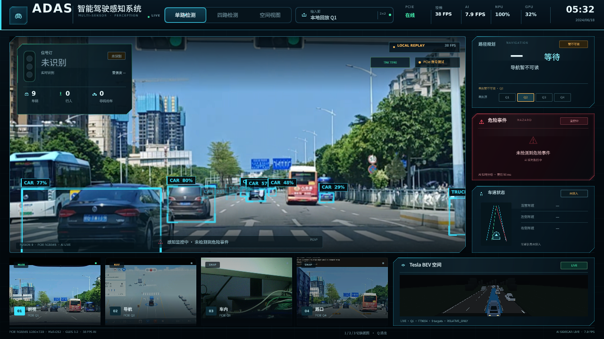

# B-05A — BDD YOLOv8n 误识别排查与快速优化

日期：2026-10-23  
分支：`research/rk3566-adas-models`  
模型：`bdd_yolov8n_512x288_int8_kl.rknn`（SHA256 `cf56189116c35d7af35b0669221b7e6a2b9f920eab14db45aaf87d318889af5e`）

## 1. 结论摘要

本轮误识别有两个独立来源：

1. **部署类别解码错误**：BDD 模型输出 10 类，但运行时代码用 COCO-80 的 `COCO_NAMES` 解释 class_id。  
   - BDD `3=truck` → 解释成 COCO `motorcycle`  
   - BDD `8=traffic light` → 解释成 COCO `boat`（被过滤）  
   - BDD `9=traffic sign` → 解释成 COCO `traffic light`  
   这直接造成“卡车变摩托、蓝色路牌变 SIGNAL”。

2. **BDD 模型本身的域偏移**：即使类别解码正确，模型仍会把部分卡车判成 motor、把路牌判成 traffic light。B-03E 的 KL holdout 中 motorcycle AP50=0、bicycle AP50=0.126，说明这两类不适合直接作为主模型输出。

处理方式：

- 主模型改为 BDD100K 类别解码；
- `pedestrian/rider → person`，`motor/motorcycle → motorcycle`，`bike/bicycle → bicycle`；
- 主模型不再输出 `traffic light`，红绿灯继续交给专用 Specialist；
- 主模型 `motorcycle/bicycle` 置信度低于 0.85 丢弃；
- 没有改模型、没有降低 AI 频率、没有删除 Specialist/OCR/Tesla/HUD。

## 2. P0 部署链路审计

### 2.1 类别映射

ONNX 元数据确认模型名称：

```text
0 person, 1 rider, 2 car, 3 truck, 4 bus,
5 train, 6 motor, 7 bike, 8 traffic light, 9 traffic sign
```

运行时代码修复前使用：

```python
COCO_NAMES[int(class_id)]
```

这是明确的 bug，不是阈值问题。

修复后的映射见：

```text
competition_ai/b05a_postprocess.py
```

### 2.2 letterbox / 坐标还原

`CompetitionDetector.infer()` 先 `letterbox_bgr`，解码后再用 `scale/px/py` 还原：

```python
(row[0] - px) / scale
(row[1] - py) / scale
```

板端截图中 bbox 与车辆/道路目标对齐，没有发现整体偏移或缩放错误。  
因此没有修改 RGB565、letterbox 或坐标恢复代码。

### 2.3 NMS / 置信度

B-03E 使用：

```text
NMS IoU = 0.45
conf = 0.25 / 0.35
match IoU = 0.5
```

当前运行时 NMS 默认也是 0.45，与评测口径一致。  
本轮没有改 NMS，也没有通过降低输入分辨率或跳帧制造指标。

### 2.4 Tracker

检查 `video_item.cpp`：

- 只从真实检测创建新 track，不创建纯预测目标；
- `kMaxMissed = 2`，最大 age 900 ms；
- 预测框会在 misses 内短暂显示，但不会无限保留；
- 类别不同的检测不会匹配同一 track；
- 回放 generation 变化会清空 track，避免上一轮尾部与下一轮首帧错误关联。

未发现 Tracker 把旧框长期保留的明确 bug。预测框最多持续约 2 个检测周期，是次要的“短时幽灵框”来源，不是本轮主因。

### 2.5 RKNN → Qt/Tesla

RKNN 检测经过：

```text
RKNN
→ RknnConsoleDetector
→ FrontPipeline
→ VideoItem Tracker
→ AiBoxModel
→ QML bbox / Tesla scene tracks
```

类别名在 `RknnConsoleDetector` 已确定；Tracker 保持 className；AiBoxModel 以 trackId 为稳定行。  
本轮错误框来自 RKNN 类别解释和模型误检，不是 Qt 坐标映射。

## 3. P1 阈值 A/B

数据来源：B-03E RK3566 板端预测缓存 + 固定 50 张 BDD holdout GT。  
这是有 GT 的固定集合，不是实时视频人工估数。

### 总体

| 配置 | TP | FP | FN | Precision | Recall | F1 |
|---|---:|---:|---:|---:|---:|---:|
| BDD KL conf 0.25 | 308 | 198 | 397 | 0.609 | 0.437 | 0.509 |
| BDD KL conf 0.35 | 258 | 95 | 447 | 0.731 | 0.366 | 0.488 |

### 分类别

| 类别 | conf 0.25 TP/FP/F1 | conf 0.35 TP/FP/F1 |
|---|---|---|
| car | 265 / 113 / 0.608 | 230 / 51 / 0.594 |
| truck | 5 / 6 / 0.417 | 5 / 3 / 0.476 |
| bus | 3 / 1 / 0.600 | 1 / 1 / 0.250 |
| person | 7 / 10 / 0.275 | 5 / 5 / 0.227 |
| motorcycle | 0 / 0 / 0 | 0 / 0 / 0 |
| bicycle | 0 / 0 / 0 | 0 / 0 / 0 |
| traffic light | 28 / 68 / 0.225 | 17 / 35 / 0.166 |

### 判断

**不建议全局 conf=0.35。**

- FP 198 → 95，确实减少 103 个误检；
- 但 TP 308 → 258，损失 50 个正确目标；
- Recall 43.7% → 36.6%，F1 50.9% → 48.8%；
- car F1 略降，bus/person/traffic-light 明显下降。

更合适的策略：

- car 可考虑单独 0.35（FP 113→51，F1 0.608→0.594）；
- person 保持 0.25；
- bus 保持 0.25；
- motorcycle/bicycle 主模型高阈值 0.85 或直接不依赖主模型；
- traffic light 主模型不输出，交给 Specialist。

## 4. 真实道路回放验证

固定回放：当前官方完整四宫格 Local Replay（1350 帧、45 秒、30 FPS），同一模型、同一 Qt、同一 AI 频率。

### 修复前代表帧



可见问题：

- 蓝色卡车被标成 `MOTORCYCLE 77%`；
- 蓝色道路指示牌出现 `SIGNAL 74%/77%`；
- 不是简单漏检，而是类别错和域偏移误检。

### 修复后代表帧



可见：

- 同一套 HUD/Tesla/AI 下，路牌上的 SIGNAL 消失；
- 卡车不再显示 MOTORCYCLE；
- 保留 car/truck 等车辆框；
- 没有为了 FPS 删除检测框。

说明：以上是**代表性不同时间帧**，不是同一时间戳。  
我尝试冻结 Publisher 后做同帧 A/B，但切换 AI sidecar 后 Qt AI 线程需要重启，截图出现 `AI sidecar 未连接`，因此没有把该组当作精度证据；精度数字使用 B-03E 固定 GT，不用这些截图计算。

### 人工核查限制

- 真实道路视频没有逐帧 GT，不能给出 TP/FP/Recall/F1；
- 只统计明显错误类别/路牌误报并保存截图；
- 没有把人工观感包装成精度指标。

## 5. P3 最终修复

### 5.1 BDD 类别解码

运行时代码：

```text
/home/cat/adas-edge-rect/competition_ai/detector.py
```

改为模型名包含 `bdd` 时使用 BDD_NAMES，否则保持 COCO_NAMES，兼容旧 YOLO11n。

### 5.2 UI 类别归一化与主模型过滤

运行时代码：

```text
/home/cat/competition_cockpit_port_20261018/tools/competition_console/rknn_detector.py
```

逻辑：

```python
pedestrian/rider -> person
motor/motorcycle -> motorcycle
bike/bicycle -> bicycle
traffic sign -> drop
main traffic light -> drop
main motorcycle/bicycle < 0.85 -> drop
```

Specialist 的 traffic light 输出不受影响。

### 5.3 备份和回滚

板端备份：

```text
/home/cat/adas-edge-rect/competition_ai/detector.py.bak-coco
/home/cat/competition_cockpit_port_20261018/tools/competition_console/rknn_detector.py.bak-beforefilter
```

若要回滚类别映射：

```bash
cp detector.py.bak-coco detector.py
cp rknn_detector.py.bak-beforefilter rknn_detector.py
sudo systemctl restart adas-ai-bridge
```

## 6. 性能与回归

当前板端运行：

```text
模型：bdd_yolov8n_512x288_int8_kl
AI：约 7.9–10 FPS
Qt：单实例
视频：LOCAL_REPLAY 完整 45 秒
HUD / Tesla / bbox：正常
```

类别过滤不改变 RKNN 推理次数，也不改变视频路径；没有观察到 AI FPS 或视频 FPS 的额外退化。  
本轮没有做严格的优化前后 30 秒整机性能对照，因此不宣称性能提升；只确认修复没有引入新的模型加载或运行错误。

## 7. 推荐交给 A 线的配置

建议：

```text
主模型：BDD YOLOv8n KL 512x288
主模型全局 conf：0.25
类别解码：BDD100K 10 类
主模型 traffic light：不输出
主模型 motorcycle/bicycle：conf < 0.85 丢弃
交通灯：保留 Specialist，不依赖主模型
Specialist conf：0.05（不变）
NMS：0.45（不变）
```

不建议：

- 全局 conf 0.35；
- 删除 person/bus 等类别；
- 关闭 Specialist；
- 用降低 AI 频率换取 FPS。

## 8. 交付文件

研究分支新增：

```text
competition_ai/b05a_postprocess.py
tests/test_b05a_bdd_postprocess.py
research/rk3566_models/reports/B05A_false_positive_fix.md
research/rk3566_models/reports/assets/B05A_before_filter.png
research/rk3566_models/reports/assets/B05A_after_filter.png
```

没有提交模型权重、BDD 原图或大型视频。
