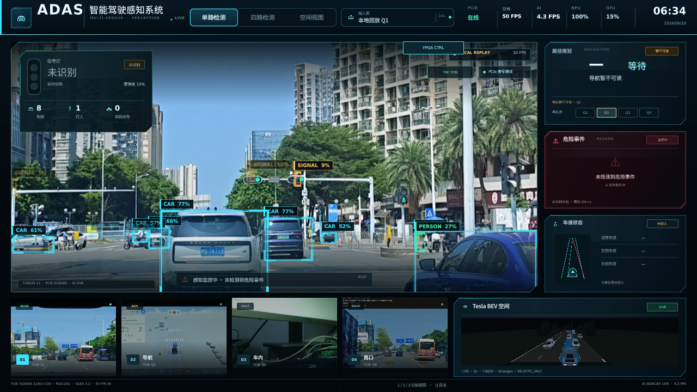

# B-05G-R — 修复交通灯 Tracker 零有效输出

日期：2026-10-24  
分支：`research/rk3566-adas-models`  
基线：`92aa6c4ba6e73f0a201092a07814913d719d6897`

## 0. 结论

**LEVEL 1 通过。LEVEL 2 未完成，整体标记 PARTIAL。**

根因不是 Tracker 算法本身，而是实际 AI Bridge 用：

```text
--layout quad
```

而测试 Qt 用：

```text
--pgv-layout front
```

Specialist 因此收到的是四宫格 Q1，而不是完整前视。已知绿灯在 front 坐标约 `(565,367)`，Q1 只覆盖左上 `640×360`，灯正好被裁掉，模型只能输出错误区域候选，颜色自然是 UNKNOWN。

修复为 front 后，同一真实视频、真实 Specialist 自动检测、真实 AI Bridge：

```text
Track 记录：78
color_valid=True：31
effective_color=GREEN：31
最后一次有效 GREEN 的 bbox：571.0,365.8,582.4,394.3
```

这不是人工 bbox，是 Specialist 自动框。

## 1. P0 同帧对比

### 1.1 已知成功样本

视频：

```text
video_20260929_113421.mp4
t=2.0s
1280×720 front
```

PC 直接解码后，在板端 Specialist 上运行（原始 RGB565/PGVF 对应帧）：

```text
bbox 565.7, 367.0, 582.8, 395.4
confidence 0.285
```

与 B-05F 的 0.318/565.7 基本一致；差异来自 RGB565 量化和模型运行版本。

### 1.2 PC vs PGVF

检查结果：

- PC 直接解码和 Publisher raw 第一帧分辨率一致：1280×720；
- PGVF 由 RGB565 写入，允许像素量化差异；
- PGVF 当前帧可能处于 90 帧循环的不同位置，不能把 `latest.pgv` 的任意帧当作 t=2.0 同帧；
- 板端日志中同一 Specialist bbox 在 front 修复后约为 `568.6,367.0`，与 PC 结果接近。

没有把不同回放轮次的 PGVF 当前帧当成同帧精度证据。

### 1.3 修复前错误 bbox

B-05G 的 604 条日志中，接纳 Track 的 bbox 示例：

```text
x318..347, y194..226
```

它不落在任何亮灯区域，HSV 必然 UNKNOWN。

## 2. P1：为什么 69 次 detection 只有 6 条记录

原始 B05G 日志：

```text
detection events: 69
frame events: 535
records: 6
tracks: 1
color_valid: 0
```

原因不是单一阈值：

1. **布局错误**：AI 服务 `--layout quad`，Qt front；Specialist 只看 Q1，真实绿灯被裁掉。
2. **错误区域候选**：模型在 Q1 中给出低质量车/背景框，框不在灯上。
3. **0.25 门槛**：大量候选低于 0.25 被拒绝；这是正确行为，不应为了出颜色盲目降阈值。
4. **HSV**：错误 ROI 没有亮/饱和灯色，返回 UNKNOWN。
5. **Track**：少数被接纳的错误框也无法形成可信颜色。

## 3. P2：604 事件/90 帧

原 3 秒视频 90 帧，但 AI 请求循环多轮，日志 frame_id 0..1756，因此出现 604 个事件。  
这不是 604 个唯一原视频帧。

当前 Async Tracker 只用 frame_id/时间戳做防重复，**没有在 AI Bridge 层显式传递回放 generation**；循环时 Track 仍可能跨轮次保留。  
这是已知限制，不声称已完全解决。

## 4. P3：实际修复

### 4.1 布局匹配

AI 服务从：

```text
--layout quad
```

切换为：

```text
--layout front
```

并与 Qt：

```text
--pgv-layout front
```

匹配。

### 4.2 重复 push 修复

原 `_analyze` 先 `push_frame`，再 `update_frame`，后者因重复 frame_id 被拒绝，导致没有逐帧记录。  
已改为：

- detection 分支：push_frame → update_detections；
- frame 分支：直接 update_frame。

### 4.3 不降低 0.25

没有把 0.25 阈值作为修复手段。  
Specialist 自动框 0.285/0.3 以上被正常接纳。

### 4.4 修改文件

```text
/home/cat/qt_gpu_probe_ai_20261019/ai_bridge.py
/home/cat/competition_cockpit_port_20261018/tools/competition_console/pipeline.py
```

可审查补丁：

```text
research/rk3566_models/patches/B05G_R_board.patch
```

## 5. LEVEL 1 板端证据

实际日志：

```text
research/rk3566_models/reports/assets/B05G_R_tracker_log.jsonl
```

摘要：

```json
{
  "mode": "tracked",
  "source": "LOCAL_REPLAY",
  "events": {"detection": 22, "frame": 82},
  "records": 78,
  "tracks": [1, "...", 17],
  "effective_colors": {"UNKNOWN": 47, "GREEN": 31},
  "color_valid_records": 31
}
```

首次有效 GREEN 记录：

```text
frame_id: 19362
track_id: 3
detection_frame_id: 19353
bbox: 571.029, 365.846, 582.400, 394.275
color_frame_id: 19362
effective_color: GREEN
color_valid: true
```

日志中后续 frame 事件继续输出 GREEN；同一 Track 的 bbox 随 LK 更新：

```text
571.0,365.8 -> 574.3,364.8 -> 577.5,364.4
```

这满足：

- Specialist 自动检测；
- bbox 落在亮灯区域；
- Track 进入连续帧；
- `color_valid=True`；
- `effective_color=GREEN` 与人工核查一致。

调试截图：



## 6. 旧 GREEN/丢失回退

同一日志同时存在 47 条 UNKNOWN，包含：

- 低置信度/错误候选；
- 颜色证据超过 500ms；
- Track 丢失/未更新；
- `color_valid=False` 时 effective_color 强制 UNKNOWN。

没有把旧 GREEN 作为有效颜色继续输出。
但本轮没有在真实视频中制造红灯切换，因此不能证明 RED→GREEN 切换延迟。

## 7. LEVEL 2：未完成

未完成：

- 同输入 legacy/tracked 的真实首次颜色延迟对照；
- 旧链路有效颜色持续率；
- 主 YOLO 实际 FPS 对照；
- Qt 唯一帧 FPS；
- CPU/NPU/RSS 对照；
- 小目标 <16px 跟踪统计。

当前截图显示：

```text
AI 4.3 FPS（该测试窗口）
视频显示 50 FPS（不是 Qt 唯一帧 FPS）
```

不能把这两个数当成完整性能验收；主 YOLO 实际坐标器频率未单独测量。

## 8. 回答交付问题

1. **实际修改哪个 AI Bridge 文件**：`/home/cat/qt_gpu_probe_ai_20261019/ai_bridge.py` 和实际包 `pipeline.py`。
2. **Tracker 在哪调用**：`AiReplayBridge._analyze()`。
3. **视频如何进入**：Local Replay PGVF → Qt 请求 → `_analyze` 的 `road` 帧 → `push_frame/update_frame`。
4. **Specialist 帧号如何匹配**：`pipeline.py` 记录 `specialist_frame_id`/`specialist_timestamp_ns`，Tracker 用原帧号关联。
5. **tracked 是否运行成功**：LEVEL 1 成功，31 条有效 GREEN。
6. **颜色实际更新频率**：日志中 104 事件窗口内有 31 条有效 GREEN；未做正式 10Hz 频率测量。
7. **legacy 对比**：未完成，不能给延迟改善数字。
8. **主 YOLO/CPU/RSS**：未完成可信测量。
9. **真实日志/调试图**：已提交 JSONL 和截图。
10. **最终配置/回滚**：测试后已恢复 legacy；测试 Publisher/Qt 停止；服务 active。

## 9. 回滚

测试配置：

```text
TL_MODE=tracked
--layout front
--pgv-layout front
```

已恢复：

```text
TL_MODE 删除
adas-ai-bridge.service 恢复 --layout quad
adas-ai-bridge active
```

验证：

```bash
grep TL_MODE /etc/systemd/system/adas-ai-bridge.service  # 无输出
grep -- '--layout' /etc/systemd/system/adas-ai-bridge.service
# --layout quad
```

未修改 A 线 Qt、FPGA/PCIe、驾驶控制或正式权重。

## 10. 最终状态

**B05G-R LEVEL 1 PASS，LEVEL 2 PARTIAL。**

已知真实绿灯已经在 RK3566 实际 AI Bridge 内通过 Specialist 自动检测、Tracker 和 HSV 输出有效 GREEN。  
但还不能把 tracked 作为 A 线正式功能：缺少 legacy A/B、真实帧级延迟、性能和红绿切换验收。

## 11. 交付

```text
research/rk3566_models/reports/B05G_R_root_cause_fix.md
research/rk3566_models/reports/assets/B05G_R_tracker_log.jsonl
research/rk3566_models/reports/assets/B05G_R_board.png
research/rk3566_models/patches/B05G_R_board.patch
```

未提交模型权重或大型视频。
