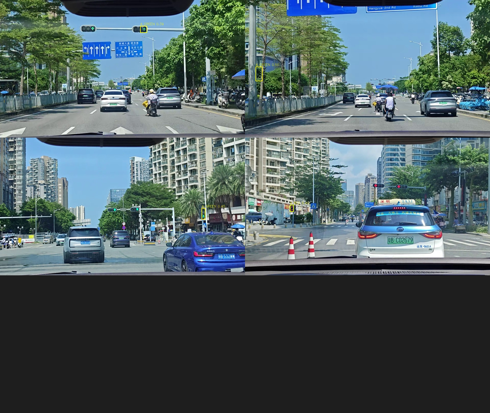
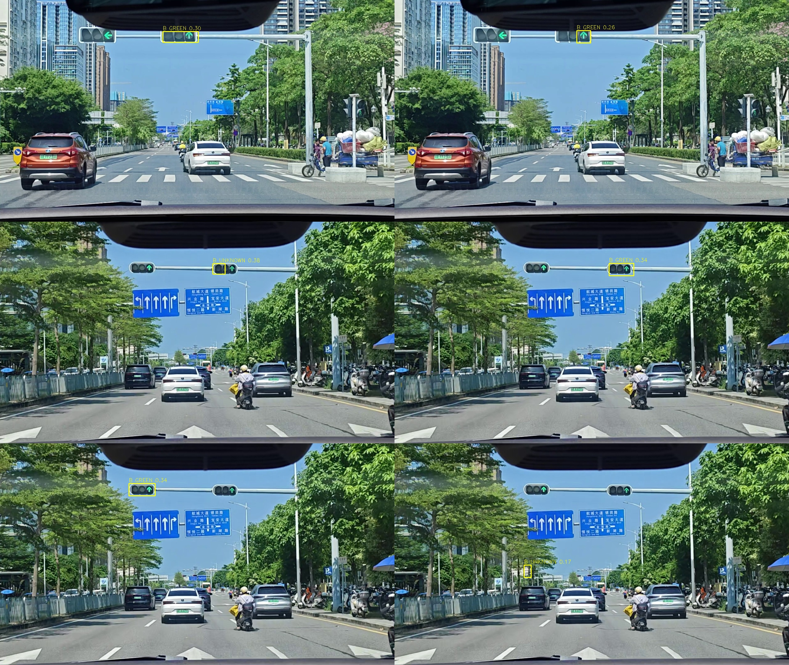

# B-05H — 比赛视频交通灯全自动标注与数据集建设

日期：2026-10-24  
分支：`research/rk3566-adas-models`

## 0. 结论

本轮完成了**自动抽帧、双教师候选、自动分组、YOLO 标签、独立真实 GT 索引**。

但**没有达到可开展 Specialist 微调的条件**：

```text
A 可信标签：4
B 待复核：43
C 误检/困难背景：0
```

A 组只有 4 个框，远不足以训练；B 组不能未经复核直接作为训练标签；没有可信的 C 组负样本。  
本轮**没有伪造人工 GT**，也没有把当前 Specialist 预测称为真实 GT。

## 1. 实际处理视频

```text
video_20260929_113421.mp4  (0–13 s, 2 fps 抽取)
video_20260929_112507.mp4  (0–20 s, 1 fps)
video_20260929_113539.mp4  (0–20 s, 1 fps)
video_20260929_112739.mp4  (0–15 s, 1 fps)
```

处理：

- FFmpeg/OpenCV 抽帧；
- 1280×720；
- dHash 去重（Hamming ≤4 丢弃）；
- 按原视频分组，记录 `video / timestamp_s / source_frame_id`。

结果：

```text
去重后帧：62
```

113421 的静态画面去重后只保留 7 帧，避免大量近似绿灯重复。

## 2. 自动标注流水线

### 教师

- Specialist：`tl_specialist_512x192_hybrid2.rknn`，前视上 60% ROI；
- BDD KL：`bdd_yolov8n_512x288_int8_kl.rknn`，class_id 8；
- 两者独立推理，保存原始 bbox/置信度。

### 自动分组规则

A（可信）：
- Specialist conf ≥0.30；
- 且 BDD IoU≥0.30、BDD conf≥0.10；
- 或 Specialist conf≥0.50；
- bbox 有效、去重后。

B（待复核）：
- Specialist 0.15–0.30；
- 或 BDD-only ≥0.25；
- 或 A 规则未满足的候选。

C（负样本/误检）：
- 只有可靠证据（例如蓝色路牌比例高）才生成；
- 本轮没有命中可信 C，**C=0**，没有把未检出自动当背景。

### 输出

```text
D:\Datasets\adas_edge_training\b05h_auto_annotation_20261024\
  pseudo/                 A-only dataset.yaml
    images/{train,val,test}
    labels/{train,val,test}
    pending/              B-only dataset.yaml
  real_gt/                BDD human GT, test only
  meta/
    pseudo_labels.json
    audit.json
    index.json
    contact_A.jpg
    contact_B.jpg
```

## 3. 数量

### 伪标签

```text
总框：47
A：4
B：43
C：0
```

按视频：

```text
A: 112507 2, 113421 1, 113539 1
B: 112507 7, 112739 13, 113421 10, 113539 13
```

### 尺寸

| 尺寸 | 数量 |
|---|---:|
| <8 px | 0 |
| 8–16 px | 8 |
| 16–32 px | 26 |
| >32 px | 13 |

8–16px 小灯全部在 B 组，没有被强行放进 A。

### 颜色

| 颜色 | 数量 |
|---|---:|
| GREEN | 26 |
| RED | 6 |
| YELLOW | 4 |
| UNKNOWN | 11 |

颜色来源统一标记：

```text
HSV_UNVERIFIED
```

没有比赛视频的颜色人工 GT；这些颜色不能当作颜色训练真值。

## 4. 真实 BDD GT（独立）

单独索引：

```text
real_gt/
  50 张固定 BDD holdout
  154 个 human traffic-light boxes
  colors: green 81, red 33, yellow 3, none 37
```

这一组只用于独立评估，**没有混入 pseudo 训练集**。

## 5. 自动质量检查

```text
越界框：0
近重复框对：0
标签类别：0 traffic light
A 主标签：4
B pending 标签：43
```

标签坐标格式：

```text
0 x_center y_center width height
```

主 `dataset.yaml` 只引用 A：

```yaml
path: D:\Datasets\adas_edge_training\b05h_auto_annotation_20261024\pseudo
train: images/train
val: images/val
test: images/test
names:
  0: traffic light
```

B 独立：

```text
pseudo/pending/dataset.yaml
```

## 6. 审计图

A 组（4 个可信框）：



B 组（待复核，含绿灯、红灯、黄灯、UNKNOWN）：



审计图显示：

- A 组框落在亮灯区域；
- B 组包含明显绿灯/红灯，但也有框偏到灯壳/背景的候选，不能直接进训练；
- 没有把 B 组自动升级为 A。

## 7. 回答交付问题

1. **处理视频**：4 段比赛道路视频。
2. **抽帧**：62 个去重帧。
3. **自动框**：47 个伪标签框。
4. **A/B/C**：A 4，B 43，C 0。
5. **尺寸**：<8=0，8–16=8，16–32=26，>32=13。
6. **颜色**：GREEN 26，RED 6，YELLOW 4，UNKNOWN 11；全部 HSV_UNVERIFIED。
7. **主要教师**：Specialist + BDD 双教师共识；没有独立高精度教师。
8. **缺乏独立验证的标签**：B 组 43 个全部缺少独立验证；A 组也只有双教师共识，不等于人工真值。
9. **是否达到微调条件**：**没有**。A 只有 4 个框，B 未复核，C 为空；不能用于正式训练。

## 8. 限制

- 没有 4090/高精度教师可用；Specialist/BDD 均有域偏移；
- 没有比赛视频颜色人工 GT；
- B 组没有自动图像理解审核，保持待复核；
- C 组为空，数据集缺少可靠负样本；
- 主数据集 A 太小且验证组 A 为空，当前 `dataset.yaml` 仅作为索引/流程验证，不应直接启动训练；
- 伪标签不能用于宣称准确率提升。

## 9. 复现

```text
tools/b05h_extract.py
tools/b05h_teachers.py
tools/b05h_build_dataset.py
tools/b05h_split_audit.py
tools/b05h_real_gt.py
```

数据目录保留在：

```text
D:\Datasets\adas_edge_training\b05h_auto_annotation_20261024
```

GitHub 只提交脚本、索引、审计图和报告，不提交图像/数据集。

## 10. 交付

```text
research/rk3566_models/reports/B05H_auto_annotation.md
research/rk3566_models/reports/assets/B05H_dataset_index.json
research/rk3566_models/reports/assets/B05H_contact_A.jpg
research/rk3566_models/reports/assets/B05H_contact_B.jpg
tools/b05h_*.py
```

本轮没有训练、没有替换 Specialist、没有改 RK3566 正式模型/Qt/FPGA/PCIe。
