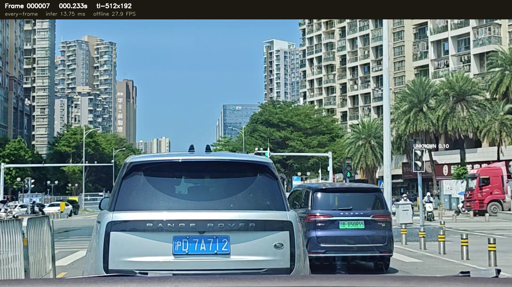
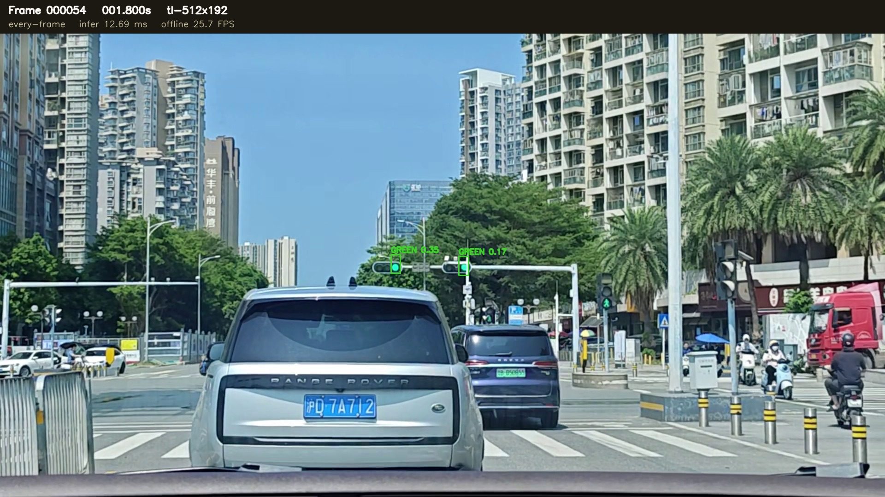
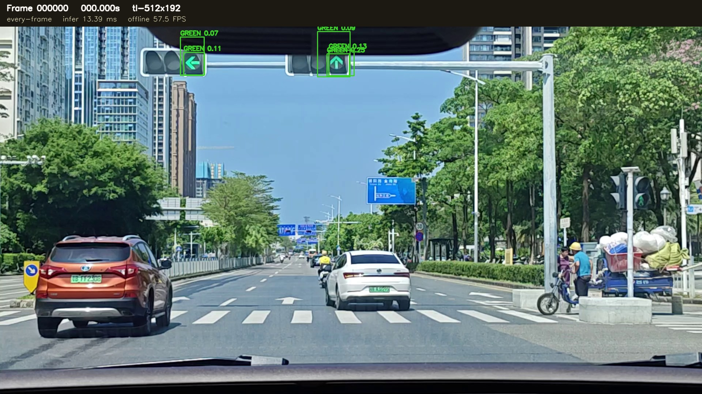

# B-05K PC 视频验证报告

日期：2026-10-24<br>
分支：`research/rk3566-adas-models`<br>
基线：`f362b88ec37a7edeedd1931dd3569dc4ff59ade6`

## 结论

本轮 PC 阶段已完成。四段官方视频均能被 Windows RTX 4060 电脑逐帧读取、推理并写出带框 MP4；同源 ONNX 也已通过直接 `onnxruntime.InferenceSession` 运行。PyTorch 和 ONNX 使用同一帧、同一网络张量、同一解码/NMS，参考视频的 1,300 个解码框全部一对一对应，平均 IoU 为 `0.999734`，没有未匹配框。

当前模型仍有明显远距离候选不稳定、蓝色路牌/车尾灯/车内导航屏误检和颜色 UNKNOWN。视频没有人工逐帧 GT，因此以下视频时间只能说明“模型候选出现/消失”，不能冒充 Recall 或颜色准确率。BDD50 的固定人工 GT 评估单独报告。

## 数据、模型与管线

实际四段素材是 `1920x1080@30 FPS`，不是文件名之外假定的 `1280x720`。代码按每帧实际尺寸取顶部 `60%` ROI，再生成 `512x192` RGB/NCHW/Float32/`1/255` 输入，并把框逆变换回原始画布坐标。模型由 `D:\Datasets\adas_edge_training\tl_specialist\manifest.json` 按 SHA-256 解析：

| 后端 | 文件 | SHA-256 | 运行设备 |
|---|---|---|---|
| PyTorch | `tl_specialist\tl-512x192\weights\best.pt` | `f5fc9c2b...feb6ce2c` | `cuda:0`, RTX 4060 Laptop |
| ONNX Runtime | `tl_specialist\tl_specialist_512x192.onnx` | `7188a00d5...3da4ca4` | `CPUExecutionProvider` |

ONNX 输入输出实测为 `[1,3,192,512] -> [1,5,2016]`。输出置信度行已经是概率，解码时没有再次 sigmoid。每帧 JSON 记录原始帧号、视频时间、尺寸、后端、输入哈希、框、置信度、颜色、`color_valid`、推理耗时；1 Hz 模式另外记录采样检测和 Tracker 轨迹，旧检测不会伪装成当前帧的新检测。

可复用入口：

```powershell
python tools/b05k_video_benchmark.py `
  --video "D:\BaiduNetdiskDownload\紫光同创杯赛题三参考素材\video_20260929_113421.mp4" `
  --model-manifest "D:\Datasets\adas_edge_training\tl_specialist\manifest.json" `
  --backend pytorch --preprocess letterbox --conf 0.05 `
  --output "D:\Datasets\adas_edge_training\b05k_pc_validation\videos\annotated_pytorch\video_20260929_113421.mp4" `
  --visualize --save-json
```

把 `--backend` 改为 `onnx` 即可运行固定形状 ONNX；`--preprocess resize` 运行直接 Resize 对照；`--schedule 1hz --conf 0.25` 运行与既有 B-05E Tracker 分开的采样模式。

## 四段官方视频

完整 MP4 和逐帧 JSON 保存在本机：
`D:\Datasets\adas_edge_training\b05k_pc_validation\videos\`。`annotated_pytorch` 是逐帧 Letterbox，`annotated_onnx` 是逐帧 ONNX，`annotated_pytorch_resize` 是逐帧直接 Resize，`annotated_pytorch_1hz` 是 PyTorch 1 Hz 采样加已有 Tracker。所有每帧标注包含帧号、时间、模型名、颜色、置信度和真实测得的离线处理 FPS。

| 视频 | 解码帧/时长 | PyTorch Letterbox 首候选 | PyTorch 首个 `conf>=.25` | PyTorch 均值推理 | ONNX 首个 `conf>=.25` | 最长无候选区间* |
|---|---:|---|---|---:|---|---|
| `113421` | 392 / 13.03 s | 0.233 s, UNKNOWN | 1.800 s, GREEN | 12.96 ms | 1.800 s, GREEN | 0.400–0.800 s |
| `112507` | 1,349 / 44.93 s | 0.000 s, GREEN | 0.000 s, GREEN | 12.56 ms | 0.000 s, GREEN | 32.733–33.467 s |
| `113539` | 2,315 / 77.13 s | 0.000 s, UNKNOWN | 0.067 s, UNKNOWN | 12.63 ms | 0.067 s, UNKNOWN | 17.433–18.900 s |
| `112739` | 2,776 / 92.50 s | 0.000 s, GREEN | 0.000 s, GREEN | 12.76 ms | 0.000 s, GREEN | 34.967–35.533 s |

\*“无候选区间”是 `conf=0.05` 下模型没有输出框的区间，不等于已证实的交通灯漏检。完整区间列表在 `assets/B05K/video_detection_timeline.json`。

逐帧 PyTorch 颜色计数如下，`UNKNOWN` 是明确保留的未知状态，不强制猜色：

| 视频 | RED | GREEN | YELLOW | UNKNOWN | 离线处理 FPS |
|---|---:|---:|---:|---:|---:|
| `113421` | 66 | 1,165 | 89 | 465 | 27.14 |
| `112507` | 117 | 1,408 | 28 | 1,532 | 27.04 |
| `113539` | 1,076 | 1,703 | 976 | 2,235 | 27.48 |
| `112739` | 2,084 | 1,941 | 339 | 4,675 | 27.16 |

这些颜色计数是模型观察结果，不是颜色准确率。没有视频级颜色 GT，不能据此声称红绿黄 Recall。

## 可核验的视觉片段

以下关键帧已提交到报告资产，完整 MP4 留在本机：








人工视觉复核得到的结论：`113421` 的 0.233 s 框先落在远处信号灯区域但颜色 UNKNOWN，1.800 s 已能看到两个真实顶部信号灯且判为 GREEN；`112739` 的 0 s GREEN 框落在车内导航屏，属于可见误检；`113539` 的 0–0.067 s 候选包含蓝色路牌和车辆尾灯区域，不能作为真实信号灯；`112507` 首帧的顶部箭头灯为可见真实信号灯。没有人工 GT 的其他帧只保留为候选记录。

## PyTorch / ONNX 一致性

在 `video_20260929_113421.mp4` 的 392 帧上，完全相同的输入张量实例发送给两个后端：

| 项目 | 结果 |
|---|---:|
| Raw 输出最大绝对差 | 0.740112（第 162 帧） |
| 最大差帧的 Raw 平均绝对差 | 0.002564 |
| 解码框匹配数 | 1,300 |
| 平均框 IoU | 0.999734 |
| 平均坐标绝对误差 | 0.0033 px |
| 平均置信度绝对误差 | 0.0001105 |
| 未匹配 PyTorch / ONNX 框 | 0 / 0 |

Raw 中有一个较大的单值差，但它没有造成解码框差异；因此目前没有证据把问题归因于量化。逐帧 ONNX 视频也都成功生成，且在共同 `conf=0.05` 下四段视频的总候选数与 PyTorch 相差不超过 4 个。由于 ONNX Runtime 本机只有 CPU provider，9.25–9.77 ms 的 ONNX 推理时间不能与 RTX 4060 上的 PyTorch 时间直接作硬件性能结论。

## Letterbox / 直接 Resize 对照

BDD50 固定人工 GT 共 50 张图、154 个交通灯，其中 150 个在顶部 60% ROI 内、4 个在 ROI 外，ROI 覆盖率 `150/154=97.40%`。以下 operating point 固定 `conf=0.25`、匹配 IoU `0.5`，AP50 候选下限 `0.001`；尺寸组使用原图像素宽度。

| 模型/输入 | AP50 | TP | FP | FN | Precision | Recall |
|---|---:|---:|---:|---:|---:|---:|
| 源 Specialist PyTorch + Letterbox | 0.3879 | 59 | 42 | 91 | 0.5842 | 0.3933 |
| 源 Specialist PyTorch + 直接 Resize | 0.3779 | 62 | 47 | 88 | 0.5688 | 0.4133 |
| 源 Specialist ONNX + Letterbox | 0.3879 | 59 | 42 | 91 | 0.5842 | 0.3933 |
| `candidate_clean` PyTorch + Letterbox | 0.3862 | 58 | 45 | 92 | 0.5631 | 0.3867 |
| `candidate_clean` PyTorch + 直接 Resize | 0.3979 | 65 | 47 | 85 | 0.5804 | 0.4333 |

源 Specialist 的 Letterbox AP50 更高且 FP 更少；直接 Resize 在固定 operating point 多找到了 3 个 TP，但也多了 5 个 FP。`candidate_clean` 对直接 Resize 更有利，说明它的输入分布和源模型不同，但这不足以直接修改 RK3566 预处理。当前建议保留部署 Letterbox，继续用 A/B 结果指导下一轮训练或重新校准。

源 Specialist Letterbox 的尺寸组为 `<8`: `1/17`、`8–16`: `26/80`、`16–32`: `28/47`、`>32`: `4/6`，合计 `59`，与总 TP 一致；直接 Resize 为 `1+27+29+5=62`，也与总 TP 一致。评估器按每张图一对一匹配、全局置信度排序计算 AP50，修复了同一预测框重复匹配多个 GT 的问题。

## 1 Hz 模拟

1 Hz 结果保存在 `videos/annotated_pytorch_1hz/`，采样检测与 Tracker 轨迹分开统计：

| 视频 | 源帧 | Specialist 推理帧 | 新检测框 | 轨迹颜色帧 RED/GREEN/YELLOW/UNKNOWN | 首个可信候选 |
|---|---:|---:|---:|---|---|
| `113421` | 392 | 14 | 12 | 0 / 312 / 0 / 11 | 2.000 s GREEN |
| `112507` | 1,349 | 45 | 18 | 0 / 226 / 0 / 389 | 0.000 s GREEN |
| `113539` | 2,315 | 78 | 26 | 177 / 211 / 63 / 439 | 4.000 s UNKNOWN |
| `112739` | 2,776 | 93 | 36 | 320 / 173 / 0 / 619 | 0.000 s GREEN |

轨迹帧计数包含 Tracker 延续的旧观测，不能与“新检测框”相加当作模型推理次数。113421 在 1 Hz 下比逐帧可信 GREEN 晚约 0.2 s，说明采样调度确实会改变首次可见时间。

## B-05J 旧 RKNN 数字矛盾

旧 `assets/B05J_metrics.json` 中 RKNN 记录为总 TP `49`，而尺寸组 TP 为 `1+26+28+5=60`。这两个数字不能来自同一份严格一对一匹配结果。B-05K 的新评估器已经证明自身 PyTorch/ONNX 结果的尺寸组和总体 TP 一致，但本轮禁止连接 RK3566、重新跑 RKNN 或修改板端，因此没有伪造一个“修正后的 RKNN TP”。旧 RKNN 数字只能保留为历史参考，必须在后续使用同一预测记录和新评估器重算。

## 十项问题的直接回答

1. **四段是否全部成功？** 是。四段 PyTorch、四段 ONNX 逐帧 MP4 均成功，帧数分别为 392、1,349、2,315、2,776。
2. **PyTorch 效果？** 能稳定处理并在近路口找到真实灯，但远距离候选、UNKNOWN 和误检明显；113421 的可视确认 GREEN 为 1.800 s。
3. **ONNX 是否成功？** 是。固定 `[1,3,192,512]` 直接运行，四段均输出 MP4，BDD50 Letterbox 指标与 PyTorch 相同到报告精度。
4. **同帧差异？** 参考 392 帧 1,300 框全部匹配，平均 IoU 0.999734，0 个未匹配框。
5. **哪种预处理更适合？** 源 Specialist 目前保留 Letterbox；直接 Resize 的 operating-point Recall 略高但 AP50 更低、FP 更多。`candidate_clean` 的结果提示训练输入分布需要单独分析。
6. **BDD50 结果？** 源 PyTorch Letterbox `AP50=0.3879, TP/FP/FN=59/42/91`；ROI 外 4 个 GT 另行计数，没有混入 ROI 指标。
7. **旧 RKNN 矛盾？** 已确认 `49` 与尺寸组 `60` 不一致，但本轮不重跑 RKNN，不编造修正值。
8. **远距离最早何时？** 113421 的首个低置信度 UNKNOWN 候选为 0.233 s，首个视觉确认 GREEN 为 1.800 s；其他视频首帧就有候选，但 113539/112739 的关键帧显示为误检或 UNKNOWN，不能直接当真实灯时间。
9. **仍漏检/误检在哪里？** 报告记录了最长无候选区间；可视确认的误检包括 112739 车内导航屏、113539 蓝色路牌和车尾灯。没有视频 GT，不能把这些区间换算为 Recall。
10. **下一步？** 先继续训练/数据清洗和输入分布分析，特别是小目标、路牌/尾灯负样本和颜色 UNKNOWN；暂不进入 RKNN 部署，等 PC 候选稳定后再做板端验收。

## 交付文件

- 工具：`tools/b05k_video_benchmark.py`、`tools/b05k_runtime.py`、`tools/b05k_common.py`、`tools/b05k_evaluate.py`、`tools/b05k_compare.py`
- 测试：`tests/test_b05k_common.py`、`tests/test_b05k_video_benchmark.py`
- 证据 JSON：`assets/B05K/` 下的 BDD50、A/B、视频时间线、Parity 和环境记录
- 关键帧：`assets/B05K/keyframes/`
- 本地完整视频：`D:\Datasets\adas_edge_training\b05k_pc_validation\videos\`
- 本地运行日志：`D:\Datasets\adas_edge_training\b05k_pc_validation\logs\runtime.csv`

完整 MP4、逐帧 CSV 和本地详细 JSON 不提交 GitHub，以免把大型视频和机器相关运行产物带入仓库。
