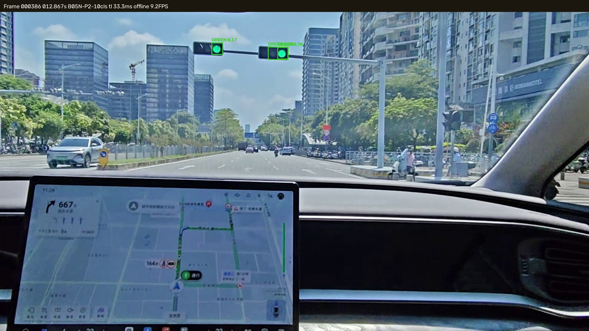
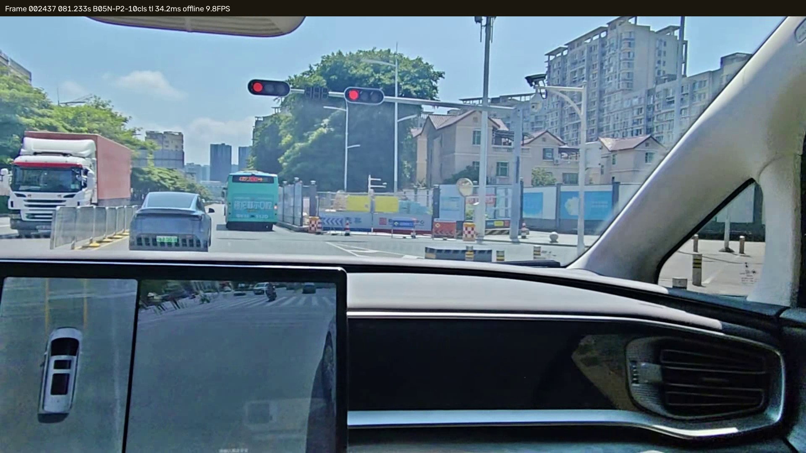
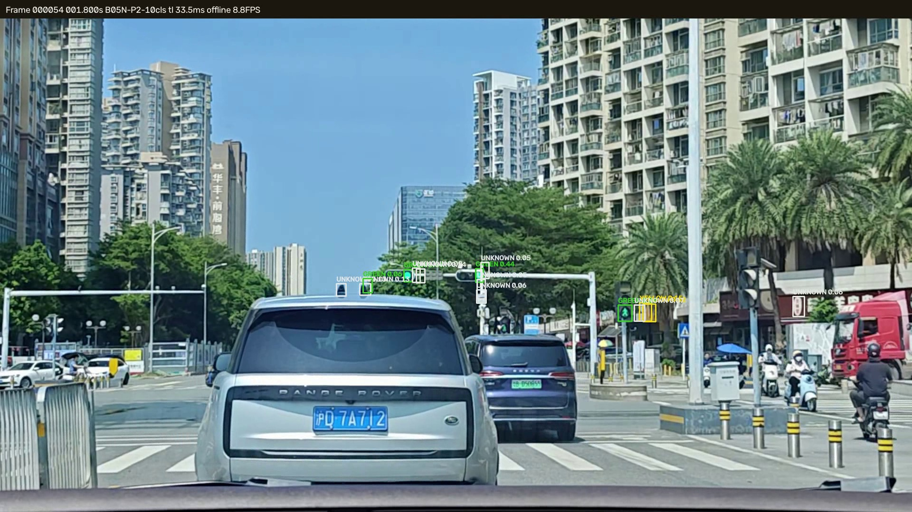
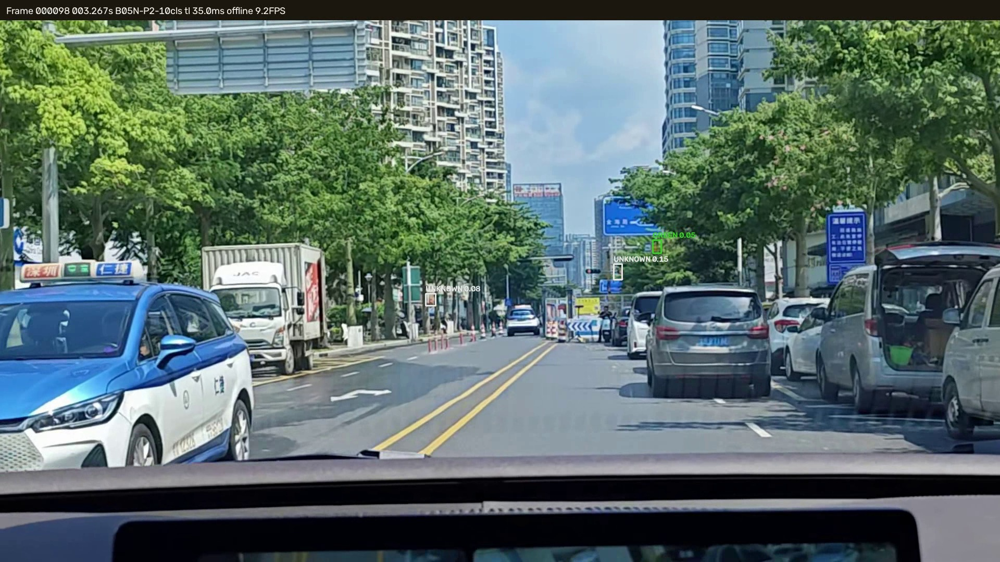
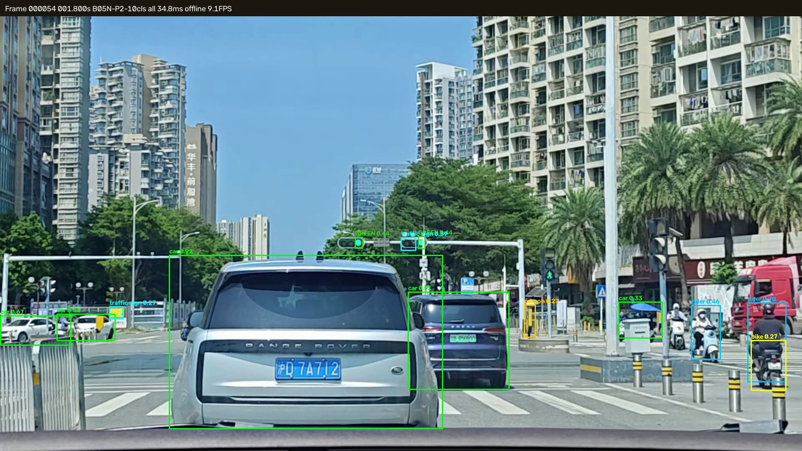

# B-05N — 全画面多类别 YOLOv8n-P2 与双模型方案对比

日期：2026-10-25<br>
分支：`research/rk3566-p2-multiclass`<br>
基线：`6fd12b9759fb84c5c121e6390662e45ed26dbfd0`<br>
训练：RTX 3080 Ti 12GB（租用）＋ RTX 4060 Laptop 8GB 交叉验证<br>
范围：只做 PC 训练、评估和视频验证；未连接 RK3566，未改板端。

## 0. 结论

**当前比赛仍建议保留 BDD-YOLOv8n + 交通灯 P2 Specialist 的双模型方案。**

原因不是“P2 训不出来”，而是实验结果很清楚：

1. 多类别 P2 **能同时检测车、人、交通灯**，ONNX 也正常。
2. P2 的 **car / person / traffic light / traffic sign** 比正式 BDD 主模型更好。
3. 但 P2 的 **rider / motor / bike / truck / bus** 明显退化，导致总体 mAP50 和 mAP50-95 都低于正式 BDD 主模型。
4. P2 全画面交通灯 AP50 最高约 `0.5205`，而 B05L 单类 P2 Specialist 仍有 `0.6107`，8–16px Recall 仍有 `0.5750`；单模型没有保住 Specialist 的交通灯优势。
5. 单模型 P2 的 PC 延迟约为双模型的 **55%**，计算上确实更省；但省下的算力换来的是 rider/motor/bike 和交通灯精度下降，对比赛不安全。

最终推荐：

```text
比赛正式方案：BDD-YOLOv8n + B05L YOLOv8n-P2 Specialist（双模型）
研究备选：     B-05N 10 类 YOLOv8n-P2（单模型）
```

如果以后必须单模型，下一步应优先补 rider/motor/bike 数据和交通灯分辨率，而不是直接上板。

## 1. 数据

### 1.1 数据来源与限制

本机没有完整 BDD100K 70k train 图像；本轮使用可审计的 BDD100K **validation 10k 全画面镜像**：

- 图像：1280×720 全画面 JPEG。
- 标注：完整 10 类检测框，来自 BDD100K 检测标注镜像。
- 训练：8,513 张（复用 B-05L 的训练名单）。
- 验证：482 张（复用 B-05L clean val）。
- 测试：1,000 张（B-03D holdout-1000，BDD50 是其中 50 张）。
- BDD50：50 张人工精修 GT，只用于交通灯专项评估；不进入训练/验证。

**这是相对正式 BDD 主模型的不利条件**：正式 `bdd100k-yolov8n-best.pt` 是在更大的 BDD 训练集上得到的；P2 只用了 8,513 张。

### 1.2 类别表

严格采用正式 BDD 主模型的类别顺序：

```text
0 person
1 rider
2 car
3 truck
4 bus
5 train
6 motor
7 bike
8 traffic light
9 traffic sign
```

BDD 镜像里的 `pedestrian → person`、`motorcycle → motor`、`bicycle → bike`；`other vehicle / trailer / other person` 忽略。

### 1.3 数据统计

| 划分 | 图像 | 框数 | 交通灯框 | 8–16px 交通灯 |
|---|---:|---:|---:|---:|
| train | 8,513 | 103,133 | 22,935 | 11,374 |
| val | 482 | 9,041 | 1,208 | 620 |
| test | 1,000 | 18,450 | 2,734 | 1,345 |

BDD50：

```text
50 图 / 154 traffic-light GT
ROI 内 150，ROI 外 4
```

BDD50 在 test 中命中 50 张，在 train/val 中为 0；没有泄漏。

数据审计与样例图保存在 `assets/B05N/`。

## 2. 训练

### 2.1 初始化审计

| 初始化 | 目标 | 精确匹配参数比例 | 结论 |
|---|---|---:|---|
| COCO `yolov8n.pt` | P2 10 类 | 43.5% | 只作为探针 |
| 正式 BDD-YOLOv8n | P2 10 类 | 43.5% | 主训练初始化 |
| B05L 单类 P2 | P2 10 类 | 部分 | 探针明显更差，放弃 |

P2 的官方结构在第 18 层附近插入 P2/4 分支，导致标准 YOLOv8n 的 neck/head 索引后移。`YOLO.load()` 日志为 219/437、389/437 items，但训练前精确同值检查只有 **43.5% 参数**；这意味 P2 的 neck/head 有大量重新初始化。

### 2.2 正式训练配置

```text
模型：YOLOv8n-P2（Ultralytics 官方 yolov8-p2.yaml）
类别：10
输入：512（rect=True → 512×288）
初始化：正式 BDD-YOLOv8n
epochs：60
batch：32
seed：0
patience：15（P2）/ 100（公平对照）
close_mosaic：10
AMP：on
```

结果：

| 模型 | 设备 | epochs | 训练时间 | val mAP50 | val mAP50-95 |
|---|---|---:|---:|---:|---:|
| P2 10 类 | RTX 3080 Ti | 60 | 1,624 s | 0.3512 | 0.1887 |
| **P2 10 类（最终）** | **RTX 4060 Laptop** | **60** | **4,926 s** | **0.3690** | **0.1992** |
| 标准 YOLOv8n 对照（16 epoch 早停） | RTX 3080 Ti | 16 | 336 s | 0.3471 | 0.1918 |
| 标准 YOLOv8n 对照（60 epoch 公平版） | RTX 3080 Ti | 60 | 1,243 s | 0.3668 | 0.2025 |

两台机器同 seed/同配置仍有约 1.8 点 val mAP50 差异，说明 CuDNN/AMP/数据加载存在非确定性；最终以 test 指标选择，不按 val 挑模型。

最终交付使用 4060 训练出的 P2 checkpoint（test 略好）。

## 3. 1000 张独立 holdout：10 类对比

固定 conf=0.25、IoU=0.5，Ultralytics 标准验证。

| 模型 | mAP50 | mAP50-95 | Precision | Recall |
|---|---:|---:|---:|---:|
| 正式 BDD-YOLOv8n | **0.3831** | **0.2102** | 0.6754 | 0.3569 |
| 同数据标准 YOLOv8n（16ep 早停） | 0.3662 | 0.1994 | 0.6464 | 0.3385 |
| 同数据标准 YOLOv8n（60ep） | 0.3660 | 0.1939 | — | — |
| P2 10 类（3080） | 0.3692 | 0.1931 | 0.5118 | 0.3497 |
| **P2 10 类（4060，最终）** | **0.3711** | **0.1944** | 0.6035 | 0.3580 |

分车型 AP50：

| 类别 | 正式 BDD | 标准同数据（60ep） | P2（4060） | P2 − BDD |
|---|---:|---:|---:|---:|
| person | 0.4389 | 0.4298 | 0.4528 | **+1.39** |
| rider | **0.3207** | 0.2967 | 0.2636 | **−5.71** |
| car | 0.6632 | 0.6685 | **0.7117** | **+4.85** |
| truck | **0.4960** | 0.4648 | 0.4686 | −2.74 |
| bus | **0.4443** | 0.4053 | 0.4059 | −3.84 |
| train | 0 | 0 | 0 | 0（test 只有 1 个 GT） |
| motor | **0.3705** | 0.2676 | 0.2718 | **−9.87** |
| bike | **0.2031** | 0.2323 | 0.1585 | −4.46 |
| traffic light | 0.4283 | 0.4354 | **0.4834** | **+5.51** |
| traffic sign | 0.4665 | 0.4600 | **0.4948** | **+2.83** |

结论：

- 与**同数据 60ep 标准 YOLOv8n** 比，P2 的 car/person/TL/sign 略好，但 rider/bike 更差，总体 mAP50 只高 0.5 点、mAP50-95 高 0.05 点，属于**基本持平**。
- 与正式 BDD 主模型比，P2 总体 mAP50 低 1.2 点、mAP50-95 低 1.6 点，因此**不能宣称单模型整体更强**。
- P2 对 **rider、bike** 负迁移明显；rider/motor/bike 是比赛道路场景的重要弱势交通参与者。

## 4. BDD50 交通灯专项

使用 B-05L 同一套 150 ROI GT、conf=0.25、IoU=0.5、一对一匹配。P2 输入全画面 512×288，只解码 class 8。

| 模型 | TL AP50 | TP/FP/FN | Recall | 8–16px Recall |
|---|---:|---:|---:|---:|
| 正式 BDD（全画面） | 0.4622 | 65/17/85 | 0.4333 | 0.3500 |
| 标准 YOLOv8n 同数据（16ep） | 0.4598 | 62/24/88 | 0.4133 | 0.3000 |
| 标准 YOLOv8n 同数据（60ep） | 0.4795 | 68/24/82 | 0.4533 | 0.4000 |
| P2（3080） | 0.4955 | 68/24/82 | 0.4533 | 0.3875 |
| **P2（4060，最终）** | **0.5205** | **68/23/82** | **0.4533** | **0.4125** |
| B05L 单类 P2 Specialist（top60 ROI） | **0.6107** | 87/26/63 | **0.5800** | **0.5750** |

结论：

- 全画面 P2 比正式 BDD 的交通灯 AP 高约 5.8 点，8–16px Recall 高约 6.25 点，方向正确。
- 但它仍**远低于 B05L 单类 Specialist**：AP 低约 9 点，8–16px Recall 低约 16 点。
- 单模型 P2 不能替代 Specialist 保住小交通灯能力。

## 5. 单模型 vs 双模型计算

RTX 3080 Ti，batch=1，100 次，PyTorch FP32，低时钟起步后稳定：

| 组成 | P50 | P95 |
|---|---:|---:|
| BDD-YOLOv8n 512×288 | 6.76 ms | 11.01 ms |
| P2 10 类 512×288 | 8.44 ms | 10.03 ms |
| B05L Specialist 512×192 | 8.45 ms | 10.13 ms |
| **双模型顺序执行** | **15.21 ms** | **21.14 ms** |
| 单模型 P2 | **8.44 ms** | 10.03 ms |

单模型 P2 的 PC 延迟约为双模型的 **55%**，计算收益明确。

但这只是 3080 Ti 的 PC 数字，不能外推 RK3566 NPU；板端还需要测 10Hz 主检测 + 1/3/5Hz Specialist 的真实吞吐。

## 6. ONNX

最终 P2：

```text
input:  [1, 3, 288, 512]
output: [1, 14, 12240]
opset:  12
size:   12.02 MB
```

- ONNX checker 通过。
- PyTorch/ONNX 同帧测试 30 张（最终模型）：
  - 162 个匹配交通灯框；
  - 平均 IoU `0.999594`；
  - 平均坐标误差 `0.00190 px`；
  - 平均置信度误差 `0.000090`；
  - PyTorch 未匹配 0，ONNX 未匹配 0；
  - Raw 最大绝对差 `0.5255`，但解码框不受影响。
- ONNX 固定形状和 4 尺度输出正确，`12240 = 64×24 + 32×12 + 16×6 + 8×3`。

RKNN：

- 未完成实际转换。B-05M 若建立可用工具链可复用，但本轮没有可用 RKNN Toolkit2 环境。
- P2 是 4 尺度 Detect，RKNN Model Zoo 默认 YOLOv8 是 3 尺度；需要自定义输出/解码验证，不能直接宣称可部署。
- 未做 INT8 校准、板端 NPU 延迟、10Hz 丢帧测试。

## 7. 官方视频

使用 B-05K/B-05L 四段 1080p 视频，最终 P2（4060 checkpoint）逐帧推理，只画交通灯。

| 视频 | 帧数 | 任意候选帧 | conf≥0.25 帧 | 首次可信 | P50 |
|---|---:|---:|---:|---:|---:|
| 113421 | 392 | 374 | 319 | 0.000 s | 35.59 ms |
| 112507 | 1,349 | 789 | 371 | 0.000 s | 35.22 ms |
| 113539 | 2,315 | 1,828 | 1,057 | 0.600 s | 34.83 ms |
| 112739 | 2,776 | 1,182 | 348 | 6.000 s | 34.38 ms |

以上为最终 4060 checkpoint。

人工复核：

- `113421` 1.8s：检出两个真实绿灯（GREEN 0.44 / 0.18）。
- `112739` 12.87s：检出两个真实绿灯（0.31 / 0.09），没有把导航屏当灯。
- `112739` 81.23s：两个真实红灯清晰可见，P2 **没有检出一个可信框**，这是明确漏检。
- `113539` 3.267s：大量 0.05–0.07 候选落在远处路牌/杆件；低阈值下误检明显。
- 视频没有逐帧 GT，以上只能说明候选和人工确认片段，不能计算视频 Recall。











完整 MP4 本地路径：

```text
D:\Datasets\adas_edge_training\b05n_videos\annotated_p2_final\
```

## 8. 颜色识别后续

本轮 P2 仍只输出 `traffic light`，颜色沿用同一个 HSV，不训练颜色头。

后续若做 RED/GREEN/YELLOW/UNKNOWN 四类头：

- 需要颜色标注完整的数十万级灯框；当前 BDD 只有部分 `trafficLightColor`，且 `NA` 很多。
- 4 类头会进一步加剧 8–16px 小灯的颜色错误；不能在没有颜色 GT 的情况下直接替换 HSV。
- 建议先做“检测 + HSV 多帧确认”，不要和检测头同时改。

## 9. 最终回答

1. **多类别 P2 能否同时检测汽车、行人和交通灯？** 能。car AP50 .7117、person .4528、traffic light .4834。
2. **与正式 BDD 主模型相比各类别如何？** car/person/TL/sign 更好；rider/motor/bike/truck/bus 更差；总体 mAP50 低 1.2 点。
3. **交通灯是否保住 B05L P2 优势？** 没有。P2 全画面 TL AP50 .5205，B05L Specialist .6107；8–16px .4125 vs .5750。
4. **哪些场景负迁移？** rider、motor、bike 最明显；视频里 112739 81.23s 两个红灯漏检；113539 低阈值路牌/杆件误检。
5. **单模型是否明显更省？** PC 上 P2 8.44ms vs 双模型 15.21ms，约省 45%；板端未测。
6. **ONNX/RKNN？** ONNX 固定 1×3×288×512、输出 1×14×12240，一致性良好；RKNN 未转换，4 尺度路径需单独验证。
7. **下一步单模型上板还是继续双模型？** 当前比赛继续双模型；单模型作为研究分支，先补 rider/motor/bike 和交通灯小目标，再谈替换。
8. **失败来自哪里？** 数据（只有 8.5k 训练、rider/motor 样本少）、输入分辨率（512×288 下小灯像素不足）、初始化（P2 只继承 43.5% 参数）、结构（4 尺度头未带来整体收益）共同造成；不是单一原因。

## 10. 交付

模型（最终 P2，4060 checkpoint）：

```text
D:\Datasets\adas_edge_training\b05n_final\b05n_p2_multiclass.pt
  SHA256 C249F7FFFC828C892C8308C0F5A4768BB4C0A3C3AB28434D2E70E843B5E278ED
D:\Datasets\adas_edge_training\b05n_final\b05n_p2_multiclass.onnx
  SHA256 C30CA4D99CCDD87A5C80F05DEC1994FD256E38208955D191E8A55F9205F22E75
D:\Datasets\adas_edge_training\b05n_final\labels.txt
D:\Datasets\adas_edge_training\b05n_final\README.txt
```

训练权重原始位置：

```text
D:\Datasets\adas_edge_training\b05n_runs\b05n_p2_bdd_full\weights\best.pt
D:\Datasets\adas_edge_training\b05n_runs\b05n_p2_bdd_full\weights\best.onnx
```

代码：

```text
tools/b05n_build_dataset.py
tools/b05n_build_remote.py
tools/b05n_train.py
tools/b05n_eval_multiclass.py
tools/b05n_tl_eval.py
tools/b05n_parity.py
tools/b05n_video.py
tools/b05n_timing.py
tools/b05n_summary.py
```

证据：

```text
research/rk3566_models/reports/assets/B05N/
  manifest.json
  eval/bdd_main_1000.json
  eval/std_1000.json
  eval/p2_1000.json
  eval/p2_4060_1000.json
  eval/bdd_main_tl.json
  eval/std_tl.json
  eval/p2_tl.json
  eval/p2_4060_tl.json
  eval/summary.json
  eval/timing.json
  eval/p2_parity.json
  runs/...
  keyframes/
```

限制：

- 未使用完整 BDD 70k train；只用 10k validation 镜像的 8.5k/482/1k 划分。
- 标准同数据 60 epoch 对照已完成；16 epoch 版是早停结果，仅作过程参考。
- 未连接 RK3566，未改正式部署。
- 视频 MP4 和训练权重不上 GitHub。
