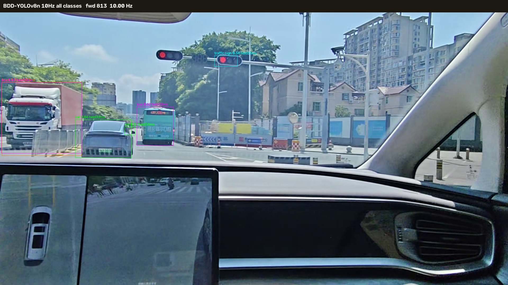
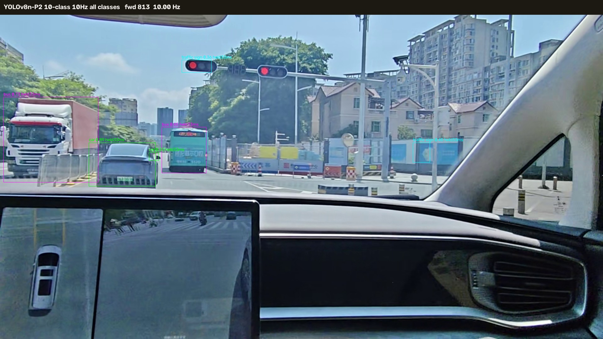
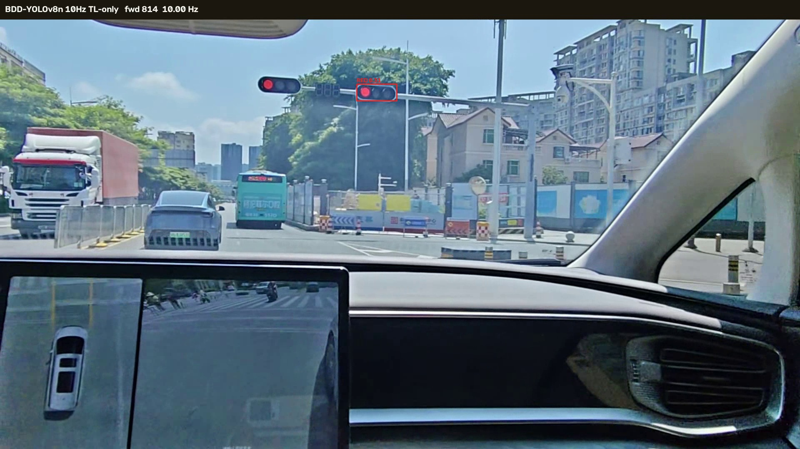
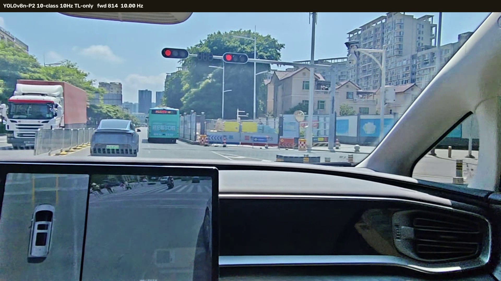
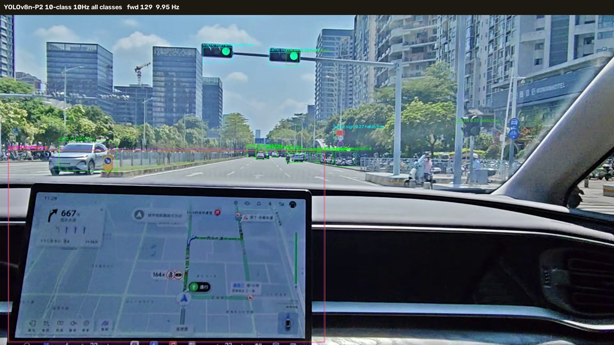

# B-05O — 官方视频 10 Hz / 5 Hz 真实调度模拟对比

日期：2026-10-25<br>
分支：`research/rk3566-b05o-video-scheduling`<br>
基线：B05N 本地提交 `6a2933b`<br>
范围：PC 端按视频时间戳模拟调度；**不是 RK3566 实测性能**。

## 0. 结论

1. **调度按视频时间戳执行，频率与设计一致。** `112739` 实测 BDD `10.01 Hz`、P2 `10.01 Hz`、Specialist `5.00 Hz`；双模型合计 `15.01` 次前向/秒，不是“总共 10 Hz”。
2. **`112739` 81.23 s 的两个红灯，三方案都漏检。** 81.233 s 帧上 BDD / P2 / Dual 都是 0 框；BDD 在 81.3 s 才检出右侧红灯（RED 0.33），P2 在 78.7–83.5 s 完全没有 TL 框。
3. **30 Hz 逐帧上限同样漏检。** 说明这次漏检来自模型和域差异，不是 10 Hz 降采样造成的。
4. **双模型采用 union + NMS 融合后，TL 显示帧最多。** `112739` 全片 BDD 282 帧、P2 354 帧、Dual 402 帧；Dual 比 BDD 多 43%，但在 81.23 s 这个关键事件上没有帮助。
5. **单 P2 不能替代 BDD。** 两个关键事件里 P2 把红灯箱分类成 `traffic sign`，或整段没有 TL 框；总体 mAP 也没有优势（见 B05N）。
6. **是否保留双模型：取决于比赛是否把 TL 召回放在算力之前。** union 融合不会比 BDD 少框，Specialist 确实能在部分片段补充 TL；但 `+5` 次/秒的代价没有在 81.23 s 这种硬场景上换来收益。若要省算力，建议先把 Specialist 从 5 Hz 降到 1–2 Hz 做对照，而不是直接删掉。

## 1. 这次到底模拟了什么

### 1.1 调度规则

```text
主模型 bucket   = floor(t * 10)
Specialist bucket = floor(t * 5)
只有 bucket 变化的那一帧才推理；同一 bucket 内的其余帧沿用最近一次检测结果
```

- `t` 是视频原始时间戳（`frame_index / fps`），不使用处理耗时。
- 未推理帧只显示 `t_infer <= t` 的检测框，不读取未来帧。
- 不使用跟踪器补框、不做插值、不预测运动。
- held 框在标签后追加 `held Nms`，表示该框产生于多少毫秒之前。

### 1.2 三方案

| 方案 | 主模型 | 交通灯模型 | 理论前向次数/秒 |
|---|---|---|---:|
| BDD 10 Hz | BDD-YOLOv8n 10 Hz | — | 10 |
| P2 10 Hz | B05N P2 10 类 10 Hz | — | 10 |
| Dual 10/5 Hz | BDD-YOLOv8n 10 Hz | B05L Specialist 5 Hz | **15**（10+5） |

> 双模型是 **10 + 5 = 15 次前向/秒**，不能简写成“总共 10 Hz”。

### 1.3 双模型融合规则

Dual 方案不是“Specialist 替换 BDD 的交通灯”，而是 **union + NMS**：

```text
候选 = BDD 的 traffic light 框 + Specialist 的交通灯框
按 confidence 从高到低排序
IoU >= 0.5 的重复框丢弃
非交通灯类别只取 BDD
```

这与仓库里 `tools/b05c_diagnose.py` 的 `fuse()` 规则一致。  
第一版脚本曾用“Specialist 替换 BDD TL”，会把 BDD 已经检出的灯删掉，已修正；本文所有数字均来自 union 版本。

### 1.4 模型与输入

| 模型 | 文件 | 输入 | 备注 |
|---|---|---|---|
| BDD 主模型 | `bdd100k-yolov8n-best.pt` | 512×288 全画面 | 正式部署主模型 |
| P2 10 类 | `b05n_p2_multiclass.pt` | 512×288 全画面 | B05N 最终模型，未上板 |
| Specialist | `b05l_runs/v8n_p2/weights/best.pt` | 512×192，ROI top 60% | 单类交通灯 |

统一 `conf=0.25`、`IoU=0.5`。

## 2. 实测调度频率

| 视频 | 时长 | BDD | P2 | Specialist | Dual 合计 |
|---|---:|---:|---:|---:|---:|
| `113421` | 13.07 s | 10.03 Hz（131） | 10.03 Hz（131） | 5.05 Hz（66） | 15.08 /s |
| `112739` | 92.53 s | 10.01 Hz（926） | 10.01 Hz（926） | 5.00 Hz（463） | 15.01 /s |

括号内是全片前向次数。短片的 `10.19 Hz` 一类偏差来自首帧也计入 bucket，属于统计口径，不是调度错误。

PC 端单次推理耗时（仅用于说明这是 PC 模拟，不能外推 RK3566）：

| 视频 | BDD mean / p95 | P2 mean / p95 | Specialist mean / p95 |
|---|---:|---:|---:|
| `113421` | 63.6 / 79.3 ms | 69.0 / 96.1 ms | 55.6 / 76.0 ms |
| `112739` | 54.8 / 81.4 ms | 61.7 / 88.6 ms | 47.2 / 64.4 ms |

## 3. 113421 冒烟测试

392 帧、13.07 s。三方案都稳定输出交通灯，没有崩溃。

| 时间 | BDD 10 Hz | P2 10 Hz | Dual 10/5 Hz |
|---|---|---|---|
| 1.8 s | 1×GREEN 0.34 | 2×GREEN 0.44 / 0.44 | 1×GREEN 0.49 |

交通灯显示帧：

| 方案 | 有 TL 框的帧 | 首次 TL |
|---|---:|---:|
| BDD | 312 / 392 | 0.1 s |
| P2 | 321 / 392 | 0.0 s |
| Dual | 347 / 392 | 0.1 s |

## 4. 112739 主验收

### 4.1 81.23 s 两个红灯

| 时刻 | BDD 10 Hz | P2 10 Hz | Dual 10/5 Hz |
|---|---|---|---|
| 81.233 s（关键帧） | 0 | 0 | 0 |
| 81.300 s | **1×RED 0.33**（右侧灯） | 0 | 1×RED 0.33（BDD 来源） |
| 81.400 s | 0 | 0 | 1×UNKNOWN（Specialist，非红灯） |
| 78.7–83.5 s 全部 | 仅 81.3 s 一帧 | **0 帧** | 81.3 / 81.4 两帧 |

关键帧：









人工复核：

- 画面里两个红灯都很清楚，尺寸约 40 px，不属于“太小”；
- P2 在关键帧把左侧灯箱分成 `traffic sign 0.32`，不是没看到；
- BDD 在 81.3 s 只抓到右侧灯，左侧仍漏；
- 30 Hz 上限在同一帧也是 0（见第 6 节），排除降采样因素。

### 4.2 12.87 s 两个绿灯

| 时刻 | BDD 10 Hz | P2 10 Hz | Dual 10/5 Hz |
|---|---|---|---|
| 12.867 s | 1×GREEN 0.25 | 2×GREEN 0.33 / 0.30 | 1×GREEN 0.25（BDD 来源） |

30 Hz 上限在 12.867 s 给出 BDD 2 个 GREEN、P2 2 个 GREEN、Dual 1 个 GREEN。  
5 Hz 的 Specialist 在 12.867 s 没有新结果，Dual 显示的是 BDD 的框；如果只看 Specialist，会晚最多 200 ms。




## 5. 框持续、漏检、误报、延迟、闪烁

### 5.1 交通灯轨迹统计

| 视频 | 来源 | 轨迹数 | 单次更新轨迹 | 平均更新次数 | 更新间平均 IoU |
|---|---|---:|---:|---:|---:|
| 113421 | BDD | 80 | 61.3% | 2.53 | 0.728 |
| 113421 | P2 | 97 | 71.1% | 2.39 | 0.745 |
| 113421 | Specialist | 35 | 65.7% | 1.63 | 0.721 |
| 112739 | BDD | 88 | 88.6% | 1.32 | 0.770 |
| 112739 | P2 | 135 | 90.4% | 1.27 | 0.713 |
| 112739 | Specialist | 41 | 97.6% | 1.02 | 0.605 |

解读：

- `112739` 里绝大多数 TL “轨迹”只出现一次，说明远处灯和反光造成明显闪烁；
- Specialist 在 41 条轨迹里 40 条只更新一次，稳定性最差；
- BDD 的更新间 IoU 最高，框位置最稳定。

### 5.2 相对 30 Hz 参考的延迟

以 `112739` 的 30 Hz 逐帧结果为参考，把每条 TL 轨迹的首次检出时间与 10/5 Hz 方案对齐：

| 来源 | 30 Hz 轨迹数 | 10 Hz 命中 | 命中率 | ≥0.2 s 轨迹 | 命中 | 延迟 p50 | 延迟 p95 | 最大延迟 |
|---|---:|---:|---:|---:|---:|---:|---:|---:|
| BDD | 147 | 71 | 48.3% | 10 | **10/10** | 0.067 s | 0.258 s | 0.333 s |
| P2 | 249 | 123 | 49.4% | 12 | **12/12** | 0.050 s | 0.247 s | 0.467 s |
| Specialist | 165 | 40 | 24.2% | 2 | **2/2** | 0.067 s | 0.127 s | 0.133 s |

说明：

- 30 Hz 下大量“轨迹”只存在 1–2 帧，属于闪烁；10 Hz 本来就不会采到每一帧。
- **持续 ≥0.2 s 的稳定轨迹，三个来源都 100% 命中**，代价是 0.1–0.47 s 的显示延迟。
- Specialist 的轨迹基数最大、命中率最低，因为 5 Hz 采样 + 单帧闪烁叠加。

因此降采样本身没有漏掉稳定目标，真正漏掉的是 81.23 s 这种**三个来源都检不出**的灯。

### 5.3 漏检与误报的口径

官方视频没有逐帧 GT，因此：

- **不能计算视频级 precision / recall**；
- “漏检”只能指“人工确认的真实灯在该帧没有框”，或“30 Hz 参考有框而调度方案没有”；
- “误报”只能人工抽查，不能给出全片误报率。

报告里的数字都是代理指标，不等同于精度指标。

## 6. 30 Hz 逐帧离线上限（不是部署效果）

`112739` 另跑一遍每帧都推理的版本：BDD 30 Hz、P2 30 Hz、Specialist 30 Hz，双模型合计 **60 次前向/秒**。这是离线精度上限，**不能当成 RK3566 部署效果**。

| 指标 | 30 Hz 上限 |
|---|---:|
| BDD 前向 | 2,776（30.00 Hz） |
| P2 前向 | 2,776（30.00 Hz） |
| Specialist 前向 | 2,776（30.00 Hz） |
| 双模型合计 | 60.00 /s |

### 6.1 关键结果

| 时刻 | BDD 30 Hz | P2 30 Hz | Dual 30 Hz |
|---|---|---|---|
| 81.233 s | **0** | **0** | **0** |
| 12.867 s | 2×GREEN | 2×GREEN | 3×GREEN（union） |
| 有 TL 的帧 | 280 / 2,776 | 348 / 2,776 | 365 / 2,776 |

`80.5–82.0 s` 窗口内：

- BDD：只有 81.3 s 一帧有 TL；
- P2：**0 帧**；
- Specialist：80.53 s 和 81.4 s 两次，都不是 81.23 s 的两个红灯；
- Dual union：81.3–81.6 s 才有框，81.233 s 本身为空。

### 6.2 结论

- 30 Hz 逐帧推理也没有救回 81.23 s 的红灯；
- 10 Hz 的显示帧数（BDD 282、P2 354）与 30 Hz（280、348）几乎相同，说明 held 显示没有明显丢帧；
- **这次漏检是模型/域问题，不是调度问题。**

30 Hz 版本视频单独放在 `upper_bound/`，文件名和标题都带 `UPPER 30Hz`，与部署模拟分开。

## 7. 客观判断：是否保留双模型

### 7.1 交通灯显示覆盖

| 视频 | 时长 | BDD 10 Hz | P2 10 Hz | Dual 10/5 Hz | Dual − BDD |
|---|---:|---:|---:|---:|---:|
| `113421` | 13.1 s | 312 | 321 | **347** | +11% |
| `112739` | 92.5 s | 282 | 354 | **402** | +43% |
| `112454` | 3.5 s | 61 | 42 | 61 | 0% |
| `113343` | 21.8 s | 96 | 198 | **193** | +101% |
| `113452` | 14.4 s | 33 | 45 | **111** | +236% |

union 融合下 Dual 的 TL 框一定不少于 BDD。Specialist 在 3/5 段视频里补充了 BDD 没有的 TL，`112454` 完全没有贡献。

**注意**：显示帧多不等于精度高，可能包含误报；没有逐帧 GT 就不能把它当成“更好”。

### 7.2 关键事件

| 事件 | BDD | P2 | Dual |
|---|---|---|---|
| 81.23 s 两个红灯 | 81.3 s 检出右侧 1 个 | 全程 0 | 81.3 s 同 BDD，无新增 |
| 12.87 s 两个绿灯 | 1 个 | 2 个 | 1 个（BDD） |
| 112454 箭头红灯 | 稳定 3.1 s 轨迹 | 0.65 s 轨迹 | 同 BDD（Specialist 0 框） |

### 7.3 代价

| 方案 | 前向/秒 | 相对 BDD |
|---|---:|---:|
| BDD 10 Hz | 10.01 | 100% |
| P2 10 Hz | 10.01 | 100% |
| Dual 10/5 Hz | **15.01** | **150%** |

### 7.4 判断

1. **不要用单 P2 替换 BDD。** P2 在两个关键事件里把红灯箱分成 `traffic sign`，或整段无 TL；它的额外 TL 帧很可能包含误报，没有 GT 无法证明是收益。
2. **双模型应使用 union，而不是 Specialist 替换。** `112454` 里 Specialist 一个框都没有，替换融合会让 Dual 从 61 帧掉到 0；union 至少保住 BDD 的结果。
3. **双模型在硬场景上没有证明自己。** 81.23 s 的漏检，BDD、P2、Specialist、30 Hz 上限全部失败；多出来的 5 次/秒没有换来这个关键红灯。
4. **如果比赛把 TL 召回放在算力之前，保留 union 双模型是合理的。** 它不会比 BDD 少框，确实能在部分片段补充 TL；B05N 的 BDD50 结果也显示 Specialist 在 8–16 px 小灯上明显更强（AP 0.61 vs 0.46，Recall 0.575 vs 0.35）。
5. **如果板端算力紧张，优先降 Specialist 频率，而不是直接删模型。** 红绿灯状态通常持续数秒，5 Hz 对“状态变化”本身是过采样；把 Specialist 降到 1–2 Hz，总前向可降到 11–12 次/秒，代价是新灯出现时最多晚 0.5–1 s。本轮没有跑这个对照，建议下一步补上。
6. **81.23 s 的正确修法是数据和域，不是调度或融合。** 需要中国路口的水平灯箱、箭头灯、逆光红灯标注；这也是 B05N 报告里“补 TL 分辨率与域数据”的同一结论。

## 8. 交付物

### 8.1 视频（PC）

```text
D:\Datasets\adas_edge_training\b05o_video_scheduling\
  video_20260929_112739\
    scheduled\
      compare_tl_3schemes.mp4      三方案交通灯同步对比
      compare_all_3schemes.mp4     三方案全类别同步对比
      bdd_10hz_tl.mp4 / _all.mp4
      p2_10hz_tl.mp4 / _all.mp4
      dual_10_5hz_tl.mp4 / _all.mp4
      metrics.json
    upper_bound\                   同结构，标题带 UPPER 30Hz
      compare_tl_3schemes.mp4
      ...
  video_20260929_113421\scheduled\
  video_20260929_112454\scheduled\
  video_20260929_113343\scheduled\
  video_20260929_113452\scheduled\
```

- 1920×1080、30 fps、原始时长；
- 每条视频标题标注实测前向频率；
- held 框带 `held Nms`；
- 全类视频保留所有类别，TL 视频只画交通灯。

### 8.2 短视频（Mac，便于快速查看）

```text
/Users/a1/files/videos/B05O/
  112739_scheduled_81s.mp4          78.5–85.5 s
  112739_scheduled_12s.mp4          11.5–15.5 s
  112739_upper30_81s.mp4            同段 30 Hz 上限
  113421_scheduled_full.mp4         全片三方案
  112454_roadonly_tl_full.mp4       纯道路素材（箭头红灯）
  113343_roadonly_tl_full.mp4
  113452_roadonly_tl_full.mp4
```

### 8.3 统计与关键帧

```text
research/rk3566_models/reports/assets/B05O/
  metrics_113421_scheduled.json
  metrics_112739_scheduled.json
  metrics_112739_upper.json
  metrics_112454_scheduled.json
  reference_compare_112739.json
  keyframes/
    112739_81.233_{bdd_10hz,p2_10hz,dual_10_5hz}.jpg
    112739_81.233_upper_*.jpg
    112739_81.300_*.jpg
    112739_12.867_*.jpg
    112454_00.900_*.jpg
    112454_01.500_*.jpg
```

`metrics_*.json` 去掉了逐事件原始数组，只保留频率、显示统计、轨迹统计和关键帧事件；完整 `metrics.json` 留在 `D:` 盘。

### 8.4 代码与测试

```text
tools/b05o_schedule_compare.py     调度、渲染、统计主脚本
tools/b05o_metrics_summary.py      指标汇总
tools/b05o_reference_compare.py    与 30 Hz 参考对比、延迟统计
tools/b05o_collect_assets.py       报告素材收集
tests/test_b05o_schedule.py        bucket 边界、10 Hz/5 Hz 计数、无未来帧
```

## 9. 限制

- PC 用视频时间戳模拟调度，**不能证明 RK3566 能跑 10 Hz**；板端延迟、NPU 占用、丢帧都未测。
- 推理在 RTX 4060 Laptop 上执行，耗时只说明 PC 侧调度可行。
- 官方视频无逐帧 GT，漏检/误报/延迟都是代理指标。
- 30 Hz 结果是离线上限，不是部署效果。
- 未训练新模型，未修改正式部署权重。
